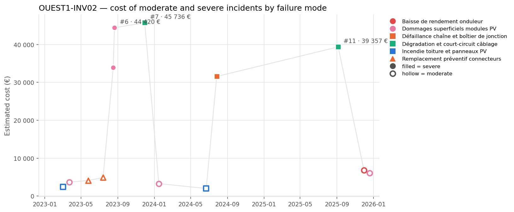
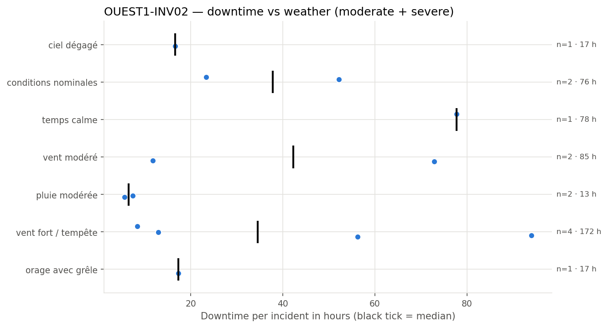
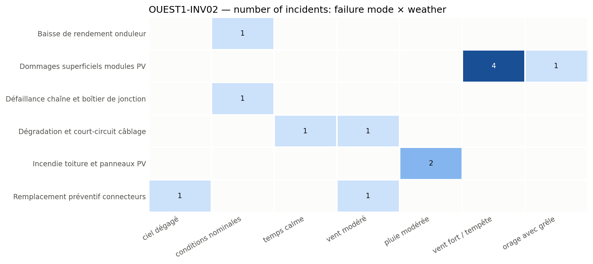

# OUEST1-INV02 PV Inverter and DC Field Failure Modes and Incidents

**Equipment:** OUEST1-INV02 · **Site:** Centrale PV Ouest-1 · **Asset type:** PV inverter · **Generated on:** 2026-10-19

> The PV inverter and the upstream DC field at OUEST1-INV02 have experienced several incidents, with a total moderate and severe incident cost of over 228,167 EUR. The most costly failure mode involves superficial damages to PV modules, while wiring degradation and short-circuits also contribute significantly. Given the high risk level and the criticality score within the site, initial actions should focus on thermography inspections, wiring tests, and regular cleaning to mitigate further damage and reduce costs.

**Equipment priority: P2 · Risk level: HIGH** — Criticality score 52.9 (below the threshold of 75) against the other equipment of the site and 85.1 (at or above the threshold of 75) against the whole solar fleet.

---

## 1. Key figures

| Indicator | This equipment | Median equipment of the site | Ratio |
| --- | --- | --- | --- |
| Incidents (all severities) | 29 | 31.5 | ×0.92 |
| Severe incidents | 5 | 4.5 | ×1.11 |
| Total estimated cost (all severities) | 238 752 EUR | 212 067 EUR | ×1.13 |
| Total downtime (all severities) | 503.9 h | 473.8 h | ×1.06 |

| Moderate and severe incidents (scope of this report) | Value |
| --- | --- |
| Incidents analysed | 13 (8 moderate · 5 severe) |
| Period covered | 2023-02-03 → 2025-12-19 |
| Total estimated cost | 228 167 EUR (85.4 % from severe incidents) |
| Average cost per incident | 17 551 EUR |
| Total downtime | 456.2 h |
| Average interval between incidents | 85 days |
| Most costly failure mode | Dommages superficiels modules PV (91 303 EUR) |
| Weather with most downtime | vent fort / tempête (171.5 h) |

This equipment has a slightly higher number of severe incidents compared to the site median, with a ratio of 1.11, and its total incident cost is also above the median with a ratio of 1.13. It is in line with the site median for overall incidents and downtime, with ratios of 0.92 and 1.06 respectively. The equipment was selected because its criticality score of 52.9 is below the threshold of 75, but its high risk level and criticality score of 85.1 against the entire fleet highlight its importance. The majority of the incident cost (85.4%) is concentrated on severe incidents, indicating a high impact of these failures.

## 2. How this report was built

**Scope.** This report covers the maintenance incidents recorded on OUEST1-INV02 between 2023-02-03 and 2025-12-19. Each incident report was read and assigned to a *failure mode* according to its description. The detailed analysis focuses on moderate and severe incidents; minor incidents only appear in the comparison with the site. Incidents are numbered #1, #2, … in chronological order for this equipment (see the annex).

**Why this equipment.** Each piece of equipment receives a criticality score from 0 to 100 that combines four indicators: number of incidents, number of severe incidents (counted twice), total repair cost and total downtime. The score is computed twice: against the other equipment of the same site and against all solar equipment of the fleet. 50 corresponds to a typical piece of equipment, 75 or more to one clearly above the others. Equipment scoring 75 or more on both comparisons is priority **P1**, on one of them priority **P2**. Here: criticality score 52.9 (below the threshold of 75) against the other equipment of the site and 85.1 (at or above the threshold of 75) against the whole solar fleet → **P2**.

**Recommendation priority.** Each recommendation addresses one failure mode and inherits its priority:
- **P1** — within 1 month: the failure mode caused at least one severe incident on this equipment and either represents >= 20% of its cost or recurred within 90 days
- **P2** — within 6 months: the failure mode caused at least one severe incident or represents >= 10% of the cost
- **P3** — next yearly maintenance plan: all other failure modes

**Root-cause confidence.** The confidence of a root-cause hypothesis reflects the number of incidents supporting it: high from 5 incidents, medium from 3, low below.

**Analysis.** All figures, tables and charts are computed directly from the incident records (a *close sequence* is a series of incidents less than 30 days apart; a *recurrence* is the same failure mode coming back within 90 days). The commentary of each section was drafted with the help of an AI assistant specialised in that topic, from the figures of the section only.

*Patterns based on fewer than 3 incidents are flagged as indicative in the text.*

## 3. Cost timeline

*Estimated cost of each moderate (hollow) and severe (filled) incident. Colour = family of failure modes, marker shape = failure mode; the three most costly incidents are labelled.*

| Year | Incidents | Severe | Cost (EUR) | Cost vs previous year | Downtime (h) |
| --- | --- | --- | --- | --- | --- |
| 2023 | 7 | 3 | 139 141 |  | 276.5 |
| 2024 | 3 | 1 | 36 833 | -73.5 % | 66.2 |
| 2025 | 3 | 1 | 52 194 | +41.7 % | 113.5 |

**Trend.** Overall, the incident cost decreased from 2023 to 2024, then increased in 2025, but the total cost over the period shows a decreasing trend. The number of incidents was highest in 2023 and then declined in 2024, remaining stable in 2025.

**Dominant incidents.** The most costly incident is #7, with a failure mode of Dégradation et court-circuit câblage. The failure mode that accounts for the highest total cost is Dommages superficiels modules PV.

**Sequences and recurrences.** Close sequences of incidents include #1 and #2 within 21 days, involving damages superficiels modules PV and incendie toiture. Another sequence involves #5 and #6 within 4 days, both involving damages superficiels modules PV. Additionally, incidents #12 and #13 occurred within 19 days, involving Baisse de rendement onduleur and damages superficiels modules PV.

**Seasonality.** Incidents are relatively evenly distributed across seasons, with few incidents in winter, and more in summer and autumn. The data is indicative, with fewer than 3 incidents in winter.

## 4. Weather exposure

### 4.1 Downtime vs weather condition

*Downtime of each incident per weather condition; the black tick is the median.*

| Weather | Incidents | Severe | Downtime (h) | Median (h) | % of downtime | Compared with site |
| --- | --- | --- | --- | --- | --- | --- |
| vent fort / tempête | 4 | 2 | 171.5 | 34.6 | 37.6 | over-represented vs site |
| vent modéré | 2 | 1 | 84.6 | 42.3 | 18.5 | over-represented vs site |
| temps calme | 1 | 1 | 77.7 | 77.7 | 17.0 | under-represented vs site |
| conditions nominales | 2 | 1 | 75.5 | 37.8 | 16.5 | in line with site |
| orage avec grêle | 1 | 0 | 17.3 | 17.3 | 3.8 | under-represented vs site |
| ciel dégagé | 1 | 0 | 16.6 | 16.6 | 3.6 | under-represented vs site |
| pluie modérée | 2 | 0 | 13.0 | 6.5 | 2.8 | in line with site |

The equipment experiences the most downtime under 'vent fort / tempête', accounting for 171.5 hours, which is over-represented compared to its share of incidents and the overall site. This weather condition is associated with the highest total downtime and a significant proportion of incidents, indicating it has a major impact on equipment availability.

### 4.2 Failure modes vs weather condition

*Number of incidents per failure mode and weather condition.*

Failure modes such as 'Dommages superficiels modules PV' occur under 'vent fort / tempête' and 'orage avec grêle', suggesting these weather conditions can cause physical damage to PV modules. 'Remplacement préventif connecteurs' occurs under 'ciel dégagé' and 'vent modéré', implying inspections or replacements may be advisable after these conditions. The correlation between weather and failure modes indicates targeted inspections following specific weather events could mitigate risks.

## 5. Failure modes

| Failure mode | Priority | Incidents | Severe | Cost (EUR) | % of cost | Recurrences < 90 d | Incidents # |
| --- | --- | --- | --- | --- | --- | --- | --- |
| Dommages superficiels modules PV | P1 | 5 | 2 | 91 303 | 40.0 | 1 | #2, #5, #6, #8, #13 |
| Dégradation et court-circuit câblage | P1 | 2 | 2 | 85 092 | 37.3 | 0 | #7, #11 |
| Défaillance chaîne et boîtier de jonction | P2 | 1 | 1 | 31 553 | 13.8 | 0 | #10 |
| Remplacement préventif connecteurs | P3 | 2 | 0 | 8 993 | 3.9 | 1 | #3, #4 |
| Baisse de rendement onduleur | P3 | 1 | 0 | 6 780 | 3.0 | 0 | #12 |
| Incendie toiture et panneaux PV | P3 | 2 | 0 | 4 446 | 1.9 | 0 | #1, #9 |

### Dommages superficiels modules PV · P1

Likely caused by mechanical impacts or environmental stress such as wind-driven debris during storms, leading to superficial damages on the modules. Five incidents, including two severe, occurred between March 2023 and December 2025. The incidents are over-represented versus site, with a total cost of EUR 91,303 and a total downtime of 188.8 hours. The most severe incidents occurred during vent fort / tempête weather conditions.

### Dégradation et court-circuit câblage · P1

Degradation of cable insulation or conductor damage possibly due to thermal cycling, moisture ingress, or mechanical wear, leading to short circuits. Two severe incidents reported from November 2023 to September 2025, with a total cost of EUR 85,092 and 150.6 hours of downtime. Incidents are in line with site, with no recurrence within 90 days, and occurred under calm or moderate wind conditions.

### Défaillance chaîne et boîtier de jonction · P2

Possible connection failure or internal component fault within the junction box, potentially caused by manufacturing defects or environmental factors. One severe incident on July 27, 2024, with a cost of EUR 31,553 and 52.2 hours of downtime. The incident is indicative, with no recurrence within 90 days, and occurred under nominal conditions.

### Remplacement préventif connecteurs · P3

Preventive replacement of connectors likely due to aging, thermal cycling, or manufacturing issues, to prevent failures. Two incidents, both moderate, between May and July 2023, with a total cost of EUR 8,993 and 28.3 hours of downtime. Incidents are over-represented versus site, with no severe incidents.

### Baisse de rendement onduleur · P3

Possible internal component degradation or firmware issues leading to reduced inverter efficiency. One moderate incident on November 30, 2025, costing EUR 6,780 and causing 23.3 hours of downtime. The incident is indicative, with no recurrence within 90 days, and occurred under nominal weather conditions.

### Incendie toiture et panneaux PV · P3

Potential thermal or electrical fault causing fire risk, possibly initiated by moisture ingress or electrical arc. Two moderate incidents between March 2023 and June 2024, with a total cost of EUR 4,446 and 13 hours of downtime. Incidents are in line with site, with no severe incidents, and occurred under pluie modérée weather conditions.

## 6. Root-cause hypotheses

1. **The incidents of damage to PV modules are primarily caused by severe weather conditions, especially 'vent fort / tempête' and 'orage avec grêle', which lead to superficial damages.** — *confidence: high (5 supporting incidents: #2, #5, #6, #8, #13)*  
   Failure modes: Dommages superficiels modules PV.  
   Most damage incidents occurred under severe weather conditions such as storms and hail, with 'vent fort / tempête' being the dominant weather for these failures. The recurrence within a short period suggests weather-induced mechanical stress as a key factor.
2. **Cabling degradation and short-circuit failures are mainly due to long-term aging and possibly environmental factors, with no specific weather pattern strongly associated.** — *confidence: low (2 supporting incidents: #7, #11)*  
   Failure modes: Dégradation et court-circuit câblage.  
   These incidents occurred with no specific weather pattern and have a long median recurrence interval, indicating aging or environmental wear as probable causes rather than acute weather events.
3. **Connector failures are likely caused by environmental exposure, such as UV and temperature variations, leading to wear and tear, especially in conditions of clear skies and moderate wind.** — *confidence: low (2 supporting incidents: #3, #4)*  
   Failure modes: Remplacement préventif connecteurs.  
   Incidents occurred under clear and moderate wind conditions, with a relatively short median interval, suggesting environmental aging or mechanical wear from exposure as the root cause.

## 7. Recommendations

| Priority | Action | Type | Failure mode addressed | Expected impact |
| --- | --- | --- | --- | --- |
| P1 | Perform thermography inspections on PV modules to identify superficial damages caused by severe weather, especially 'vent fort / tempête', and address any hot spots. | monitoring | Dommages superficiels modules PV | Early detection of superficial damages to prevent further deterioration and reduce the risk of severe incidents. |
| P1 | Conduct IV-curve tracing tests to detect degradation and short-circuit issues in the wiring, focusing on the DC field. | monitoring | Dégradation et court-circuit câblage | Identification of wiring degradation before failures occur, minimizing costly repairs and downtime. |
| P1 | Schedule regular insulation resistance tests on the DC field to monitor aging and environmental effects on wiring insulation. | preventive | Dégradation et court-circuit câblage | Early warning of insulation failures, reducing the likelihood of short circuits and equipment damage. |
| P1 | Establish a cleaning schedule for the PV modules and DC field to remove dirt and debris, particularly after moderate rain events. | preventive | Dommages superficiels modules PV | Maintaining optimal module performance and reducing superficial damage risk. |
| P3 | Implement torque checks and tightening of connectors in the DC field, especially in areas exposed to UV and temperature variations. | preventive | Remplacement préventif connecteurs | Reduced connector wear and tear, decreasing the risk of connector failure and associated incidents. |
| P3 | Inspect surge protection devices regularly, especially under conditions of moderate wind and clear skies, to ensure proper functioning. | monitoring | Remplacement préventif connecteurs | Prevention of surge-related damages, maintaining system reliability. |
| P3 | Conduct fire-risk inspections focusing on areas with superficial damages and wiring degradation, especially after severe weather events. | monitoring | Incendie toiture et panneaux PV | Early detection of fire hazards, enhancing safety and preventing damage. |

## 8. Conclusion

The main issue with OUEST1-INV02 involves superficial damages to PV modules and wiring degradation, both of which have caused severe incidents. The first actions should focus on thermography inspections, IV-curve tracing, insulation resistance tests, and cleaning schedules to identify and mitigate these failure modes. Implementing these measures is expected to reduce the risk of severe incidents and improve equipment reliability.

---

### Annex — Incident register

| # | Date | Severity | Failure mode | Cost (EUR) | Downtime (h) | Weather |
| --- | --- | --- | --- | --- | --- | --- |
| #1 | 2023-03-03 | modérée | Incendie toiture et panneaux PV | 2 445 | 7.4 | pluie modérée |
| #2 | 2023-03-24 | modérée | Dommages superficiels modules PV | 3 672 | 12.9 | vent fort / tempête |
| #3 | 2023-05-26 | modérée | Remplacement préventif connecteurs | 4 111 | 11.7 | vent modéré |
| #4 | 2023-07-14 | modérée | Remplacement préventif connecteurs | 4 882 | 16.6 | ciel dégagé |
| #5 | 2023-08-17 | sévère | Dommages superficiels modules PV | 33 875 | 56.2 | vent fort / tempête |
| #6 | 2023-08-21 | sévère | Dommages superficiels modules PV | 44 420 | 94.0 | vent fort / tempête |
| #7 | 2023-11-30 | sévère | Dégradation et court-circuit câblage | 45 736 | 77.7 | temps calme |
| #8 | 2024-01-16 | modérée | Dommages superficiels modules PV | 3 279 | 8.4 | vent fort / tempête |
| #9 | 2024-06-22 | modérée | Incendie toiture et panneaux PV | 2 001 | 5.6 | pluie modérée |
| #10 | 2024-07-27 | sévère | Défaillance chaîne et boîtier de jonction | 31 553 | 52.2 | conditions nominales |
| #11 | 2025-09-05 | sévère | Dégradation et court-circuit câblage | 39 357 | 72.9 | vent modéré |
| #12 | 2025-11-30 | modérée | Baisse de rendement onduleur | 6 780 | 23.3 | conditions nominales |
| #13 | 2025-12-19 | modérée | Dommages superficiels modules PV | 6 057 | 17.3 | orage avec grêle |
