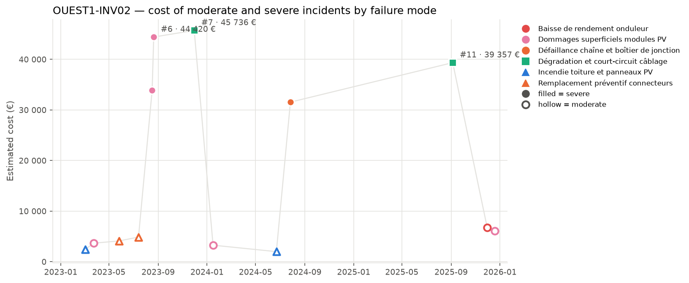

## 3. Cost timeline

*Estimated cost of each moderate (hollow) and severe (filled) incident. Colour = family of failure modes, marker shape = failure mode, grey cross = unclassified; the three most costly incidents are labelled.*

| Year | Incidents | Severe | Cost (EUR) | Cost vs previous year | Downtime (h) |
| --- | --- | --- | --- | --- | --- |
| 2023 | 7 | 3 | 139 141 |  | 276.5 |
| 2024 | 3 | 1 | 36 833 | -73.5 % | 66.2 |
| 2025 | 3 | 1 | 52 194 | +41.7 % | 113.5 |

**Trend.** Overall, the incident cost decreased from 2023 to 2024, then increased in 2025, but the total cost over the period shows a decreasing trend. The number of incidents was highest in 2023 and then declined in 2024, remaining stable in 2025.

**Dominant incidents.** The most costly incident is #7, with a failure mode of Dégradation et court-circuit câblage. The failure mode that accounts for the highest total cost is Dommages superficiels modules PV.

**Sequences and recurrences.** Close sequences of incidents include #1 and #2 within 21 days, involving damages superficiels modules PV and incendie toiture. Another sequence involves #5 and #6 within 4 days, both involving damages superficiels modules PV. Additionally, incidents #12 and #13 occurred within 19 days, involving Baisse de rendement onduleur and damages superficiels modules PV.

**Seasonality.** Incidents are relatively evenly distributed across seasons, with few incidents in winter, and more in summer and autumn. The data is indicative, with fewer than 3 incidents in winter.
