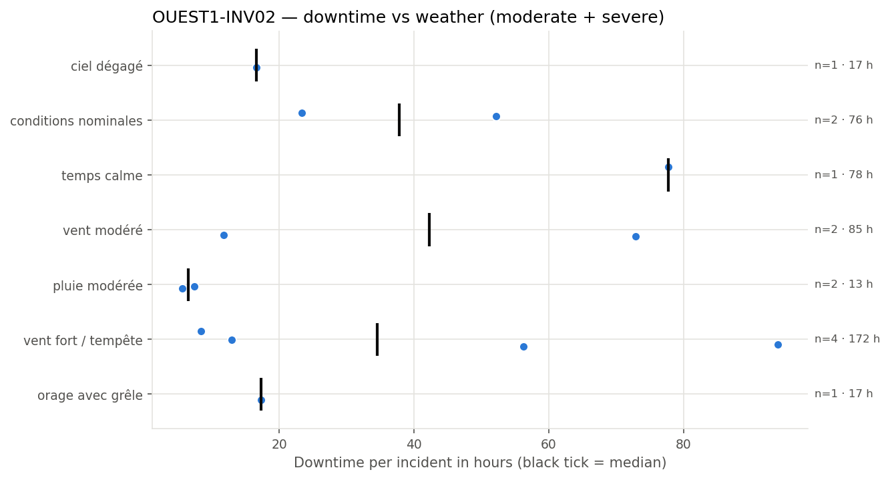
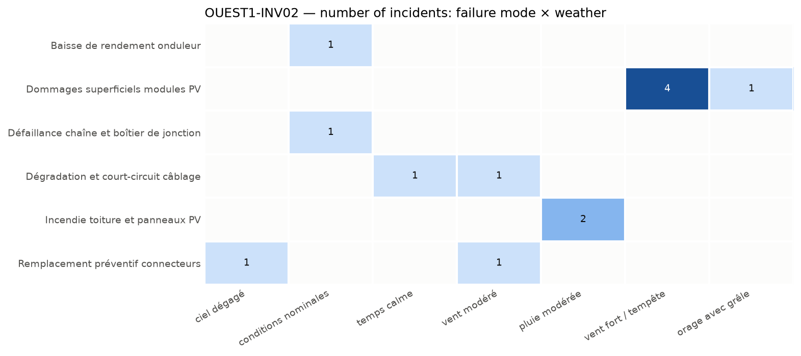

## 4. Weather exposure

### 4.1 Downtime vs weather condition

*Downtime of each incident per weather condition; the black tick is the median.*

| Weather | Incidents | Severe | Downtime (h) | Median (h) | % of downtime | Compared with site |
| --- | --- | --- | --- | --- | --- | --- |
| vent fort / tempête | 4 | 2 | 171.5 | 34.6 | 37.6 | over-represented vs site |
| vent modéré | 2 | 1 | 84.6 | 42.3 | 18.5 | over-represented vs site |
| temps calme | 1 | 1 | 77.7 | 77.7 | 17.0 | under-represented vs site |
| conditions nominales | 2 | 1 | 75.5 | 37.8 | 16.5 | in line with site |
| orage avec grêle | 1 | 0 | 17.3 | 17.3 | 3.8 | under-represented vs site |
| ciel dégagé | 1 | 0 | 16.6 | 16.6 | 3.6 | under-represented vs site |
| pluie modérée | 2 | 0 | 13.0 | 6.5 | 2.8 | in line with site |

The equipment experiences the most downtime under 'vent fort / tempête', accounting for 171.5 hours, which is over-represented compared to its share of incidents and the overall site. This weather condition is associated with the highest total downtime and a significant proportion of incidents, indicating it has a major impact on equipment availability.

### 4.2 Failure modes vs weather condition

*Number of incidents per failure mode and weather condition.*

Failure modes such as 'Dommages superficiels modules PV' occur under 'vent fort / tempête' and 'orage avec grêle', suggesting these weather conditions can cause physical damage to PV modules. 'Remplacement préventif connecteurs' occurs under 'ciel dégagé' and 'vent modéré', implying inspections or replacements may be advisable after these conditions. The correlation between weather and failure modes indicates targeted inspections following specific weather events could mitigate risks.
