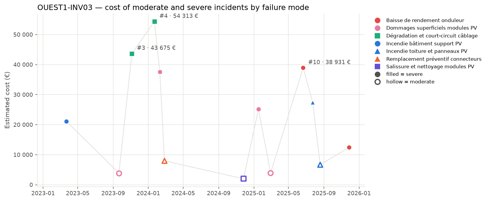
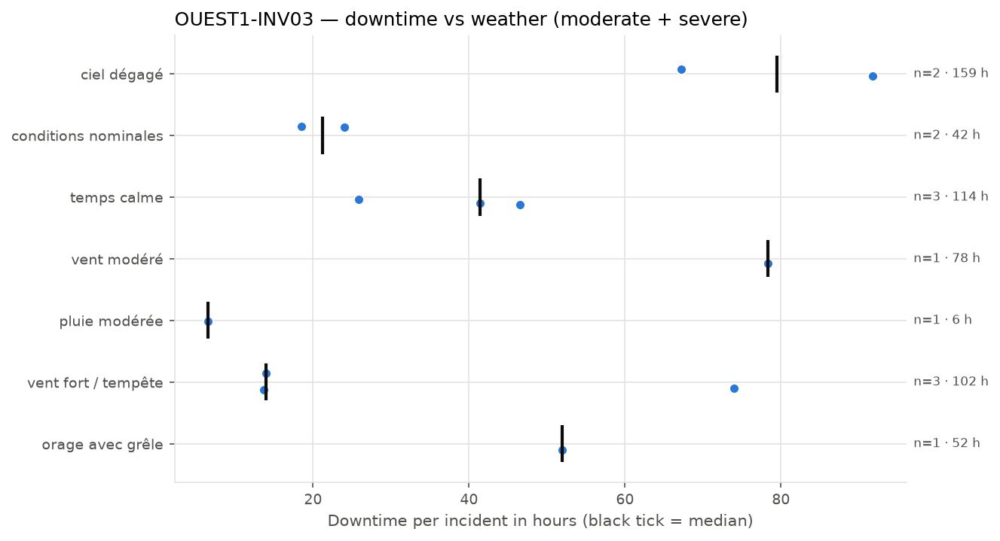
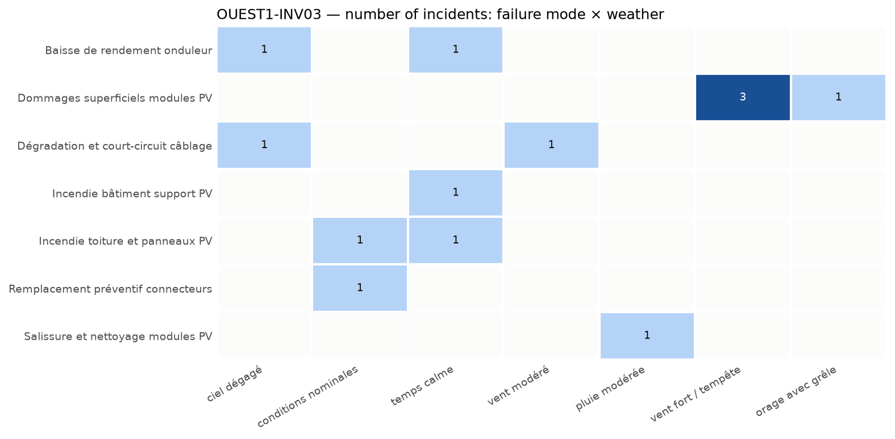

# PV inverter and DC field failure modes at OUEST1-INV03

**Equipment:** OUEST1-INV03 · **Site:** Centrale PV Ouest-1 · **Asset type:** PV inverter · **Generated on:** 2026-10-20

> OUEST1-INV03, a critical asset at Centrale PV Ouest-1, exhibits a higher incident rate compared to the site median, with 36 incidents versus 31.5. The most costly failure mode is wiring degradation and short-circuit, accounting for 34.4% of the equipment's total incident cost, which has been increasing over time. Immediate actions include inspecting cable connections and wiring, cleaning PV modules, and verifying surge protection devices to mitigate the most critical failure modes.

**Equipment priority: P1 · Risk level: CRITICAL** — Criticality score 95.5 (at or above the threshold of 75) against the other equipment of the site and 98.2 (at or above the threshold of 75) against the whole solar fleet.

---

## 1. Key figures

| Indicator | This equipment | Median equipment of the site | Ratio |
| --- | --- | --- | --- |
| Incidents (all severities) | 36 | 31.5 | ×1.14 |
| Severe incidents | 8 | 4.5 | ×1.78 |
| Total estimated cost (all severities) | 301 163 EUR | 212 067 EUR | ×1.42 |
| Total downtime (all severities) | 627.8 h | 473.8 h | ×1.33 |

| Moderate and severe incidents (scope of this report) | Value |
| --- | --- |
| Incidents analysed | 13 (5 moderate · 8 severe) |
| Period covered | 2023-01-04 → 2025-11-27 |
| Total estimated cost | 285 065 EUR (91.4 % from severe incidents) |
| Average cost per incident | 21 928 EUR |
| Total downtime | 553.7 h |
| Average interval between incidents | 82 days |
| Most costly failure mode | Dégradation et court-circuit câblage (97 989 EUR) |
| Weather with most downtime | ciel dégagé (159.0 h) |

This equipment exhibits a higher number of incidents compared to the site median, with a ratio of 1.14 for all incidents and 1.78 for severe incidents. It also incurs more costs and downtime than the median equipment, with ratios of 1.42 and 1.33 respectively. The equipment was selected due to its criticality score of 95.5 and fleet score of 98.2, both well above the thresholds, indicating its high importance. The cost is heavily concentrated on severe incidents, which account for over 91% of the total incident-related costs.

## 2. How this report was built

**Scope.** This report covers the maintenance incidents recorded on OUEST1-INV03 between 2023-01-04 and 2025-11-27. Each incident report was read and assigned to a *failure mode* according to its description. The detailed analysis focuses on moderate and severe incidents; minor incidents only appear in the comparison with the site. Incidents are numbered #1, #2, … in chronological order for this equipment (see the annex).

**Why this equipment.** Each piece of equipment receives a criticality score from 0 to 100 that combines four indicators: number of incidents, number of severe incidents (counted twice), total repair cost and total downtime. The score is computed twice: against the other equipment of the same site and against all solar equipment of the fleet. 50 corresponds to a typical piece of equipment, 75 or more to one clearly above the others. Equipment scoring 75 or more on both comparisons is priority **P1**, on one of them priority **P2**. Here: criticality score 95.5 (at or above the threshold of 75) against the other equipment of the site and 98.2 (at or above the threshold of 75) against the whole solar fleet → **P1**.

**Recommendation priority.** Each recommendation addresses one failure mode and inherits its priority:
- **P1** — within 1 month: the failure mode caused at least one severe incident on this equipment and either represents >= 20% of its cost or recurred within 90 days
- **P2** — within 6 months: the failure mode caused at least one severe incident or represents >= 10% of the cost
- **P3** — next yearly maintenance plan: all other failure modes

**Root-cause confidence.** The confidence of a root-cause hypothesis reflects the number of incidents supporting it: high from 5 incidents, medium from 3, low below.

**Analysis.** All figures, tables and charts are computed directly from the incident records (a *close sequence* is a series of incidents less than 30 days apart; a *recurrence* is the same failure mode coming back within 90 days). The commentary of each section was drafted with the help of an AI assistant specialised in that topic, from the figures of the section only.

*Patterns based on fewer than 3 incidents are flagged as indicative in the text.*

## 3. Cost timeline

*Estimated cost of each moderate (hollow) and severe (filled) incident. Colour = family of failure modes, marker shape = failure mode, grey cross = unclassified; the three most costly incidents are labelled.*

| Year | Incidents | Severe | Cost (EUR) | Cost vs previous year | Downtime (h) |
| --- | --- | --- | --- | --- | --- |
| 2023 | 3 | 2 | 68 661 |  | 133.4 |
| 2024 | 4 | 2 | 101 819 | +48.3 % | 196.3 |
| 2025 | 6 | 4 | 114 585 | +12.5 % | 224.0 |

**Trend.** The overall cost of incidents has been increasing from 2023 to 2025, with a 66.9% rise over the period. The number of incidents has also grown, with the year 2025 experiencing the highest count. The last year saw a continued increase in total costs compared to the previous year.

**Dominant incidents.** The incidents that dominate the cost are #4, #3, and #10. Their failure modes are 'Dégradation et court-circuit câblage' for incidents #4 and #3, and 'Baisse de rendement onduleur' for incident #10.

**Sequences and recurrences.** Close sequences of incidents occurred within 30 days, notably from #4 to #6, involving multiple failure modes, and from #11 to #12, involving 'Incendie toiture et panneaux PV'. These indicate quick recurrences or related failures.

**Seasonality.** Incidents are most frequent in winter, with fewer incidents in spring, suggesting a possible seasonal pattern. The sample size for spring is small, so this observation is indicative.

## 4. Weather exposure

### 4.1 Downtime vs weather condition

*Downtime of each incident per weather condition; the black tick is the median.*

| Weather | Incidents | Severe | Downtime (h) | Median (h) | % of downtime | Compared with site |
| --- | --- | --- | --- | --- | --- | --- |
| ciel dégagé | 2 | 2 | 159.0 | 79.5 | 28.7 | in line with site |
| temps calme | 3 | 3 | 113.8 | 41.4 | 20.6 | over-represented vs site |
| vent fort / tempête | 3 | 1 | 101.7 | 14.0 | 18.4 | over-represented vs site |
| vent modéré | 1 | 1 | 78.3 | 78.3 | 14.1 | in line with site |
| orage avec grêle | 1 | 1 | 51.9 | 51.9 | 9.4 | under-represented vs site |
| conditions nominales | 2 | 0 | 42.5 | 21.2 | 7.7 | in line with site |
| pluie modérée | 1 | 0 | 6.5 | 6.5 | 1.2 | under-represented vs site |

The equipment experiences the most downtime under 'ciel dégagé' conditions, accounting for 28.7% of the downtime, which is in line with its incident share and site representation. 'Temps calme' conditions are over-represented, with 23.1% of incidents compared to 17.4% on the site, indicating a higher likelihood of failures during calm weather. 'Vent fort / tempête' is also over-represented, with 23.1% of incidents versus 15.9% site share, suggesting increased failure risk under strong wind conditions.

### 4.2 Failure modes vs weather condition

*Number of incidents per failure mode and weather condition.*

Failures such as 'Dommages superficiels modules PV' occur under 'vent fort / tempête' and 'orage avec grêle', indicating these weather conditions can lead to physical damage. 'Baisse de rendement onduleur' is linked to 'ciel dégagé' and 'temps calme', implying that high irradiance or stable conditions may contribute to performance issues. 'Salissure et nettoyage modules PV' is associated with 'pluie modérée', suggesting that moderate rain can cause dirt accumulation requiring cleaning. These links imply that inspections should be prioritized after such weather events, especially for damage-prone failure modes.

## 5. Failure modes

| Failure mode | Priority | Incidents | Severe | Cost (EUR) | % of cost | Recurrences < 90 d | Incidents # |
| --- | --- | --- | --- | --- | --- | --- | --- |
| Dégradation et court-circuit câblage | P1 | 2 | 2 | 97 989 | 34.4 | 1 | #3, #4 |
| Dommages superficiels modules PV | P1 | 4 | 2 | 70 510 | 24.7 | 1 | #2, #5, #8, #9 |
| Baisse de rendement onduleur | P2 | 2 | 2 | 51 357 | 18.0 | 0 | #10, #13 |
| Incendie toiture et panneaux PV | P1 | 2 | 1 | 34 127 | 12.0 | 1 | #11, #12 |
| Incendie bâtiment support PV | P2 | 1 | 1 | 21 116 | 7.4 | 0 | #1 |
| Remplacement préventif connecteurs | P3 | 1 | 0 | 7 961 | 2.8 | 0 | #6 |
| Salissure et nettoyage modules PV | P3 | 1 | 0 | 2 006 | 0.7 | 0 | #7 |

### Dégradation et court-circuit câblage · P1

Likely caused by insulation degradation and thermal stress leading to short circuits in the wiring. Indicative, 2 severe incidents, with costs totaling EUR 97989, and one recurrence within 90 days. Incidents occurred under 'vent modéré' and 'ciel dégagé' weather conditions, with a total downtime of 170.1 hours.

### Dommages superficiels modules PV · P1

Surface damages possibly caused by mechanical impact or environmental factors such as wind or hail, leading to superficial module damage. Indicative, 2 severe incidents, with a total cost of EUR 70510, and one recurrence within 90 days. Incidents occurred mainly under 'vent fort / tempête' weather, with a total downtime of 153.6 hours.

### Baisse de rendement onduleur · P2

Likely due to internal component failure or thermal issues affecting inverter performance. Indicative, 2 severe incidents, with a total cost of EUR 51357, no recurrence within 90 days. Incidents occurred under 'ciel dégagé' and 'temps calme', with a total downtime of 93.1 hours.

### Incendie toiture et panneaux PV · P1

Potential electrical fault or thermal runaway causing fire in the roof and panels. Indicative, 2 incidents, with a total cost of EUR 34127, including one severe incident. Incidents occurred under 'conditions nominales' and 'temps calme', with a total downtime of 65 hours.

### Incendie bâtiment support PV · P2

Electrical fault or overheating in the support building leading to fire. Indicative, 1 severe incident, costing EUR 21116, occurred under 'temps calme', with 41.4 hours of downtime.

### Remplacement préventif connecteurs · P3

Preventive replacement of connectors likely due to aging or wear, to prevent failure. Indicative, 1 moderate incident, costing EUR 7961, occurred under 'conditions nominales', with 24 hours of downtime.

### Salissure et nettoyage modules PV · P3

Accumulation of dirt and debris reducing module efficiency, mitigated by cleaning. Indicative, 1 moderate incident, costing EUR 2006, occurred under 'pluie modérée', with 6.5 hours of downtime.

## 6. Root-cause hypotheses

1. **The incidents of the PV inverter and upstream DC field are primarily caused by environmental stressors such as wind storms and weather-related mechanical impacts, leading to cable degradation and superficial module damages.** — *confidence: high (6 supporting incidents: #2, #3, #4, #5, #8, #9)*  
   Failure modes: Dégradation et court-circuit câblage, Dommages superficiels modules PV.  
   Most cable degradation and superficial damages occurred during windy conditions, especially 'vent fort / tempête' and 'orage avec grêle', indicating that mechanical impacts from severe weather are a significant contributing factor.
2. **Electrical component failures, including inverter performance drops and connector issues, are linked to thermal and environmental stress, with some incidents occurring under nominal weather conditions.** — *confidence: medium (3 supporting incidents: #6, #10, #13)*  
   Failure modes: Baisse de rendement onduleur, Remplacement préventif connecteurs.  
   Incidents of inverter performance decline and connector replacements happened during clear or calm weather, suggesting that thermal cycling and aging, rather than weather, may be primary causes.
3. **Fire-related incidents are caused by internal faults or overheating, independent of weather conditions, possibly exacerbated by dust or lack of maintenance.** — *confidence: low (2 supporting incidents: #11, #12)*  
   Failure modes: Incendie toiture et panneaux PV, Incendie bâtiment support PV.  
   Both fire incidents occurred under 'conditions nominales' and 'temps calme', indicating that internal faults or maintenance issues, rather than external weather, are likely responsible.

## 7. Recommendations

| Priority | Action | Type | Failure mode addressed | Expected impact |
| --- | --- | --- | --- | --- |
| P1 | Conduct a comprehensive visual inspection and thermography scan of the cable connections and wiring to identify degradation or hot spots. | monitoring | Dégradation et court-circuit câblage | Early detection of cable degradation will help prevent severe incidents and reduce the 34.4% of the equipment cost associated with this failure mode. |
| P1 | Implement a regular schedule for cleaning PV modules, especially after moderate rain, to prevent dirt accumulation that could contribute to superficial damages. | preventive | Dommages superficiels modules PV | Maintaining clean modules will mitigate superficial damages, which account for 24.7% of the equipment cost and are linked to incidents under windy and stormy conditions. |
| P1 | Inspect and verify the operation of surge protection devices regularly to prevent internal faults or overheating that could lead to fire incidents. | preventive | Incendie toiture et panneaux PV | Regular inspection will help mitigate fire risks, which have a recurrence within 90 days and account for 12% of the equipment cost. |
| P1 | Conduct a fire risk assessment focusing on internal faults and overheating sources, independent of weather conditions, to identify potential hazards early. | monitoring | Incendie toiture et panneaux PV | Proactive fire risk management aims to prevent severe incidents and recurrences, which have a significant impact on safety and costs. |
| P2 | Perform detailed IV-curve tracing and insulation resistance tests on the PV inverter and upstream DC field to detect early electrical faults and insulation issues. | monitoring | Baisse de rendement onduleur | Early electrical fault detection will help prevent performance drops, although this failure mode has no recent recurrence within 90 days. |
| P3 | Check and tighten all connector torque settings, and replace any connectors showing signs of wear or corrosion, especially in areas exposed to environmental stress. | preventive | Remplacement préventif connecteurs | Proper connector maintenance will reduce the risk of connector failures, which have no recent severe incidents but are linked to environmental stress. |
| P3 | Establish a scheduled cleaning and inspection routine for the PV modules to minimize dirt accumulation and mechanical impacts, especially after storm events. | preventive | Salissure et nettoyage modules PV | Routine cleaning will help prevent damages and reduce the risk of incidents related to dirt and mechanical impacts, although this failure mode has no recent severe incidents. |

## 8. Conclusion

The main issue with OUEST1-INV03 is wiring degradation and short-circuit risks, which have caused the most costly failures and are prioritized as P1. The first actions should focus on conducting a thorough visual and thermography inspection of cable connections and wiring, along with regular cleaning and surge protection checks. Implementing these measures is expected to reduce the risk of severe incidents and improve equipment reliability.

---

### Annex — Incident register

| # | Date | Severity | Failure mode | Cost (EUR) | Downtime (h) | Weather |
| --- | --- | --- | --- | --- | --- | --- |
| #1 | 2023-03-23 | sévère | Incendie bâtiment support PV | 21 116 | 41.4 | temps calme |
| #2 | 2023-09-21 | modérée | Dommages superficiels modules PV | 3 870 | 13.7 | vent fort / tempête |
| #3 | 2023-11-05 | sévère | Dégradation et court-circuit câblage | 43 675 | 78.3 | vent modéré |
| #4 | 2024-01-22 | sévère | Dégradation et court-circuit câblage | 54 313 | 91.8 | ciel dégagé |
| #5 | 2024-02-10 | sévère | Dommages superficiels modules PV | 37 539 | 74.0 | vent fort / tempête |
| #6 | 2024-02-26 | modérée | Remplacement préventif connecteurs | 7 961 | 24.0 | conditions nominales |
| #7 | 2024-11-26 | modérée | Salissure et nettoyage modules PV | 2 006 | 6.5 | pluie modérée |
| #8 | 2025-01-17 | sévère | Dommages superficiels modules PV | 25 134 | 51.9 | orage avec grêle |
| #9 | 2025-02-28 | modérée | Dommages superficiels modules PV | 3 967 | 14.0 | vent fort / tempête |
| #10 | 2025-06-21 | sévère | Baisse de rendement onduleur | 38 931 | 67.2 | ciel dégagé |
| #11 | 2025-07-24 | sévère | Incendie toiture et panneaux PV | 27 461 | 46.5 | temps calme |
| #12 | 2025-08-19 | modérée | Incendie toiture et panneaux PV | 6 667 | 18.5 | conditions nominales |
| #13 | 2025-11-27 | sévère | Baisse de rendement onduleur | 12 425 | 25.9 | temps calme |
