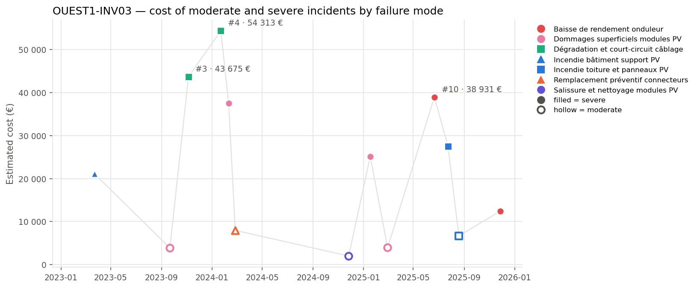

## 3. Cost timeline

*Estimated cost of each moderate (hollow) and severe (filled) incident. Colour = family of failure modes, marker shape = failure mode; the three most costly incidents are labelled.*

| Year | Incidents | Severe | Cost (EUR) | Cost vs previous year | Downtime (h) |
| --- | --- | --- | --- | --- | --- |
| 2023 | 3 | 2 | 68 661 |  | 133.4 |
| 2024 | 4 | 2 | 101 819 | +48.3 % | 196.3 |
| 2025 | 6 | 4 | 114 585 | +12.5 % | 224.0 |

**Trend.** The overall cost of incidents has been increasing from 2023 to 2025, with a 66.9% rise over the period. The number of incidents has also grown, with the year 2025 experiencing the highest count. The last year saw a continued increase in total costs compared to the previous year.

**Dominant incidents.** The incidents that dominate the cost are #4, #3, and #10. Their failure modes are 'Dégradation et court-circuit câblage' for incidents #4 and #3, and 'Baisse de rendement onduleur' for incident #10.

**Sequences and recurrences.** Close sequences of incidents occurred within 30 days, notably from #4 to #6, involving multiple failure modes, and from #11 to #12, involving 'Incendie toiture et panneaux PV'. These indicate quick recurrences or related failures.

**Seasonality.** Incidents are most frequent in winter, with fewer incidents in spring, suggesting a possible seasonal pattern. The sample size for spring is small, so this observation is indicative.
