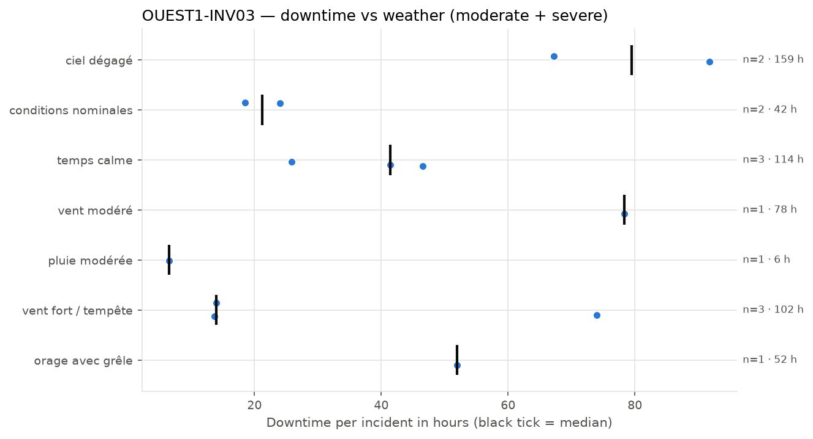
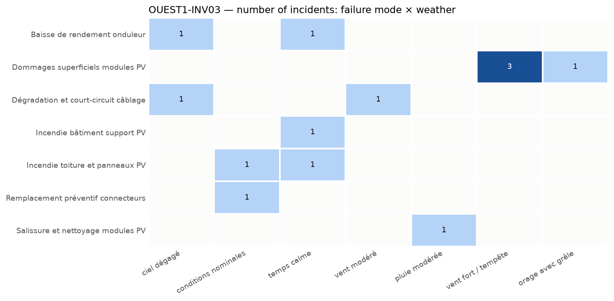

## 4. Weather exposure

### 4.1 Downtime vs weather condition

*Downtime of each incident per weather condition; the black tick is the median.*

| Weather | Incidents | Severe | Downtime (h) | Median (h) | % of downtime | Compared with site |
| --- | --- | --- | --- | --- | --- | --- |
| ciel dégagé | 2 | 2 | 159.0 | 79.5 | 28.7 | in line with site |
| temps calme | 3 | 3 | 113.8 | 41.4 | 20.6 | over-represented vs site |
| vent fort / tempête | 3 | 1 | 101.7 | 14.0 | 18.4 | over-represented vs site |
| vent modéré | 1 | 1 | 78.3 | 78.3 | 14.1 | in line with site |
| orage avec grêle | 1 | 1 | 51.9 | 51.9 | 9.4 | under-represented vs site |
| conditions nominales | 2 | 0 | 42.5 | 21.2 | 7.7 | in line with site |
| pluie modérée | 1 | 0 | 6.5 | 6.5 | 1.2 | under-represented vs site |

The equipment experiences the most downtime under 'ciel dégagé' conditions, accounting for 28.7% of the downtime, which is in line with its incident share and site representation. 'Temps calme' conditions are over-represented, with 23.1% of incidents compared to 17.4% on the site, indicating a higher likelihood of failures during calm weather. 'Vent fort / tempête' is also over-represented, with 23.1% of incidents versus 15.9% site share, suggesting increased failure risk under strong wind conditions.

### 4.2 Failure modes vs weather condition

*Number of incidents per failure mode and weather condition.*

Failures such as 'Dommages superficiels modules PV' occur under 'vent fort / tempête' and 'orage avec grêle', indicating these weather conditions can lead to physical damage. 'Baisse de rendement onduleur' is linked to 'ciel dégagé' and 'temps calme', implying that high irradiance or stable conditions may contribute to performance issues. 'Salissure et nettoyage modules PV' is associated with 'pluie modérée', suggesting that moderate rain can cause dirt accumulation requiring cleaning. These links imply that inspections should be prioritized after such weather events, especially for damage-prone failure modes.
