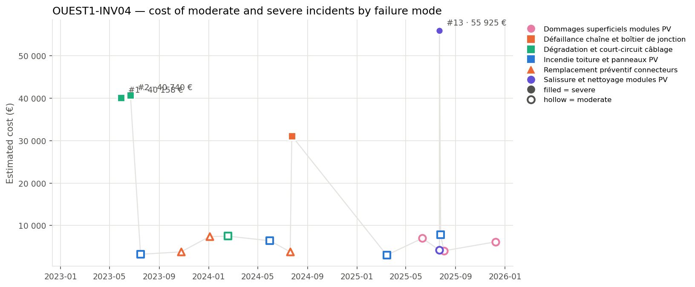
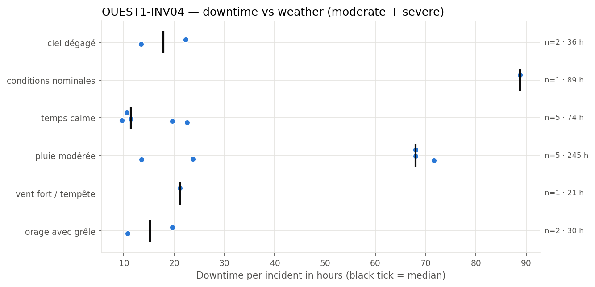
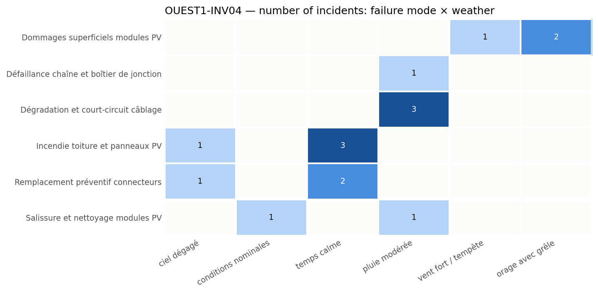

# PV inverter OUEST1-INV04: Cable Degradation and Short-Circuit Risks

**Equipment:** OUEST1-INV04 · **Site:** Centrale PV Ouest-1 · **Asset type:** PV inverter · **Generated on:** 2026-10-19

> The PV inverter OUEST1-INV04 at Centrale PV Ouest-1 faces critical failure modes including cable degradation and short-circuit, which account for over 38% of the equipment's failure-related costs. The equipment experiences a higher incident rate compared to the site median, with 38 incidents versus 31.5, although severe incidents are slightly below the site median. Immediate actions should focus on thermography inspections and electrical integrity tests to identify and mitigate wiring issues, complemented by regular cleaning to prevent contamination.

**Equipment priority: P2 · Risk level: HIGH** — Criticality score 56.4 (below the threshold of 75) against the other equipment of the site and 88.8 (at or above the threshold of 75) against the whole solar fleet.

---

## 1. Key figures

| Indicator | This equipment | Median equipment of the site | Ratio |
| --- | --- | --- | --- |
| Incidents (all severities) | 38 | 31.5 | ×1.21 |
| Severe incidents | 4 | 4.5 | ×0.89 |
| Total estimated cost (all severities) | 247 736 EUR | 212 067 EUR | ×1.17 |
| Total downtime (all severities) | 563.4 h | 473.8 h | ×1.19 |

| Moderate and severe incidents (scope of this report) | Value |
| --- | --- |
| Incidents analysed | 16 (12 moderate · 4 severe) |
| Period covered | 2023-01-13 → 2025-12-08 |
| Total estimated cost | 232 135 EUR (72.4 % from severe incidents) |
| Average cost per incident | 14 508 EUR |
| Total downtime | 494.6 h |
| Average interval between incidents | 62 days |
| Most costly failure mode | Dégradation et court-circuit câblage (88 376 EUR) |
| Weather with most downtime | pluie modérée (244.8 h) |

This equipment exhibits a higher number of incidents of all severities compared to the site median, with a ratio of 1.21. However, it has fewer severe incidents than the median, with a ratio of 0.89. The estimated total cost of incidents is above the median at a ratio of 1.17, and downtime is also higher, with a ratio of 1.19. It was selected because its criticality score of 56.4 is below the threshold of 75 against other equipment at the site but above the threshold of 75 against the entire fleet, indicating its importance within the site context. Its high risk level and criticality score suggest a significant impact on operations, and the concentration of costs on severe incidents is notable, with 72.4% of the total incident cost attributable to severe failures.

## 2. How this report was built

**Scope.** This report covers the maintenance incidents recorded on OUEST1-INV04 between 2023-01-13 and 2025-12-08. Each incident report was read and assigned to a *failure mode* according to its description. The detailed analysis focuses on moderate and severe incidents; minor incidents only appear in the comparison with the site. Incidents are numbered #1, #2, … in chronological order for this equipment (see the annex).

**Why this equipment.** Each piece of equipment receives a criticality score from 0 to 100 that combines four indicators: number of incidents, number of severe incidents (counted twice), total repair cost and total downtime. The score is computed twice: against the other equipment of the same site and against all solar equipment of the fleet. 50 corresponds to a typical piece of equipment, 75 or more to one clearly above the others. Equipment scoring 75 or more on both comparisons is priority **P1**, on one of them priority **P2**. Here: criticality score 56.4 (below the threshold of 75) against the other equipment of the site and 88.8 (at or above the threshold of 75) against the whole solar fleet → **P2**.

**Recommendation priority.** Each recommendation addresses one failure mode and inherits its priority:
- **P1** — within 1 month: the failure mode caused at least one severe incident on this equipment and either represents >= 20% of its cost or recurred within 90 days
- **P2** — within 6 months: the failure mode caused at least one severe incident or represents >= 10% of the cost
- **P3** — next yearly maintenance plan: all other failure modes

**Root-cause confidence.** The confidence of a root-cause hypothesis reflects the number of incidents supporting it: high from 5 incidents, medium from 3, low below.

**Analysis.** All figures, tables and charts are computed directly from the incident records (a *close sequence* is a series of incidents less than 30 days apart; a *recurrence* is the same failure mode coming back within 90 days). The commentary of each section was drafted with the help of an AI assistant specialised in that topic, from the figures of the section only.

*Patterns based on fewer than 3 incidents are flagged as indicative in the text.*

## 3. Cost timeline

*Estimated cost of each moderate (hollow) and severe (filled) incident. Colour = family of failure modes, marker shape = failure mode; the three most costly incidents are labelled.*

| Year | Incidents | Severe | Cost (EUR) | Cost vs previous year | Downtime (h) |
| --- | --- | --- | --- | --- | --- |
| 2023 | 4 | 2 | 87 884 |  | 163.6 |
| 2024 | 5 | 1 | 56 186 | -36.1 % | 145.3 |
| 2025 | 7 | 1 | 88 065 | +56.7 % | 185.7 |

**Trend.** Overall, the incident count and costs have fluctuated over the years, with a slight increase in total costs from 2023 to 2025. The year 2024 saw a decrease in total costs compared to 2023, but 2025 experienced a significant rise, bringing the total costs close to the initial year. The overall change from 2023 to 2025 is minimal, indicating a stable trend.

**Dominant incidents.** The most costly incident is #13 involving salissure et nettoyage modules PV, and the most costly failure mode is dégradation et court-circuit câblage. These incidents and failure modes account for a large share of the total costs, with the top three incidents representing nearly 59% of the total.

**Sequences and recurrences.** Close sequences of incidents occurred within 30 days, notably from #1 to #3 in 2023, from #8 to #9 in 2024, and from #12 to #15 in 2025. The recurrence of the same failure mode, such as dégradation et court-circuit câblage, is observed with incidents #1, #2, and #6, indicating some recurring issues over time.

**Seasonality.** Summer shows the highest number of incidents and costs, with 9 incidents and a total cost of 157,784 EUR, including severe failures. Spring also has notable activity, while winter and autumn have fewer incidents, with winter being indicative of fewer incidents.

## 4. Weather exposure

### 4.1 Downtime vs weather condition

*Downtime of each incident per weather condition; the black tick is the median.*

| Weather | Incidents | Severe | Downtime (h) | Median (h) | % of downtime | Compared with site |
| --- | --- | --- | --- | --- | --- | --- |
| pluie modérée | 5 | 3 | 244.8 | 68.0 | 49.5 | over-represented vs site |
| conditions nominales | 1 | 1 | 88.8 | 88.8 | 18.0 | under-represented vs site |
| temps calme | 5 | 0 | 73.8 | 11.4 | 14.9 | over-represented vs site |
| ciel dégagé | 2 | 0 | 35.7 | 17.9 | 7.2 | in line with site |
| orage avec grêle | 2 | 0 | 30.4 | 15.2 | 6.1 | in line with site |
| vent fort / tempête | 1 | 0 | 21.1 | 21.1 | 4.3 | under-represented vs site |

The equipment loses the most hours under 'pluie modérée', accounting for 49.5% of the total downtime, and this weather condition is over-represented compared to the site. Conversely, 'conditions nominales' and 'vent fort / tempête' are under-represented in incidents relative to their occurrence on the site, with the latter being notably less frequent.

### 4.2 Failure modes vs weather condition

*Number of incidents per failure mode and weather condition.*

Failure modes such as 'Dommages superficiels modules PV' occur under 'vent fort / tempête' and 'orage avec grêle', indicating that severe weather events can cause physical damage to modules. 'Dégradation et court-circuit câblage' and 'Défaillance chaîne et boîtier de jonction' are linked to 'pluie modérée', suggesting that moisture exposure may accelerate electrical degradation. Incidents related to 'Incendie toiture et panneaux PV' and 'Remplacement préventif connecteurs' are associated with 'ciel dégagé' and 'temps calme', implying that maintenance or thermal stress during stable weather can lead to failures. Salissure and cleaning issues are linked to 'conditions nominales' and 'pluie modérée', indicating that both dry and wet conditions can contribute to soiling.

## 5. Failure modes

| Failure mode | Priority | Incidents | Severe | Cost (EUR) | % of cost | Recurrences < 90 d | Incidents # |
| --- | --- | --- | --- | --- | --- | --- | --- |
| Dégradation et court-circuit câblage | P1 | 3 | 2 | 88 376 | 38.1 | 1 | #1, #2, #6 |
| Salissure et nettoyage modules PV | P1 | 2 | 1 | 60 105 | 25.9 | 1 | #12, #13 |
| Défaillance chaîne et boîtier de jonction | P2 | 1 | 1 | 31 133 | 13.4 | 0 | #9 |
| Incendie toiture et panneaux PV | P3 | 4 | 0 | 20 423 | 8.8 | 0 | #3, #7, #10, #14 |
| Dommages superficiels modules PV | P3 | 3 | 0 | 17 146 | 7.4 | 1 | #11, #15, #16 |
| Remplacement préventif connecteurs | P3 | 3 | 0 | 14 953 | 6.4 | 1 | #4, #5, #8 |

### Dégradation et court-circuit câblage · P1

Likely caused by insulation degradation and thermal stress, leading to short circuits in the wiring. Three incidents occurred, two of which were severe, with costs totaling 88,376 euros. Incidents happened under moderate rain, with one recurrence within 90 days, and caused significant downtime.

### Salissure et nettoyage modules PV · P1

Accumulation of dirt and debris on module surfaces reduces light absorption, necessitating cleaning. Two incidents, one severe, with total costs of 60,105 euros. The incidents occurred under nominal conditions and rain, with one recurrence within 90 days, impacting module performance.

### Défaillance chaîne et boîtier de jonction · P2

Possible connection failure or corrosion within the junction box, disrupting current flow. One severe incident with a cost of 31,133 euros, occurred under moderate rain, with no recurrence within 90 days, causing notable downtime.

### Incendie toiture et panneaux PV · P3

Potential thermal or electrical fault leading to fire, possibly exacerbated by environmental conditions. Four incidents, all moderate, with total costs of 20,423 euros. Incidents occurred mostly under calm weather, with no severe incidents reported, but over-represented compared to site.

### Dommages superficiels modules PV · P3

Impact from hail or strong wind causing superficial damage to module surfaces. Three moderate incidents costing 17,146 euros, mainly under storm or hail conditions, with one recurrence within 90 days, affecting module integrity.

### Remplacement préventif connecteurs · P3

Preventive replacement to avoid failure, possibly due to aging or wear of connectors. Three incidents, all moderate, with costs totaling 14,953 euros. Incidents occurred mostly under calm weather, with one recurrence within 90 days, involving over-represented equipment.

## 6. Root-cause hypotheses

1. **The incidents are primarily caused by moisture ingress and electrical degradation due to frequent rain, leading to cable short-circuits and wiring degradation.** — *confidence: medium (3 supporting incidents: #1, #2, #6)*  
   Failure modes: Dégradation et court-circuit câblage.  
   Most incidents occurred under 'pluie modérée' weather conditions, with two severe cases, indicating that rain-related moisture ingress is a significant factor in cable degradation and short-circuits.
2. **Surface contamination and dirt accumulation on modules, possibly exacerbated by rain, are causing performance issues and failures, including module damage and efficiency loss.** — *confidence: medium (4 supporting incidents: #12, #13, #15, #16)*  
   Failure modes: Salissure et nettoyage modules PV, Dommages superficiels modules PV.  
   Incidents related to dirt and superficial damage occurred in conditions of nominal weather and rain, with a notable cluster in summer, suggesting that dirt accumulation and cleaning are contributing to module failures.
3. **Electrical failures in the chain and junction box are triggered by environmental factors such as rain and possibly electrical surges, leading to severe outages.** — *confidence: low (1 supporting incident: #9)*  
   Failure modes: Défaillance chaîne et boîtier de jonction.  
   The single incident under 'pluie modérée' indicates that environmental moisture may cause or accelerate failures in the chain and junction box, resulting in severe outages.
4. **Mechanical damage from weather events like hail or storms, especially during summer, causes superficial damage to modules, leading to moderate failures.** — *confidence: medium (3 supporting incidents: #11, #15, #16)*  
   Failure modes: Dommages superficiels modules PV.  
   Incidents with superficial damage occurred during stormy weather, notably hail, and are clustered in summer, indicating that weather-related mechanical impacts are a key failure trigger.
5. **Corrosion or wear of connectors over time, possibly accelerated by environmental conditions, leads to connector failures, which are mitigated by preventive replacement.** — *confidence: medium (3 supporting incidents: #4, #5, #8)*  
   Failure modes: Remplacement préventif connecteurs.  
   Incidents of connector replacement occurred in calm weather, with a recurrence pattern over approximately four to five months, suggesting aging and environmental wear as causes.

## 7. Recommendations

| Priority | Action | Type | Failure mode addressed | Expected impact |
| --- | --- | --- | --- | --- |
| P1 | Perform thermography inspections to identify hot spots and potential short circuits in wiring, especially after rainy conditions. | monitoring | Dégradation et court-circuit câblage | Early detection of wiring degradation and short circuits, addressing the failure mode which accounts for 38.1% of the equipment cost and has one recurrence within 90 days. |
| P1 | Conduct IV-curve tracing and insulation resistance tests to verify electrical integrity of the PV strings and identify degradation or insulation issues. | preventive | Dégradation et court-circuit câblage | Improved reliability of wiring and reduced risk of short circuits, targeting the failure mode responsible for the highest cost share and recurrences. |
| P1 | Implement a regular cleaning schedule for modules to prevent dirt accumulation, especially after moderate rain events, to mitigate contamination. | preventive | Salissure et nettoyage modules PV | Reduction in performance loss and failures caused by surface contamination, which represents 25.9% of the equipment cost and has one recurrence within 90 days. |
| P1 | Review and stock spare parts for critical components such as connectors and junction boxes to enable prompt corrective actions when failures occur. | spare parts | Dégradation et court-circuit câblage | Faster repair response and reduced downtime, especially for the failure mode with the highest recurrence and cost share. |
| P2 | Inspect surge protection devices and grounding to prevent electrical surges from rain or storms from triggering chain and junction box failures. | monitoring | Défaillance chaîne et boîtier de jonction | Reduced risk of severe electrical failures triggered by environmental factors, despite a lower cost share and no recent recurrence. |
| P3 | Check and tighten connector torque during scheduled maintenance to prevent connector failures caused by environmental wear. | preventive | Remplacement préventif connecteurs | Decrease in connector failures and associated costs, addressing the failure mode with a 6.4% cost share and recurrent incidents. |
| P3 | Schedule fire-risk inspections focusing on areas with accumulated debris or potential ignition sources, even though no recent severe incidents occurred. | monitoring | Incendie toiture et panneaux PV | Minimized fire risk, maintaining safety standards, with no severe incidents reported. |

## 8. Conclusion

The main issue with OUEST1-INV04 involves wiring degradation and contamination, which are high-priority failure modes. Initial actions should include thermography inspections, electrical testing, and regular cleaning to identify and mitigate these risks. Implementing these measures is expected to reduce the likelihood of severe incidents and improve overall reliability.

---

### Annex — Incident register

| # | Date | Severity | Failure mode | Cost (EUR) | Downtime (h) | Weather |
| --- | --- | --- | --- | --- | --- | --- |
| #1 | 2023-05-30 | sévère | Dégradation et court-circuit câblage | 40 158 | 68.0 | pluie modérée |
| #2 | 2023-06-22 | sévère | Dégradation et court-circuit câblage | 40 740 | 71.6 | pluie modérée |
| #3 | 2023-07-17 | modérée | Incendie toiture et panneaux PV | 3 207 | 10.6 | temps calme |
| #4 | 2023-10-25 | modérée | Remplacement préventif connecteurs | 3 778 | 13.4 | ciel dégagé |
| #5 | 2024-01-03 | modérée | Remplacement préventif connecteurs | 7 390 | 19.6 | temps calme |
| #6 | 2024-02-18 | modérée | Dégradation et court-circuit câblage | 7 477 | 23.7 | pluie modérée |
| #7 | 2024-05-31 | modérée | Incendie toiture et panneaux PV | 6 401 | 22.6 | temps calme |
| #8 | 2024-07-20 | modérée | Remplacement préventif connecteurs | 3 785 | 11.4 | temps calme |
| #9 | 2024-07-24 | sévère | Défaillance chaîne et boîtier de jonction | 31 133 | 68.0 | pluie modérée |
| #10 | 2025-03-15 | modérée | Incendie toiture et panneaux PV | 3 009 | 9.6 | temps calme |
| #11 | 2025-06-11 | modérée | Dommages superficiels modules PV | 6 986 | 21.1 | vent fort / tempête |
| #12 | 2025-07-23 | modérée | Salissure et nettoyage modules PV | 4 179 | 13.5 | pluie modérée |
| #13 | 2025-07-23 | sévère | Salissure et nettoyage modules PV | 55 925 | 88.8 | conditions nominales |
| #14 | 2025-07-26 | modérée | Incendie toiture et panneaux PV | 7 805 | 22.3 | ciel dégagé |
| #15 | 2025-08-03 | modérée | Dommages superficiels modules PV | 4 023 | 10.8 | orage avec grêle |
| #16 | 2025-12-08 | modérée | Dommages superficiels modules PV | 6 137 | 19.6 | orage avec grêle |
