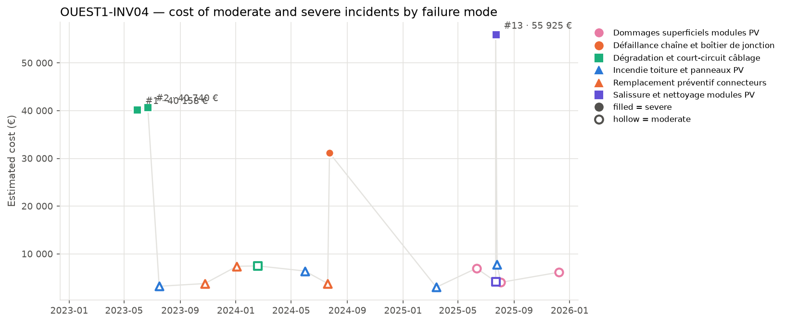

## 3. Cost timeline

*Estimated cost of each moderate (hollow) and severe (filled) incident. Colour = family of failure modes, marker shape = failure mode; the three most costly incidents are labelled.*

| Year | Incidents | Severe | Cost (EUR) | Cost vs previous year | Downtime (h) |
| --- | --- | --- | --- | --- | --- |
| 2023 | 4 | 2 | 87 884 |  | 163.6 |
| 2024 | 5 | 1 | 56 186 | -36.1 % | 145.3 |
| 2025 | 7 | 1 | 88 065 | +56.7 % | 185.7 |

**Trend.** Overall, the incident count and costs have fluctuated over the years, with a slight increase in total costs from 2023 to 2025. The year 2024 saw a decrease in total costs compared to 2023, but 2025 experienced a significant rise, bringing the total costs close to the initial year. The overall change from 2023 to 2025 is minimal, indicating a stable trend.

**Dominant incidents.** The most costly incident is #13 involving salissure et nettoyage modules PV, and the most costly failure mode is dégradation et court-circuit câblage. These incidents and failure modes account for a large share of the total costs, with the top three incidents representing nearly 59% of the total.

**Sequences and recurrences.** Close sequences of incidents occurred within 30 days, notably from #1 to #3 in 2023, from #8 to #9 in 2024, and from #12 to #15 in 2025. The recurrence of the same failure mode, such as dégradation et court-circuit câblage, is observed with incidents #1, #2, and #6, indicating some recurring issues over time.

**Seasonality.** Summer shows the highest number of incidents and costs, with 9 incidents and a total cost of 157,784 EUR, including severe failures. Spring also has notable activity, while winter and autumn have fewer incidents, with winter being indicative of fewer incidents.
