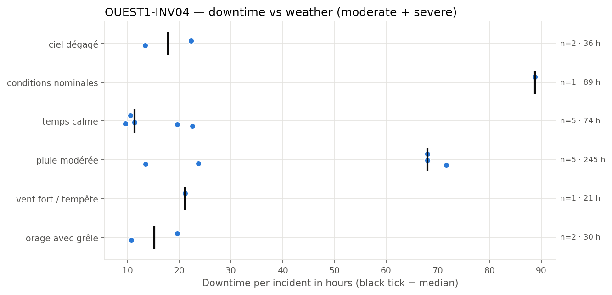
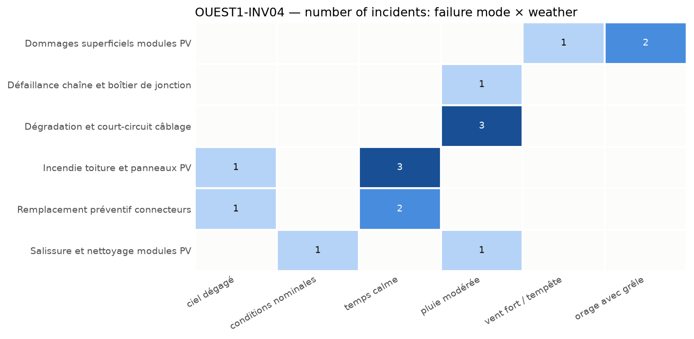

## 4. Weather exposure

### 4.1 Downtime vs weather condition

*Downtime of each incident per weather condition; the black tick is the median.*

| Weather | Incidents | Severe | Downtime (h) | Median (h) | % of downtime | Compared with site |
| --- | --- | --- | --- | --- | --- | --- |
| pluie modérée | 5 | 3 | 244.8 | 68.0 | 49.5 | over-represented vs site |
| conditions nominales | 1 | 1 | 88.8 | 88.8 | 18.0 | under-represented vs site |
| temps calme | 5 | 0 | 73.8 | 11.4 | 14.9 | over-represented vs site |
| ciel dégagé | 2 | 0 | 35.7 | 17.9 | 7.2 | in line with site |
| orage avec grêle | 2 | 0 | 30.4 | 15.2 | 6.1 | in line with site |
| vent fort / tempête | 1 | 0 | 21.1 | 21.1 | 4.3 | under-represented vs site |

The equipment loses the most hours under 'pluie modérée', accounting for 49.5% of the total downtime, and this weather condition is over-represented compared to the site. Conversely, 'conditions nominales' and 'vent fort / tempête' are under-represented in incidents relative to their occurrence on the site, with the latter being notably less frequent.

### 4.2 Failure modes vs weather condition

*Number of incidents per failure mode and weather condition.*

Failure modes such as 'Dommages superficiels modules PV' occur under 'vent fort / tempête' and 'orage avec grêle', indicating that severe weather events can cause physical damage to modules. 'Dégradation et court-circuit câblage' and 'Défaillance chaîne et boîtier de jonction' are linked to 'pluie modérée', suggesting that moisture exposure may accelerate electrical degradation. Incidents related to 'Incendie toiture et panneaux PV' and 'Remplacement préventif connecteurs' are associated with 'ciel dégagé' and 'temps calme', implying that maintenance or thermal stress during stable weather can lead to failures. Salissure and cleaning issues are linked to 'conditions nominales' and 'pluie modérée', indicating that both dry and wet conditions can contribute to soiling.
