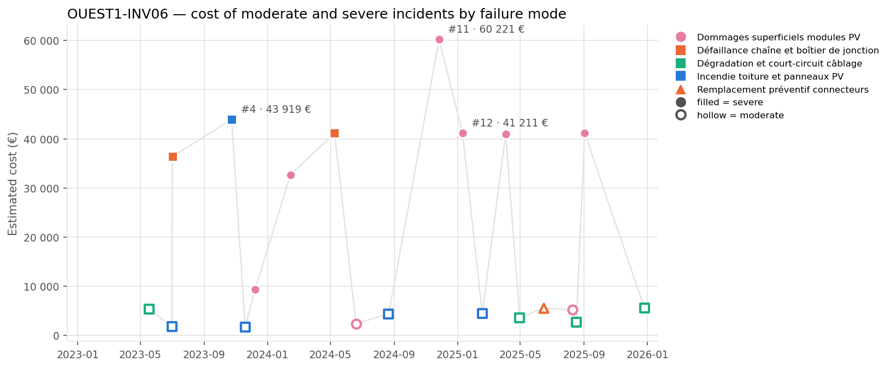
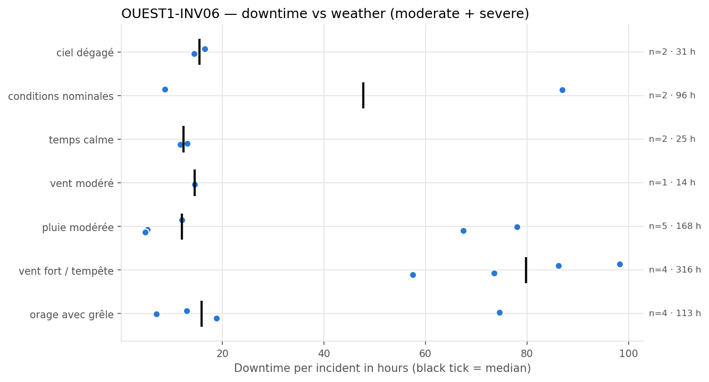
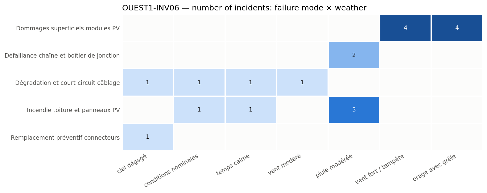

# OUEST1-INV06: PV Inverter and DC Field Failure Modes and Critical Incidents

**Equipment:** OUEST1-INV06 · **Site:** Centrale PV Ouest-1 · **Asset type:** PV inverter · **Generated on:** 2026-10-19

> The PV inverter OUEST1-INV06 at Centrale PV Ouest-1 has experienced a higher-than-median number of incidents, with 37 failures compared to 31.5 for similar equipment at the site. The most costly failure mode involves surface damages to PV modules, accounting for nearly 60% of related costs, and is associated with severe incidents. Immediate actions should focus on regular thermography inspections and electrical testing to prevent surface damages and electrical anomalies, given the equipment's critical risk level and high criticality score.

**Equipment priority: P1 · Risk level: CRITICAL** — Criticality score 99.0 (at or above the threshold of 75) against the other equipment of the site and 99.2 (at or above the threshold of 75) against the whole solar fleet.

---

## 1. Key figures

| Indicator | This equipment | Median equipment of the site | Ratio |
| --- | --- | --- | --- |
| Incidents (all severities) | 37 | 31.5 | ×1.17 |
| Severe incidents | 9 | 4.5 | ×2.0 |
| Total estimated cost (all severities) | 403 752 EUR | 212 067 EUR | ×1.9 |
| Total downtime (all severities) | 826.3 h | 473.8 h | ×1.74 |

| Moderate and severe incidents (scope of this report) | Value |
| --- | --- |
| Incidents analysed | 20 (11 moderate · 9 severe) |
| Period covered | 2023-02-25 → 2025-12-26 |
| Total estimated cost | 388 974 EUR (89.2 % from severe incidents) |
| Average cost per incident | 19 449 EUR |
| Total downtime | 762.2 h |
| Average interval between incidents | 50 days |
| Most costly failure mode | Dommages superficiels modules PV (232 939 EUR) |
| Weather with most downtime | vent fort / tempête (315.5 h) |

This equipment, OUEST1-INV06, stands out from the median equipment of its site on several indicators, including incidents of all severities, severe incidents, total cost, and downtime, with ratios of 1.17, 2.0, 1.9, and 1.74 respectively. It was selected because of its criticality score of 99.0 and 99.2, which are above the thresholds, indicating its high importance within the site and fleet. The cost is highly concentrated on severe incidents, which account for 89.2% of the total incident-related cost and nearly all of the downtime.

## 2. How this report was built

**Scope.** This report covers the maintenance incidents recorded on OUEST1-INV06 between 2023-02-25 and 2025-12-26. Each incident report was read and assigned to a *failure mode* according to its description. The detailed analysis focuses on moderate and severe incidents; minor incidents only appear in the comparison with the site. Incidents are numbered #1, #2, … in chronological order for this equipment (see the annex).

**Why this equipment.** Each piece of equipment receives a criticality score from 0 to 100 that combines four indicators: number of incidents, number of severe incidents (counted twice), total repair cost and total downtime. The score is computed twice: against the other equipment of the same site and against all solar equipment of the fleet. 50 corresponds to a typical piece of equipment, 75 or more to one clearly above the others. Equipment scoring 75 or more on both comparisons is priority **P1**, on one of them priority **P2**. Here: criticality score 99.0 (at or above the threshold of 75) against the other equipment of the site and 99.2 (at or above the threshold of 75) against the whole solar fleet → **P1**.

**Recommendation priority.** Each recommendation addresses one failure mode and inherits its priority:
- **P1** — within 1 month: the failure mode caused at least one severe incident on this equipment and either represents >= 20% of its cost or recurred within 90 days
- **P2** — within 6 months: the failure mode caused at least one severe incident or represents >= 10% of the cost
- **P3** — next yearly maintenance plan: all other failure modes

**Root-cause confidence.** The confidence of a root-cause hypothesis reflects the number of incidents supporting it: high from 5 incidents, medium from 3, low below.

**Analysis.** All figures, tables and charts are computed directly from the incident records (a *close sequence* is a series of incidents less than 30 days apart; a *recurrence* is the same failure mode coming back within 90 days). The commentary of each section was drafted with the help of an AI assistant specialised in that topic, from the figures of the section only.

*Patterns based on fewer than 3 incidents are flagged as indicative in the text.*

## 3. Cost timeline

*Estimated cost of each moderate (hollow) and severe (filled) incident. Colour = family of failure modes, marker shape = failure mode; the three most costly incidents are labelled.*

| Year | Incidents | Severe | Cost (EUR) | Cost vs previous year | Downtime (h) |
| --- | --- | --- | --- | --- | --- |
| 2023 | 6 | 3 | 98 215 |  | 208.2 |
| 2024 | 5 | 3 | 140 685 | +43.2 % | 242.3 |
| 2025 | 9 | 3 | 150 075 | +6.7 % | 311.7 |

**Trend.** The cost of incidents has been increasing from 2023 to 2025, with a total rise of 52.8%. Each year saw a rise in total costs, with 2024 showing a significant increase compared to 2023, and 2025 continuing this upward trend.

**Dominant incidents.** The most costly incident is #11, involving damages superficiels modules PV, with a cost of 60221 EUR. The failure mode that dominates the cost is damages superficiels modules PV, accounting for nearly 60% of the total cost of moderate and severe incidents.

**Sequences and recurrences.** Close sequences of incidents include #2 and #3 occurring within one day, and #4, #5, and #6 happening within 45 days. There are also multiple incidents involving damages superficiels modules PV and other failure modes occurring within a few weeks, indicating quick recurrences.

**Seasonality.** Incidents are distributed across all seasons, with winter and summer having slightly more incidents. The data suggests no strong seasonal pattern, but autumn shows a notably high total cost, flagged as indicative.

## 4. Weather exposure

### 4.1 Downtime vs weather condition

*Downtime of each incident per weather condition; the black tick is the median.*

| Weather | Incidents | Severe | Downtime (h) | Median (h) | % of downtime | Compared with site |
| --- | --- | --- | --- | --- | --- | --- |
| vent fort / tempête | 4 | 4 | 315.5 | 79.8 | 41.4 | in line with site |
| pluie modérée | 5 | 2 | 167.5 | 12.0 | 22.0 | over-represented vs site |
| orage avec grêle | 4 | 2 | 113.4 | 15.9 | 14.9 | over-represented vs site |
| conditions nominales | 2 | 1 | 95.6 | 47.8 | 12.5 | in line with site |
| ciel dégagé | 2 | 0 | 30.9 | 15.4 | 4.1 | in line with site |
| temps calme | 2 | 0 | 24.8 | 12.4 | 3.3 | under-represented vs site |
| vent modéré | 1 | 0 | 14.5 | 14.5 | 1.9 | under-represented vs site |

The equipment experiences the most downtime under 'vent fort / tempête', accounting for 41.4% of the downtime, with 4 incidents. This weather condition's incident share is in line with its site representation, indicating a proportional impact. Other weather conditions like 'pluie modérée' and 'orage avec grêle' are over-represented in incidents relative to their site share, suggesting higher vulnerability during these conditions.

### 4.2 Failure modes vs weather condition

*Number of incidents per failure mode and weather condition.*

Failure modes such as 'Dommages superficiels modules PV' occur under 'vent fort / tempête' and 'orage avec grêle', indicating these severe weather events can cause physical damage. 'Défaillance chaîne et boîtier de jonction' is linked to 'pluie modérée', implying moisture-related failures. 'Dégradation et court-circuit câblage' and 'Incendie toiture et panneaux PV' are associated with various weather conditions, including 'ciel dégagé', 'conditions nominales', 'temps calme', and 'pluie modérée', suggesting that both normal and adverse weather can contribute to electrical and thermal failures. These links imply that inspections should be prioritized after severe wind or hail events, and moisture ingress should be checked following rainy conditions.

## 5. Failure modes

| Failure mode | Priority | Incidents | Severe | Cost (EUR) | % of cost | Recurrences < 90 d | Incidents # |
| --- | --- | --- | --- | --- | --- | --- | --- |
| Dommages superficiels modules PV | P1 | 8 | 6 | 232 939 | 59.9 | 4 | #6, #7, #9, #11, #12, #14, #17, #19 |
| Défaillance chaîne et boîtier de jonction | P2 | 2 | 2 | 77 502 | 19.9 | 0 | #3, #8 |
| Incendie toiture et panneaux PV | P1 | 5 | 1 | 55 997 | 14.4 | 1 | #2, #4, #5, #10, #13 |
| Dégradation et court-circuit câblage | P3 | 4 | 0 | 17 007 | 4.4 | 0 | #1, #15, #18, #20 |
| Remplacement préventif connecteurs | P3 | 1 | 0 | 5 529 | 1.4 | 0 | #16 |

### Dommages superficiels modules PV · P1

Physical damage caused by severe weather conditions such as storm winds or hail, leading to superficial damages on the PV modules. Six severe incidents occurred, with damages costing a total of EUR 232,939. The incidents happened between December 2023 and September 2025, with four recurrences within 90 days. The damage is over-represented compared to the site, mainly under storm and hail conditions, impacting 40% of incidents and causing significant downtime.

### Défaillance chaîne et boîtier de jonction · P2

Electrical failure within the string and junction box, likely due to moisture ingress or mechanical stress, leading to loss of connection or short circuit. Two severe incidents occurred, with a total cost of EUR 77,502. Both incidents happened in 2023 and 2024, with no recurrence within 90 days. The incidents are indicative, with all under moderate rain conditions, affecting 10% of incidents and causing notable downtime.

### Incendie toiture et panneaux PV · P1

Thermal or electrical fault leading to fire, possibly initiated by arc faults or overheating, causing damage to the roof and PV panels. Five incidents, including one severe, with total costs of EUR 55,997. Incidents occurred from July 2023 to February 2025, with one recurrence within 90 days. The damage is over-represented, mainly under moderate rain and calm conditions, impacting 25% of incidents and causing considerable downtime.

### Dégradation et court-circuit câblage · P3

Degradation of cables or insulation leading to short circuits, possibly due to aging, thermal stress, or environmental factors. Four moderate incidents with a total cost of EUR 17,007, occurring from May 2023 to December 2025. No recurrences within 90 days, with incidents under various weather conditions including clear sky and calm weather, affecting 20% of incidents and causing moderate downtime.

### Remplacement préventif connecteurs · P3

Preventive replacement of connectors to avoid failure, likely due to aging or environmental stress. One moderate incident with a cost of EUR 5,529, occurring in June 2025. No recurrence within 90 days, under clear sky conditions, representing 5% of incidents and causing minimal downtime.

## 6. Root-cause hypotheses

1. **The incidents are primarily caused by physical damage to the PV modules due to severe weather conditions, especially 'vent fort / tempête' and 'orage avec grêle', which are over-represented compared to site averages.** — *confidence: high (8 supporting incidents: #6, #7, #9, #11, #12, #14, #17, #19)*  
   Failure modes: Dommages superficiels modules PV.  
   Most damage occurs under storm conditions, with a significant number of incidents linked to high wind and hail, indicating weather-induced physical damage as the main root cause.
2. **The failures of the chain and junction box are mainly triggered by moderate rain events, which can lead to water ingress and subsequent failure, supported by the weather counts and the two incidents under 'pluie modérée'.** — *confidence: low (2 supporting incidents: #3, #8)*  
   Failure modes: Défaillance chaîne et boîtier de jonction.  
   Both incidents occurred during moderate rain, and the failure mode is associated with weather conditions that promote water ingress, suggesting rain as a key factor.
3. **Some incidents, including module damage and wiring degradation, are related to seasonal and environmental factors such as temperature variations and prolonged exposure to weather, with a notable occurrence during autumn and summer.** — *confidence: medium (4 supporting incidents: #1, #15, #18, #20)*  
   Failure modes: Dommages superficiels modules PV, Dégradation et court-circuit câblage.  
   Incidents are spread across different seasons, but the higher severity and recurrence during autumn and summer suggest environmental stressors like temperature fluctuations and UV exposure contribute to equipment degradation.

## 7. Recommendations

| Priority | Action | Type | Failure mode addressed | Expected impact |
| --- | --- | --- | --- | --- |
| P1 | Implement regular thermography inspections to detect hot spots indicative of surface damages or connection issues. | monitoring | Dommages superficiels modules PV | Early detection of surface damages, potentially reducing the severity and recurrence of incidents, which account for 59.9% of the equipment cost and 4 recurrences within 90 days. |
| P1 | Perform IV-curve tracing and insulation resistance tests periodically to identify electrical anomalies and insulation degradation in the PV modules. | preventive | Dommages superficiels modules PV | Improved detection of electrical faults and surface damages, helping to prevent severe incidents and recurrence. |
| P1 | Conduct fire-risk inspections focusing on the PV modules and roof areas, especially after severe weather events like 'vent fort / tempête' and 'orage avec grêle'. | monitoring | Incendie toiture et panneaux PV | Early identification of fire hazards, aiming to prevent the severe incident and recurrence, which together account for 14.4% of the cost. |
| P1 | Inspect surge protection devices regularly to ensure proper functioning and replace faulty units. | preventive | Incendie toiture et panneaux PV | Minimize risk of fire caused by electrical faults, addressing the primary failure mode with a high priority. |
| P1 | Review environmental and seasonal factors influencing module and wiring conditions, and adapt maintenance schedules accordingly. | monitoring | Dommages superficiels modules PV | Mitigate damage caused by environmental factors, potentially reducing the high recurrence rate. |
| P2 | Establish a cleaning schedule to remove debris and dirt, especially after weather events, to prevent water ingress and electrical issues. | preventive | Défaillance chaîne et boîtier de jonction | Reduce failures triggered by moderate rain, which are supported by weather counts and two incidents. |
| P3 | Schedule routine connector torque checks and replace connectors proactively as part of preventive maintenance. | preventive | Remplacement préventif connecteurs | Reduction in connector-related failures, which have caused incidents with a low cost share of 1.4% and no recurrence. |

## 8. Conclusion

The main issue for OUEST1-INV06 is surface damages to PV modules, which account for the highest costs and recurrence. The first recommended actions include regular thermography inspections and electrical testing to detect damages early. Implementing these measures is expected to reduce failure recurrence and mitigate severe incidents, improving equipment reliability and safety.

---

### Annex — Incident register

| # | Date | Severity | Failure mode | Cost (EUR) | Downtime (h) | Weather |
| --- | --- | --- | --- | --- | --- | --- |
| #1 | 2023-05-18 | modérée | Dégradation et court-circuit câblage | 5 297 | 14.5 | vent modéré |
| #2 | 2023-07-01 | modérée | Incendie toiture et panneaux PV | 1 733 | 5.2 | pluie modérée |
| #3 | 2023-07-02 | sévère | Défaillance chaîne et boîtier de jonction | 36 364 | 78.0 | pluie modérée |
| #4 | 2023-10-24 | sévère | Incendie toiture et panneaux PV | 43 919 | 86.9 | conditions nominales |
| #5 | 2023-11-19 | modérée | Incendie toiture et panneaux PV | 1 635 | 4.8 | pluie modérée |
| #6 | 2023-12-08 | sévère | Dommages superficiels modules PV | 9 267 | 18.8 | orage avec grêle |
| #7 | 2024-02-14 | sévère | Dommages superficiels modules PV | 32 669 | 57.5 | vent fort / tempête |
| #8 | 2024-05-09 | sévère | Défaillance chaîne et boîtier de jonction | 41 138 | 67.5 | pluie modérée |
| #9 | 2024-06-19 | modérée | Dommages superficiels modules PV | 2 359 | 7.0 | orage avec grêle |
| #10 | 2024-08-21 | modérée | Incendie toiture et panneaux PV | 4 298 | 12.0 | pluie modérée |
| #11 | 2024-11-26 | sévère | Dommages superficiels modules PV | 60 221 | 98.3 | vent fort / tempête |
| #12 | 2025-01-10 | sévère | Dommages superficiels modules PV | 41 211 | 73.5 | vent fort / tempête |
| #13 | 2025-02-17 | modérée | Incendie toiture et panneaux PV | 4 412 | 13.1 | temps calme |
| #14 | 2025-04-03 | sévère | Dommages superficiels modules PV | 40 943 | 86.2 | vent fort / tempête |
| #15 | 2025-04-30 | modérée | Dégradation et court-circuit câblage | 3 540 | 11.7 | temps calme |
| #16 | 2025-06-15 | modérée | Remplacement préventif connecteurs | 5 529 | 14.4 | ciel dégagé |
| #17 | 2025-08-10 | modérée | Dommages superficiels modules PV | 5 137 | 13.0 | orage avec grêle |
| #18 | 2025-08-17 | modérée | Dégradation et court-circuit câblage | 2 669 | 8.7 | conditions nominales |
| #19 | 2025-09-02 | sévère | Dommages superficiels modules PV | 41 132 | 74.6 | orage avec grêle |
| #20 | 2025-12-26 | modérée | Dégradation et court-circuit câblage | 5 501 | 16.5 | ciel dégagé |
