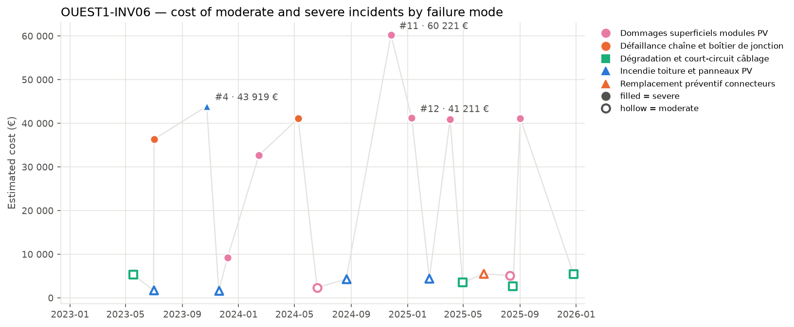

## 3. Cost timeline

*Estimated cost of each moderate (hollow) and severe (filled) incident. Colour = family of failure modes, marker shape = failure mode; the three most costly incidents are labelled.*

| Year | Incidents | Severe | Cost (EUR) | Cost vs previous year | Downtime (h) |
| --- | --- | --- | --- | --- | --- |
| 2023 | 6 | 3 | 98 215 |  | 208.2 |
| 2024 | 5 | 3 | 140 685 | +43.2 % | 242.3 |
| 2025 | 9 | 3 | 150 075 | +6.7 % | 311.7 |

**Trend.** The cost of incidents has been increasing from 2023 to 2025, with a total rise of 52.8%. Each year saw a rise in total costs, with 2024 showing a significant increase compared to 2023, and 2025 continuing this upward trend.

**Dominant incidents.** The most costly incident is #11, involving damages superficiels modules PV, with a cost of 60221 EUR. The failure mode that dominates the cost is damages superficiels modules PV, accounting for nearly 60% of the total cost of moderate and severe incidents.

**Sequences and recurrences.** Close sequences of incidents include #2 and #3 occurring within one day, and #4, #5, and #6 happening within 45 days. There are also multiple incidents involving damages superficiels modules PV and other failure modes occurring within a few weeks, indicating quick recurrences.

**Seasonality.** Incidents are distributed across all seasons, with winter and summer having slightly more incidents. The data suggests no strong seasonal pattern, but autumn shows a notably high total cost, flagged as indicative.
