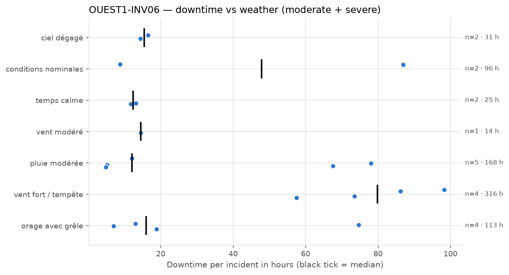
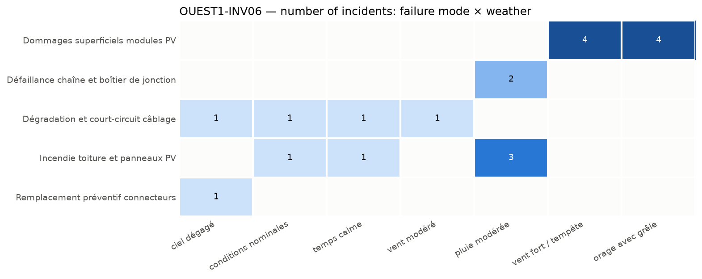

## 4. Weather exposure

### 4.1 Downtime vs weather condition

*Downtime of each incident per weather condition; the black tick is the median.*

| Weather | Incidents | Severe | Downtime (h) | Median (h) | % of downtime | Compared with site |
| --- | --- | --- | --- | --- | --- | --- |
| vent fort / tempête | 4 | 4 | 315.5 | 79.8 | 41.4 | in line with site |
| pluie modérée | 5 | 2 | 167.5 | 12.0 | 22.0 | over-represented vs site |
| orage avec grêle | 4 | 2 | 113.4 | 15.9 | 14.9 | over-represented vs site |
| conditions nominales | 2 | 1 | 95.6 | 47.8 | 12.5 | in line with site |
| ciel dégagé | 2 | 0 | 30.9 | 15.4 | 4.1 | in line with site |
| temps calme | 2 | 0 | 24.8 | 12.4 | 3.3 | under-represented vs site |
| vent modéré | 1 | 0 | 14.5 | 14.5 | 1.9 | under-represented vs site |

The equipment experiences the most downtime under 'vent fort / tempête', accounting for 41.4% of the downtime, with 4 incidents. This weather condition's incident share is in line with its site representation, indicating a proportional impact. Other weather conditions like 'pluie modérée' and 'orage avec grêle' are over-represented in incidents relative to their site share, suggesting higher vulnerability during these conditions.

### 4.2 Failure modes vs weather condition

*Number of incidents per failure mode and weather condition.*

Failure modes such as 'Dommages superficiels modules PV' occur under 'vent fort / tempête' and 'orage avec grêle', indicating these severe weather events can cause physical damage. 'Défaillance chaîne et boîtier de jonction' is linked to 'pluie modérée', implying moisture-related failures. 'Dégradation et court-circuit câblage' and 'Incendie toiture et panneaux PV' are associated with various weather conditions, including 'ciel dégagé', 'conditions nominales', 'temps calme', and 'pluie modérée', suggesting that both normal and adverse weather can contribute to electrical and thermal failures. These links imply that inspections should be prioritized after severe wind or hail events, and moisture ingress should be checked following rainy conditions.
