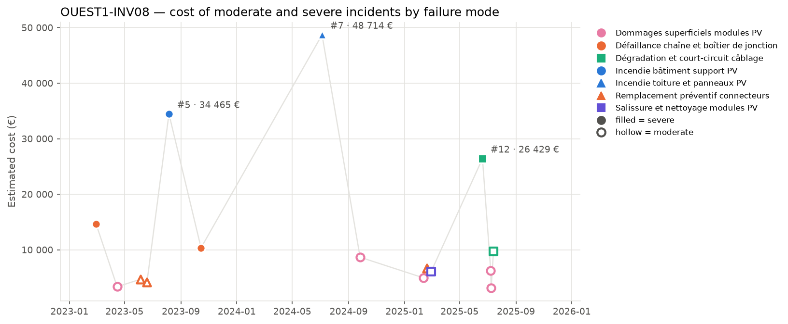
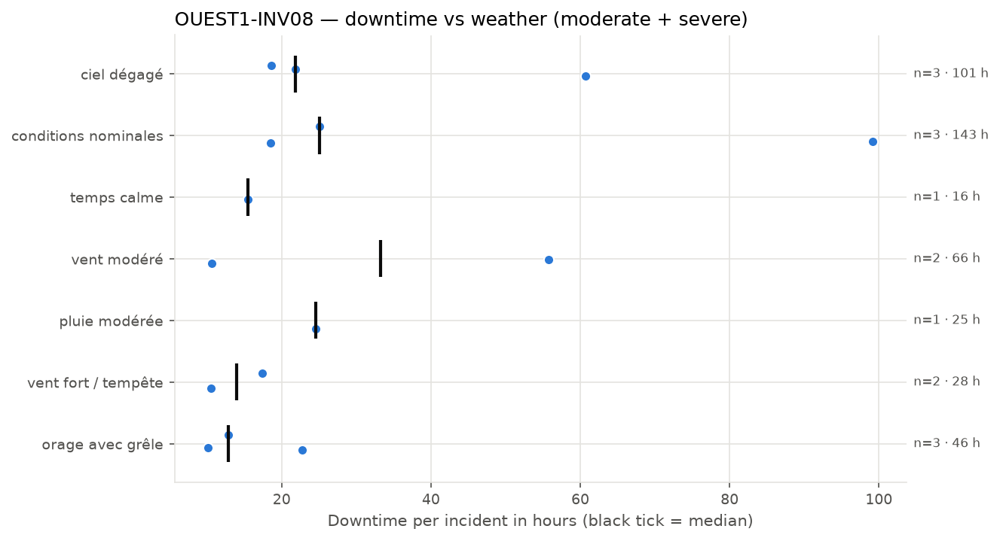
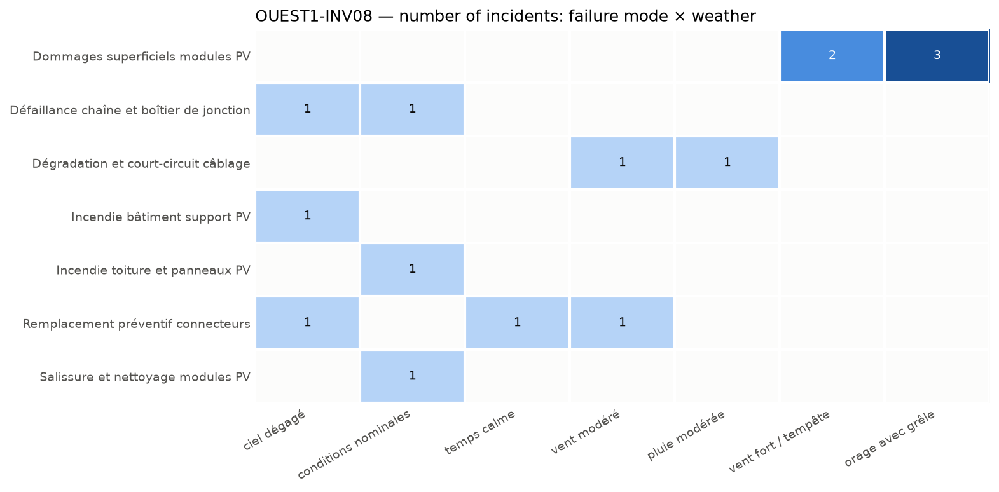

# OUEST1-INV08: Fire and Cable Short-Circuit Failures

**Equipment:** OUEST1-INV08 · **Site:** Centrale PV Ouest-1 · **Asset type:** PV inverter · **Generated on:** 2026-10-20

> The PV inverter OUEST1-INV08 and its upstream DC field are prone to fire incidents and cable short circuits, which are the most costly failure modes at this site. These failure modes account for a significant portion of the equipment's incident costs and are prioritized as P1 due to their severity and financial impact. Initial actions should focus on thermography inspections and cable testing to prevent severe incidents and reduce risks.

**Equipment priority: P2 · Risk level: HIGH** — Criticality score 59.5 (below the threshold of 75) against the other equipment of the site and 84.8 (at or above the threshold of 75) against the whole solar fleet.

---

## 1. Key figures

| Indicator | This equipment | Median equipment of the site | Ratio |
| --- | --- | --- | --- |
| Incidents (all severities) | 34 | 31.5 | ×1.08 |
| Severe incidents | 5 | 4.5 | ×1.11 |
| Total estimated cost (all severities) | 206 576 EUR | 212 067 EUR | ×0.97 |
| Total downtime (all severities) | 486.6 h | 473.8 h | ×1.03 |

| Moderate and severe incidents (scope of this report) | Value |
| --- | --- |
| Incidents analysed | 15 (10 moderate · 5 severe) |
| Period covered | 2023-02-09 → 2025-09-23 |
| Total estimated cost | 192 356 EUR (70.0 % from severe incidents) |
| Average cost per incident | 12 824 EUR |
| Total downtime | 424.0 h |
| Average interval between incidents | 62 days |
| Most costly failure mode | Incendie toiture et panneaux PV (48 714 EUR) |
| Weather with most downtime | conditions nominales (142.8 h) |

This equipment has a slightly higher number of incidents compared to the site median, with a ratio of 1.08, and a higher count of severe incidents, with a ratio of 1.11, indicating it is somewhat more prone to issues of higher severity. Its incident cost and downtime are in line with the site median, with ratios of 0.97 and 1.03 respectively. It was selected due to its criticality score of 59.5, which is below the threshold of 75, but still notable within the site and fleet context, emphasizing its importance despite a moderate criticality score. The majority of the incident cost (70%) stems from severe incidents, highlighting a concentration of costs on more serious failures.

## 2. How this report was built

**Scope.** This report covers the maintenance incidents recorded on OUEST1-INV08 between 2023-02-09 and 2025-09-23. Each incident report was read and assigned to a *failure mode* according to its description. The detailed analysis focuses on moderate and severe incidents; minor incidents only appear in the comparison with the site. Incidents are numbered #1, #2, … in chronological order for this equipment (see the annex).

**Why this equipment.** Each piece of equipment receives a criticality score from 0 to 100 that combines four indicators: number of incidents, number of severe incidents (counted twice), total repair cost and total downtime. The score is computed twice: against the other equipment of the same site and against all solar equipment of the fleet. 50 corresponds to a typical piece of equipment, 75 or more to one clearly above the others. Equipment scoring 75 or more on both comparisons is priority **P1**, on one of them priority **P2**. Here: criticality score 59.5 (below the threshold of 75) against the other equipment of the site and 84.8 (at or above the threshold of 75) against the whole solar fleet → **P2**.

**Recommendation priority.** Each recommendation addresses one failure mode and inherits its priority:
- **P1** — within 1 month: the failure mode caused at least one severe incident on this equipment and either represents >= 20% of its cost or recurred within 90 days
- **P2** — within 6 months: the failure mode caused at least one severe incident or represents >= 10% of the cost
- **P3** — next yearly maintenance plan: all other failure modes

**Root-cause confidence.** The confidence of a root-cause hypothesis reflects the number of incidents supporting it: high from 5 incidents, medium from 3, low below.

**Analysis.** All figures, tables and charts are computed directly from the incident records (a *close sequence* is a series of incidents less than 30 days apart; a *recurrence* is the same failure mode coming back within 90 days). The commentary of each section was drafted with the help of an AI assistant specialised in that topic, from the figures of the section only.

*Patterns based on fewer than 3 incidents are flagged as indicative in the text.*

## 3. Cost timeline

*Estimated cost of each moderate (hollow) and severe (filled) incident. Colour = family of failure modes, marker shape = failure mode, grey cross = unclassified; the three most costly incidents are labelled.*

| Year | Incidents | Severe | Cost (EUR) | Cost vs previous year | Downtime (h) |
| --- | --- | --- | --- | --- | --- |
| 2023 | 6 | 3 | 71 689 |  | 144.2 |
| 2024 | 2 | 1 | 57 385 | -20.0 % | 121.9 |
| 2025 | 7 | 1 | 63 281 | +10.3 % | 157.9 |

**Trend.** The incident count and costs fluctuated over the years, with 2023 having the highest number of incidents and costs. 2024 saw a decrease in both, but 2025 experienced an increase again, resulting in an overall slight decrease in total cost from 2023 to 2025, indicating a stable trend.

**Dominant incidents.** The most costly incident is #7, an Incendie toiture et panneaux PV, with a cost of 48714 EUR, followed by incident #5, Incendie bâtiment support PV, costing 34465 EUR. The failure modes associated with these incidents are incendies and degradation or damage to the building or panels.

**Sequences and recurrences.** Close sequences of incidents include #3 and #4 involving replacement of connectors within 14 days, and #9, #10, and #11 involving damages and replacements within 17 days. The incident #14 and #15 also occurred within 24 days, involving damages and degradation of cables and modules.

**Seasonality.** Summer shows the highest number of incidents and costs, with 8 incidents and 137565 EUR, indicating a seasonal pattern with more failures during warmer months. Winter has fewer incidents, with 4 incidents and 32401 EUR, but still notable.

## 4. Weather exposure

### 4.1 Downtime vs weather condition

*Downtime of each incident per weather condition; the black tick is the median.*

| Weather | Incidents | Severe | Downtime (h) | Median (h) | % of downtime | Compared with site |
| --- | --- | --- | --- | --- | --- | --- |
| conditions nominales | 3 | 2 | 142.8 | 25.1 | 33.7 | over-represented vs site |
| ciel dégagé | 3 | 2 | 101.1 | 21.8 | 23.8 | over-represented vs site |
| vent modéré | 2 | 1 | 66.4 | 33.2 | 15.7 | over-represented vs site |
| orage avec grêle | 3 | 0 | 45.7 | 12.9 | 10.8 | over-represented vs site |
| vent fort / tempête | 2 | 0 | 27.9 | 13.9 | 6.6 | in line with site |
| pluie modérée | 1 | 0 | 24.6 | 24.6 | 5.8 | under-represented vs site |
| temps calme | 1 | 0 | 15.5 | 15.5 | 3.7 | under-represented vs site |

The equipment loses the most hours under 'conditions nominales', accounting for 33.7% of the downtime and being over-represented compared with the rest of the site. 'Ciel dégagé' also shows significant downtime and is similarly over-represented. These conditions are more likely to be associated with incidents, indicating that inspections and maintenance might be particularly important after periods of clear or nominal weather.

### 4.2 Failure modes vs weather condition

*Number of incidents per failure mode and weather condition.*

Failure modes such as 'Dommages superficiels modules PV' occur under 'vent fort / tempête' and 'orage avec grêle', suggesting that severe wind and hail events can cause superficial damage. 'Dégradation et court-circuit câblage' occurs under 'vent modéré' and 'pluie modérée', indicating that moderate wind and rain may contribute to wiring issues. 'Incendie bâtiment support PV' and 'Incendie toiture et panneaux PV' are linked to 'ciel dégagé' and 'conditions nominales', implying that fire incidents may not be directly related to severe weather but could be associated with normal operational conditions or maintenance activities.

## 5. Failure modes

| Failure mode | Priority | Incidents | Severe | Cost (EUR) | % of cost | Recurrences < 90 d | Incidents # |
| --- | --- | --- | --- | --- | --- | --- | --- |
| Incendie toiture et panneaux PV | P1 | 1 | 1 | 48 714 | 25.3 | 0 | #7 |
| Dégradation et court-circuit câblage | P1 | 2 | 1 | 36 150 | 18.8 | 1 | #12, #15 |
| Incendie bâtiment support PV | P2 | 1 | 1 | 34 465 | 17.9 | 0 | #5 |
| Dommages superficiels modules PV | P2 | 5 | 0 | 26 364 | 13.7 | 1 | #2, #8, #9, #13, #14 |
| Défaillance chaîne et boîtier de jonction | P2 | 2 | 2 | 25 010 | 13.0 | 0 | #1, #6 |
| Remplacement préventif connecteurs | P3 | 3 | 0 | 15 573 | 8.1 | 1 | #3, #4, #10 |
| Salissure et nettoyage modules PV | P3 | 1 | 0 | 6 080 | 3.2 | 0 | #11 |

### Incendie toiture et panneaux PV · P1

Likely caused by thermal or electrical faults leading to ignition of materials, possibly due to overheating or arc faults. One severe incident on 2024-07-05 resulted in a cost of EUR 48714 and 99.2 hours of downtime. The incident is indicative, with weather conditions nominales, and the failure is under-represented compared to site incidents.

### Dégradation et court-circuit câblage · P1

Corrosion, insulation deterioration, or mechanical damage causing short circuits and degradation in wiring. Two incidents, one severe on 2025-06-20 and one moderate on 2025-07-14, with a total cost of EUR 36150 and 80.4 hours of downtime. The first incident was under moderate weather conditions, with a recurrence within 90 days.

### Incendie bâtiment support PV · P2

Electrical faults or overheating in the support structure leading to fire, possibly due to insulation failure or component malfunction. One severe incident on 2023-08-06 caused EUR 34465 in damages and 60.7 hours of downtime. Weather was clear, and the incident is in line with site data.

### Dommages superficiels modules PV · P2

Impact from hail, wind-driven debris, or mechanical stress causing superficial damage to PV modules. Five incidents with no severe cases, total EUR 26364, and 73.6 hours of downtime. The dominant weather was hail or storm conditions, with some incidents occurring under stormy weather.

### Défaillance chaîne et boîtier de jonction · P2

Electrical failure or corrosion within junction boxes and string components, possibly exacerbated by environmental exposure. Two severe incidents, one on 2023-02-28 and another on 2023-10-15, totaling EUR 25010 and 46.9 hours of downtime. Weather was nominal or clear, with incidents over a long period.

### Remplacement préventif connecteurs · P3

Degradation or wear of connectors over time, leading to increased resistance or failure, mitigated by preventive replacement. Three incidents, all moderate, with total EUR 15573 and 44.7 hours of downtime. Weather conditions varied, including clear, calm, and moderate wind.

### Salissure et nettoyage modules PV · P3

Accumulation of dirt, dust, or debris reducing module efficiency, addressed by cleaning. One moderate incident on 2025-02-28, EUR 6080 in cost, and 18.5 hours of downtime, under nominal weather conditions.

## 6. Root-cause hypotheses

1. **The incidents of this equipment are primarily caused by weather-related stresses, especially during summer, leading to damages such as superficial module damage and cable degradation.** — *confidence: high (6 supporting incidents: #8, #9, #12, #13, #14, #15)*  
   Failure modes: Dommages superficiels modules PV, Dégradation et court-circuit câblage.  
   Most incidents occurred during summer with weather conditions like storm and hail, which are known to cause superficial damages and cable issues. The recurrence of these failure modes under such weather supports this hypothesis.
2. **Electrical connection issues, including connector failures and junction box faults, are a significant root cause, often triggered or exacerbated by environmental factors such as wind and temperature variations.** — *confidence: high (5 supporting incidents: #1, #3, #4, #6, #10)*  
   Failure modes: Remplacement préventif connecteurs, Défaillance chaîne et boîtier de jonction.  
   Multiple incidents involving connectors and junction boxes occurred under various weather conditions, with some close sequences suggesting environmental factors like wind may influence connection integrity.
3. **Certain incidents, such as the fire in the building support PV, are caused by internal faults or material failures unrelated to weather, possibly due to aging or manufacturing defects.** — *confidence: low (1 supporting incident: #5)*  
   Failure modes: Incendie bâtiment support PV.  
   This severe incident occurred under clear sky conditions and is isolated, indicating a likely internal fault rather than weather influence.
4. **Maintenance activities, such as cleaning modules or preventive connector replacements, contribute to incident occurrence, especially when performed under favorable weather conditions.** — *confidence: medium (3 supporting incidents: #3, #4, #11)*  
   Failure modes: Salissure et nettoyage modules PV, Remplacement préventif connecteurs.  
   Incidents related to cleaning and connector replacement occurred during calm or clear weather, suggesting maintenance activities can be a contributing factor.
5. **The overall failure pattern indicates that severe weather events, particularly hail and storms, are associated with superficial module damages, but other failure modes are more influenced by environmental conditions like wind and temperature.** — *confidence: medium (4 supporting incidents: #8, #9, #13, #14)*  
   Failure modes: Dommages superficiels modules PV.  
   Most superficial damages occurred during storm and hail conditions, supporting the link between severe weather and physical damage to modules.

## 7. Recommendations

| Priority | Action | Type | Failure mode addressed | Expected impact |
| --- | --- | --- | --- | --- |
| P1 | Perform thermography inspections to identify hot spots and potential thermal faults in the inverter and DC field. | monitoring | Incendie toiture et panneaux PV | Early detection of thermal anomalies can prevent fire incidents and reduce the associated 25.3% of equipment cost. |
| P1 | Conduct IV-curve tracing and insulation resistance tests on the DC cables to detect degradation or short circuits. | preventive | Dégradation et court-circuit câblage | Identifying cable issues can prevent recurrence and mitigate the 18.8% cost share of this failure mode. |
| P2 | Inspect surge protection devices for proper operation and signs of damage, especially after storm events. | monitoring | Défaillance chaîne et boîtier de jonction | Ensuring surge protection integrity can prevent damage to junction boxes and reduce severe incidents. |
| P2 | Perform fire-risk inspections focusing on internal faults and material aging in the PV building support structure. | monitoring | Incendie bâtiment support PV | Proactive fire risk management can prevent severe incidents and associated costs. |
| P3 | Schedule regular torque checks on connectors to ensure proper tightening and prevent connection issues. | preventive | Remplacement préventif connecteurs | Proper torque maintenance can reduce connector failures and the 8.1% cost share associated with this failure mode. |
| P3 | Implement a cleaning schedule for modules to minimize dirt accumulation and maintain optimal performance. | preventive | Salissure et nettoyage modules PV | Regular cleaning can prevent performance degradation and avoid incidents related to dirt buildup. |

## 8. Conclusion

The main issue with OUEST1-INV08 involves fire risks and cable degradation, which have caused significant incidents and costs. The first recommended actions are thermography inspections and cable testing to detect thermal faults and electrical degradation. Implementing these measures is expected to reduce the risk of severe incidents, including fires, and improve overall equipment reliability.

---

### Annex — Incident register

| # | Date | Severity | Failure mode | Cost (EUR) | Downtime (h) | Weather |
| --- | --- | --- | --- | --- | --- | --- |
| #1 | 2023-02-28 | sévère | Défaillance chaîne et boîtier de jonction | 14 647 | 25.1 | conditions nominales |
| #2 | 2023-04-15 | modérée | Dommages superficiels modules PV | 3 355 | 10.5 | vent fort / tempête |
| #3 | 2023-06-05 | modérée | Remplacement préventif connecteurs | 4 703 | 15.5 | temps calme |
| #4 | 2023-06-19 | modérée | Remplacement préventif connecteurs | 4 156 | 10.6 | vent modéré |
| #5 | 2023-08-06 | sévère | Incendie bâtiment support PV | 34 465 | 60.7 | ciel dégagé |
| #6 | 2023-10-15 | sévère | Défaillance chaîne et boîtier de jonction | 10 363 | 21.8 | ciel dégagé |
| #7 | 2024-07-05 | sévère | Incendie toiture et panneaux PV | 48 714 | 99.2 | conditions nominales |
| #8 | 2024-09-26 | modérée | Dommages superficiels modules PV | 8 671 | 22.7 | orage avec grêle |
| #9 | 2025-02-11 | modérée | Dommages superficiels modules PV | 4 961 | 12.9 | orage avec grêle |
| #10 | 2025-02-19 | modérée | Remplacement préventif connecteurs | 6 713 | 18.6 | ciel dégagé |
| #11 | 2025-02-28 | modérée | Salissure et nettoyage modules PV | 6 080 | 18.5 | conditions nominales |
| #12 | 2025-06-20 | sévère | Dégradation et court-circuit câblage | 26 429 | 55.8 | vent modéré |
| #13 | 2025-07-08 | modérée | Dommages superficiels modules PV | 6 266 | 17.4 | vent fort / tempête |
| #14 | 2025-07-09 | modérée | Dommages superficiels modules PV | 3 110 | 10.1 | orage avec grêle |
| #15 | 2025-07-14 | modérée | Dégradation et court-circuit câblage | 9 721 | 24.6 | pluie modérée |
