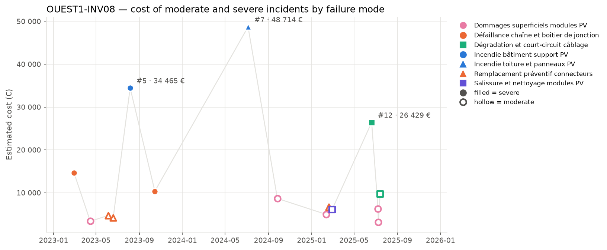

## 3. Cost timeline

*Estimated cost of each moderate (hollow) and severe (filled) incident. Colour = family of failure modes, marker shape = failure mode; the three most costly incidents are labelled.*

| Year | Incidents | Severe | Cost (EUR) | Cost vs previous year | Downtime (h) |
| --- | --- | --- | --- | --- | --- |
| 2023 | 6 | 3 | 71 689 |  | 144.2 |
| 2024 | 2 | 1 | 57 385 | -20.0 % | 121.9 |
| 2025 | 7 | 1 | 63 281 | +10.3 % | 157.9 |

**Trend.** The incident count and costs fluctuated over the years, with 2023 having the highest number of incidents and costs. 2024 saw a decrease in both, but 2025 experienced an increase again, resulting in an overall slight decrease in total cost from 2023 to 2025, indicating a stable trend.

**Dominant incidents.** The most costly incident is #7, an Incendie toiture et panneaux PV, with a cost of 48714 EUR, followed by incident #5, Incendie bâtiment support PV, costing 34465 EUR. The failure modes associated with these incidents are incendies and degradation or damage to the building or panels.

**Sequences and recurrences.** Close sequences of incidents include #3 and #4 involving replacement of connectors within 14 days, and #9, #10, and #11 involving damages and replacements within 17 days. The incident #14 and #15 also occurred within 24 days, involving damages and degradation of cables and modules.

**Seasonality.** Summer shows the highest number of incidents and costs, with 8 incidents and 137565 EUR, indicating a seasonal pattern with more failures during warmer months. Winter has fewer incidents, with 4 incidents and 32401 EUR, but still notable.
