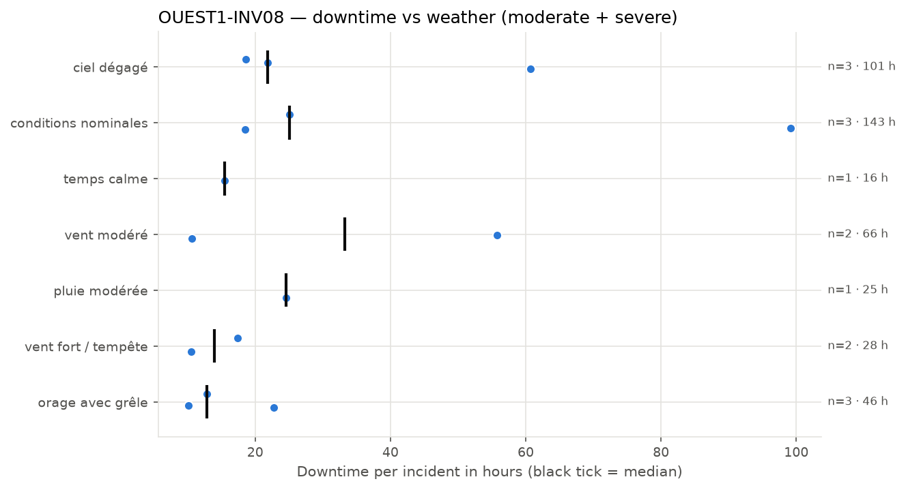
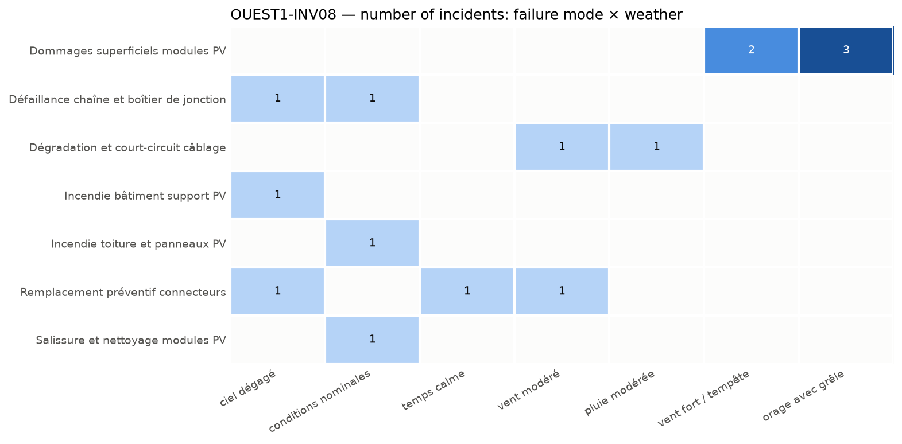

## 4. Weather exposure

### 4.1 Downtime vs weather condition

*Downtime of each incident per weather condition; the black tick is the median.*

| Weather | Incidents | Severe | Downtime (h) | Median (h) | % of downtime | Compared with site |
| --- | --- | --- | --- | --- | --- | --- |
| conditions nominales | 3 | 2 | 142.8 | 25.1 | 33.7 | over-represented vs site |
| ciel dégagé | 3 | 2 | 101.1 | 21.8 | 23.8 | over-represented vs site |
| vent modéré | 2 | 1 | 66.4 | 33.2 | 15.7 | over-represented vs site |
| orage avec grêle | 3 | 0 | 45.7 | 12.9 | 10.8 | over-represented vs site |
| vent fort / tempête | 2 | 0 | 27.9 | 13.9 | 6.6 | in line with site |
| pluie modérée | 1 | 0 | 24.6 | 24.6 | 5.8 | under-represented vs site |
| temps calme | 1 | 0 | 15.5 | 15.5 | 3.7 | under-represented vs site |

The equipment loses the most hours under 'conditions nominales', accounting for 33.7% of the downtime and being over-represented compared with the rest of the site. 'Ciel dégagé' also shows significant downtime and is similarly over-represented. These conditions are more likely to be associated with incidents, indicating that inspections and maintenance might be particularly important after periods of clear or nominal weather.

### 4.2 Failure modes vs weather condition

*Number of incidents per failure mode and weather condition.*

Failure modes such as 'Dommages superficiels modules PV' occur under 'vent fort / tempête' and 'orage avec grêle', suggesting that severe wind and hail events can cause superficial damage. 'Dégradation et court-circuit câblage' occurs under 'vent modéré' and 'pluie modérée', indicating that moderate wind and rain may contribute to wiring issues. 'Incendie bâtiment support PV' and 'Incendie toiture et panneaux PV' are linked to 'ciel dégagé' and 'conditions nominales', implying that fire incidents may not be directly related to severe weather but could be associated with normal operational conditions or maintenance activities.
