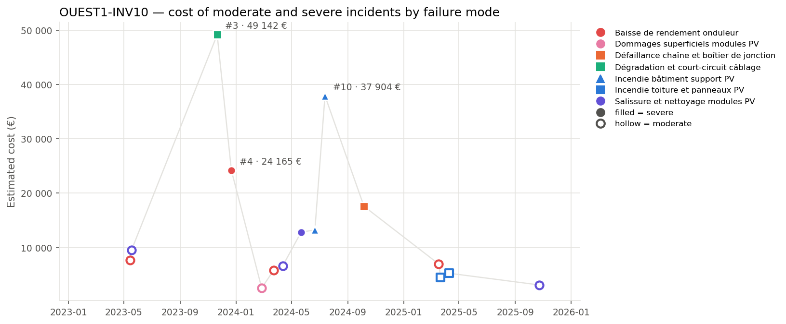
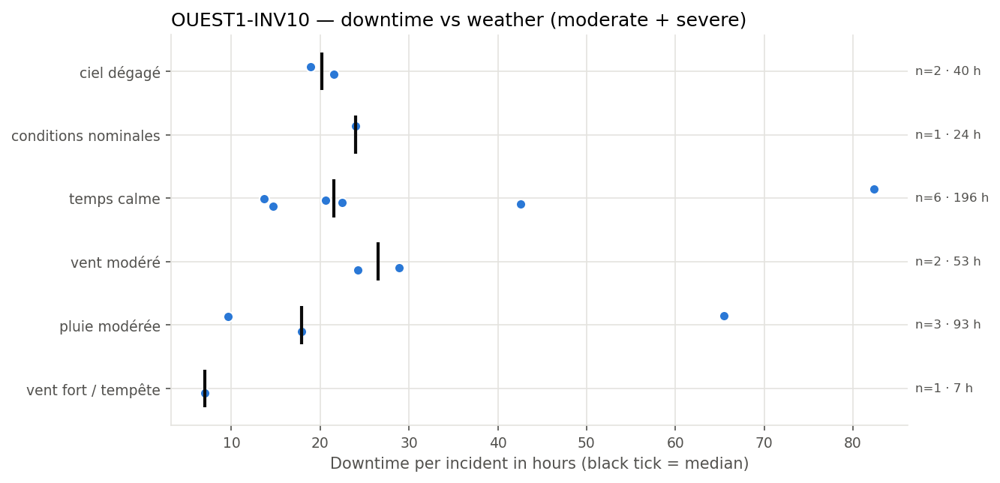
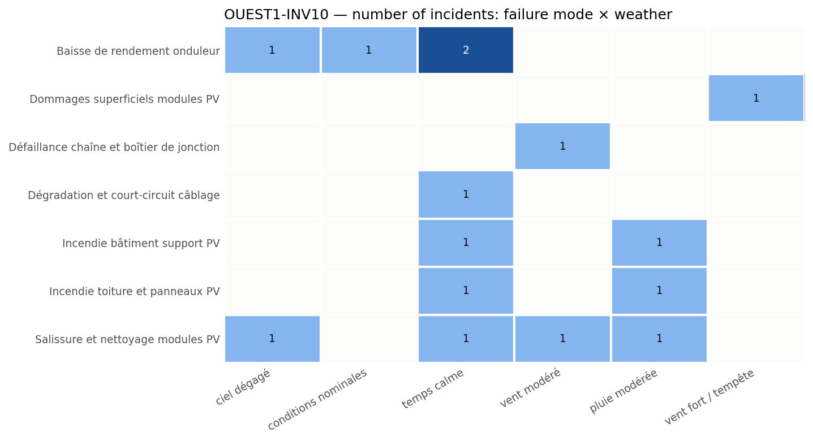

# OUEST1-INV10 Inverter and DC Field Failure Modes and Incidents

**Equipment:** OUEST1-INV10 · **Site:** Centrale PV Ouest-1 · **Asset type:** PV inverter · **Generated on:** 2026-10-19

> The PV inverter and the upstream DC field at OUEST1-INV10 have experienced multiple incidents, with severe failures including wiring degradation and building support fires. The total cost of moderate and severe incidents is over 206,762 EUR, with the most costly incident at 49,142 EUR. Given the equipment's high risk level and criticality, initial actions should focus on thermography inspections, testing the DC field, and upgrading surge protection devices.

**Equipment priority: P2 · Risk level: HIGH** — Criticality score 64.3 (below the threshold of 75) against the other equipment of the site and 86.2 (at or above the threshold of 75) against the whole solar fleet.

---

## 1. Key figures

| Indicator | This equipment | Median equipment of the site | Ratio |
| --- | --- | --- | --- |
| Incidents (all severities) | 29 | 31.5 | ×0.92 |
| Severe incidents | 6 | 4.5 | ×1.33 |
| Total estimated cost (all severities) | 217 557 EUR | 212 067 EUR | ×1.03 |
| Total downtime (all severities) | 460.9 h | 473.8 h | ×0.97 |

| Moderate and severe incidents (scope of this report) | Value |
| --- | --- |
| Incidents analysed | 15 (9 moderate · 6 severe) |
| Period covered | 2023-02-19 → 2025-12-30 |
| Total estimated cost | 206 762 EUR (74.9 % from severe incidents) |
| Average cost per incident | 13 784 EUR |
| Total downtime | 414.0 h |
| Average interval between incidents | 64 days |
| Most costly failure mode | Incendie bâtiment support PV (51 131 EUR) |
| Weather with most downtime | temps calme (196.5 h) |

This equipment has a slightly lower number of incidents compared to the site median, with a ratio of 0.92, indicating it is in line with other equipment. However, it exhibits a higher ratio of severe incidents at 1.33, meaning it experiences more severe failures than most equipment at the site. Its cost and downtime are also in line with the median, with ratios close to 1.0. It was selected because its criticality score of 64.3 is below the threshold of 75 within the site but at or above 75 compared to the entire fleet, highlighting its importance. The high risk level and P2 priority emphasize the need for close monitoring. Most of the incident cost (74.9%) is concentrated on severe incidents, indicating a significant impact from the most serious failures.

## 2. How this report was built

**Scope.** This report covers the maintenance incidents recorded on OUEST1-INV10 between 2023-02-19 and 2025-12-30. Each incident report was read and assigned to a *failure mode* according to its description. The detailed analysis focuses on moderate and severe incidents; minor incidents only appear in the comparison with the site. Incidents are numbered #1, #2, … in chronological order for this equipment (see the annex).

**Why this equipment.** Each piece of equipment receives a criticality score from 0 to 100 that combines four indicators: number of incidents, number of severe incidents (counted twice), total repair cost and total downtime. The score is computed twice: against the other equipment of the same site and against all solar equipment of the fleet. 50 corresponds to a typical piece of equipment, 75 or more to one clearly above the others. Equipment scoring 75 or more on both comparisons is priority **P1**, on one of them priority **P2**. Here: criticality score 64.3 (below the threshold of 75) against the other equipment of the site and 86.2 (at or above the threshold of 75) against the whole solar fleet → **P2**.

**Recommendation priority.** Each recommendation addresses one failure mode and inherits its priority:
- **P1** — within 1 month: the failure mode caused at least one severe incident on this equipment and either represents >= 20% of its cost or recurred within 90 days
- **P2** — within 6 months: the failure mode caused at least one severe incident or represents >= 10% of the cost
- **P3** — next yearly maintenance plan: all other failure modes

**Root-cause confidence.** The confidence of a root-cause hypothesis reflects the number of incidents supporting it: high from 5 incidents, medium from 3, low below.

**Analysis.** All figures, tables and charts are computed directly from the incident records (a *close sequence* is a series of incidents less than 30 days apart; a *recurrence* is the same failure mode coming back within 90 days). The commentary of each section was drafted with the help of an AI assistant specialised in that topic, from the figures of the section only.

*Patterns based on fewer than 3 incidents are flagged as indicative in the text.*

## 3. Cost timeline

*Estimated cost of each moderate (hollow) and severe (filled) incident. Colour = family of failure modes, marker shape = failure mode; the three most costly incidents are labelled.*

| Year | Incidents | Severe | Cost (EUR) | Cost vs previous year | Downtime (h) |
| --- | --- | --- | --- | --- | --- |
| 2023 | 4 | 2 | 90 452 |  | 173.2 |
| 2024 | 7 | 4 | 96 489 | +6.7 % | 180.7 |
| 2025 | 4 | 0 | 19 821 | -79.5 % | 60.1 |

**Trend.** The overall cost of incidents has decreased significantly from 2023 to 2025, with a notable drop of over three-quarters in total costs. Incident frequency increased slightly in 2024 compared to 2023 but then declined in 2025, reflecting a downward trend in costs despite some fluctuations.

**Dominant incidents.** The most costly incident was #3, involving degradation and short-circuiting of wiring, accounting for nearly a quarter of the total incident costs. The failure mode that dominates costs is incendie bâtiment support PV, with two incidents totaling over a quarter of the overall costs.

**Sequences and recurrences.** Close sequences of incidents occurred within days of each other, such as #1 and #2 in May 2023, and multiple incidents involving the same failure modes like 'Baisse de rendement onduleur' and 'Salissure et nettoyage modules PV' occurring within weeks in early 2024. The recurrence of the same failure modes within short periods indicates potential recurring issues.

**Seasonality.** Incidents occurred across all seasons, with spring and autumn showing higher incident counts and costs. Winter and summer had fewer incidents, but the sample size is indicative only, as fewer than three incidents were recorded in those seasons.

## 4. Weather exposure

### 4.1 Downtime vs weather condition

*Downtime of each incident per weather condition; the black tick is the median.*

| Weather | Incidents | Severe | Downtime (h) | Median (h) | % of downtime | Compared with site |
| --- | --- | --- | --- | --- | --- | --- |
| temps calme | 6 | 3 | 196.5 | 21.6 | 47.5 | over-represented vs site |
| pluie modérée | 3 | 1 | 93.0 | 17.9 | 22.5 | in line with site |
| vent modéré | 2 | 1 | 53.1 | 26.5 | 12.8 | over-represented vs site |
| ciel dégagé | 2 | 1 | 40.4 | 20.2 | 9.8 | in line with site |
| conditions nominales | 1 | 0 | 24.0 | 24.0 | 5.8 | under-represented vs site |
| vent fort / tempête | 1 | 0 | 7.0 | 7.0 | 1.7 | under-represented vs site |

The equipment experiences the most downtime under 'temps calme', accounting for 47.5% of the total downtime, which is over-represented compared to its share on the whole site (17.4%). This indicates that most failures and associated downtime tend to occur during calm weather conditions, possibly due to the nature of failure modes active in these conditions.

### 4.2 Failure modes vs weather condition

*Number of incidents per failure mode and weather condition.*

Failure modes such as 'Baisse de rendement onduleur' occur under 'ciel dégagé', 'conditions nominales', and 'temps calme', suggesting they are not weather-dependent. 'Dommages superficiels modules PV' occur under 'vent fort / tempête', indicating a link with high wind events. 'Défaillance chaîne et boîtier de jonction' is associated with 'vent modéré', and 'Salissure et nettoyage modules PV' appears under multiple conditions including 'ciel dégagé', 'temps calme', 'vent modéré', and 'pluie modérée', implying these failure modes may be influenced by weather conditions that affect dirt accumulation or mechanical stress. These links imply that inspections after specific weather events, such as storms or high winds, could be beneficial for early detection of certain failure modes.

## 5. Failure modes

| Failure mode | Priority | Incidents | Severe | Cost (EUR) | % of cost | Recurrences < 90 d | Incidents # |
| --- | --- | --- | --- | --- | --- | --- | --- |
| Incendie bâtiment support PV | P1 | 2 | 2 | 51 131 | 24.7 | 1 | #9, #10 |
| Dégradation et court-circuit câblage | P1 | 1 | 1 | 49 142 | 23.8 | 0 | #3 |
| Baisse de rendement onduleur | P1 | 4 | 1 | 44 568 | 21.6 | 0 | #1, #4, #6, #12 |
| Salissure et nettoyage modules PV | P1 | 4 | 1 | 32 044 | 15.5 | 1 | #2, #7, #8, #15 |
| Défaillance chaîne et boîtier de jonction | P2 | 1 | 1 | 17 578 | 8.5 | 0 | #11 |
| Incendie toiture et panneaux PV | P3 | 2 | 0 | 9 760 | 4.7 | 1 | #13, #14 |
| Dommages superficiels modules PV | P3 | 1 | 0 | 2 540 | 1.2 | 0 | #5 |

### Incendie bâtiment support PV · P1

The physical mechanism likely involves thermal or electrical faults leading to combustion of support structures, possibly exacerbated by weather conditions such as rain or calm weather. Two severe incidents occurred on 2024-06-21 and 2024-07-13, with costs of EUR 13226 and EUR 37904 respectively. The incidents resulted in a total downtime of 88 hours and are indicative of a high-risk failure mode, over-represented compared to the site. The first incident was during calm weather, and the second during moderate rain.

### Dégradation et court-circuit câblage · P1

The failure mechanism involves deterioration of cable insulation or connections, leading to short circuits, possibly accelerated by environmental factors such as temperature fluctuations or moisture ingress. A single severe incident on 2023-11-21 caused EUR 49142 in damages and 82.4 hours of downtime. This failure mode is under-represented at the site but indicates a critical electrical fault.

### Baisse de rendement onduleur · P1

The cause is likely internal component degradation or thermal stress within the inverter, reducing its efficiency and power output. Four incidents, including one severe, occurred between 2023-05-15 and 2025-03-18, with a total cost of EUR 44568 and 100.2 hours of downtime. The incidents are mostly during calm weather conditions, and this failure mode is over-represented versus the site.

### Salissure et nettoyage modules PV · P1

Accumulation of dirt, dust, or other debris on the module surfaces reduces light absorption, leading to decreased performance. Four incidents, including one severe, occurred from 2023-05-18 to 2025-10-23, costing EUR 32044 and causing 75.9 hours of downtime. Incidents are spread across various weather conditions, with some during calm weather.

### Défaillance chaîne et boîtier de jonction · P2

Electrical failure in the junction chain or box, possibly due to moisture ingress, corrosion, or connection failure. One severe incident on 2024-10-06 caused EUR 17578 in damages and 28.9 hours of downtime. This failure mode is in line with the site’s incident distribution and is associated with moderate wind conditions.

### Incendie toiture et panneaux PV · P3

Potential electrical faults or thermal issues causing ignition of roof materials or panels, possibly triggered by weather conditions like calm or rain. Two incidents occurred between 2025-03-22 and 2025-04-10, with costs of EUR 4506 and EUR 5254. No severe incidents have been reported, and the total downtime is 31.6 hours.

### Dommages superficiels modules PV · P3

Physical damage such as impact from wind or debris, or storm-related stress causing superficial damage to the module surfaces. One incident on 2024-02-26 caused EUR 2540 in damages and 7 hours of downtime. It is under-represented compared to the site and occurred during storm conditions.

## 6. Root-cause hypotheses

1. **The incidents are primarily caused by weather-related stress, especially under 'temps calme' and 'pluie modérée', leading to thermal or moisture-related failures.** — *confidence: medium (4 supporting incidents: #2, #8, #9, #10)*  
   Failure modes: Incendie bâtiment support PV, Salissure et nettoyage modules PV.  
   Most incidents occurred under calm weather conditions, which may contribute to thermal buildup or moisture accumulation, increasing the risk of fires and dirt-related performance issues.
2. **Electrical connection degradation or failure, possibly accelerated by environmental factors such as wind or moisture, is a key root cause.** — *confidence: low (2 supporting incidents: #3, #11)*  
   Failure modes: Dégradation et court-circuit câblage, Défaillance chaîne et boîtier de jonction.  
   The occurrence of cable degradation and junction box failures under calm or moderate wind conditions suggests environmental stress or aging as contributing factors.
3. **Thermal stress and aging of the inverter components are responsible for the observed decrease in performance and some failures.** — *confidence: medium (4 supporting incidents: #1, #4, #6, #12)*  
   Failure modes: Baisse de rendement onduleur.  
   Multiple inverter performance issues occurred over a long period, mostly under calm weather, indicating possible thermal aging or component fatigue.

## 7. Recommendations

| Priority | Action | Type | Failure mode addressed | Expected impact |
| --- | --- | --- | --- | --- |
| P1 | Perform thermography inspections on the inverter to identify hot spots indicating potential failure modes. | monitoring | Baisse de rendement onduleur | Early detection of thermal issues could prevent severe incidents, which account for 21.6% of the equipment cost. |
| P1 | Conduct IV-curve tracing and insulation resistance tests on the DC field upstream to detect degradation or short circuits. | preventive | Dégradation et court-circuit câblage | Identifying electrical degradation early can reduce the risk of severe incidents, which represent 23.8% of the equipment cost. |
| P1 | Implement a regular connector torque check schedule for all DC field connections. | preventive | Dégradation et court-circuit câblage | Proper torque maintenance can mitigate connection failures, potentially reducing the recurrence of incidents. |
| P1 | Inspect and upgrade surge protection devices in the DC field to prevent damage from electrical surges. | preventive | Incendie bâtiment support PV | Enhanced surge protection can lower the risk of fire incidents, which are responsible for 24.7% of the equipment cost and have recurred within 90 days. |
| P1 | Establish a cleaning schedule for modules to reduce dirt accumulation, especially under conditions of 'ciel dégagé' and 'vent modéré'. | preventive | Salissure et nettoyage modules PV | Regular cleaning can decrease the likelihood of severe incidents, which account for 15.5% of the equipment cost and have a recurrence within 90 days. |
| P1 | Maintain a stock of critical spare parts for the inverter and DC connectors to enable quick corrective actions. | spare parts | Baisse de rendement onduleur | Availability of spare parts can reduce downtime and mitigate the impact of failures related to inverter performance. |
| P3 | Perform fire-risk inspections focusing on support structures and PV panels, especially during calm weather conditions. | monitoring | Incendie toiture et panneaux PV | Proactive inspections can prevent fire incidents, which have no severe incidents but account for 4.7% of the cost and have recurred once. |

## 8. Conclusion

The main issue with OUEST1-INV10 involves high-risk failure modes such as inverter efficiency decline, wiring degradation, and building support fires. Immediate actions should focus on thermography inspections and DC field testing to identify and mitigate these risks. Implementing these measures is expected to improve reliability and reduce the likelihood of costly incidents.

---

### Annex — Incident register

| # | Date | Severity | Failure mode | Cost (EUR) | Downtime (h) | Weather |
| --- | --- | --- | --- | --- | --- | --- |
| #1 | 2023-05-15 | modérée | Baisse de rendement onduleur | 7 670 | 24.0 | conditions nominales |
| #2 | 2023-05-18 | modérée | Salissure et nettoyage modules PV | 9 476 | 24.2 | vent modéré |
| #3 | 2023-11-21 | sévère | Dégradation et court-circuit câblage | 49 142 | 82.4 | temps calme |
| #4 | 2023-12-22 | sévère | Baisse de rendement onduleur | 24 165 | 42.6 | temps calme |
| #5 | 2024-02-26 | modérée | Dommages superficiels modules PV | 2 540 | 7.0 | vent fort / tempête |
| #6 | 2024-03-23 | modérée | Baisse de rendement onduleur | 5 780 | 14.7 | temps calme |
| #7 | 2024-04-12 | modérée | Salissure et nettoyage modules PV | 6 643 | 20.6 | temps calme |
| #8 | 2024-05-22 | sévère | Salissure et nettoyage modules PV | 12 817 | 21.5 | ciel dégagé |
| #9 | 2024-06-21 | sévère | Incendie bâtiment support PV | 13 226 | 22.5 | temps calme |
| #10 | 2024-07-13 | sévère | Incendie bâtiment support PV | 37 904 | 65.5 | pluie modérée |
| #11 | 2024-10-06 | sévère | Défaillance chaîne et boîtier de jonction | 17 578 | 28.9 | vent modéré |
| #12 | 2025-03-18 | modérée | Baisse de rendement onduleur | 6 954 | 18.9 | ciel dégagé |
| #13 | 2025-03-22 | modérée | Incendie toiture et panneaux PV | 4 506 | 13.7 | temps calme |
| #14 | 2025-04-10 | modérée | Incendie toiture et panneaux PV | 5 254 | 17.9 | pluie modérée |
| #15 | 2025-10-23 | modérée | Salissure et nettoyage modules PV | 3 108 | 9.6 | pluie modérée |
