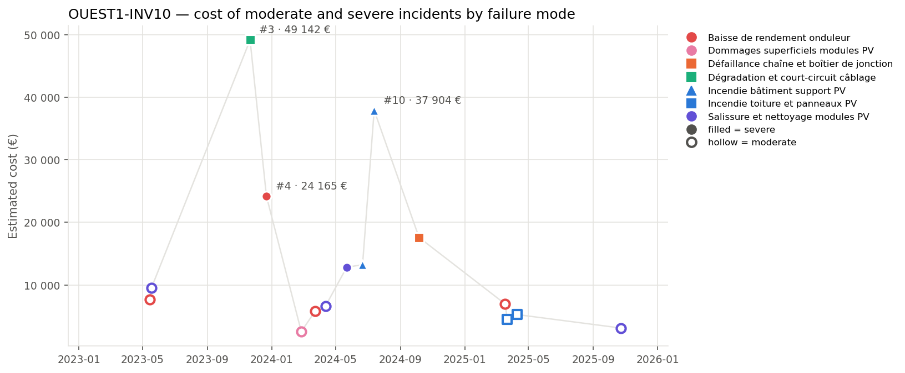

## 3. Cost timeline

*Estimated cost of each moderate (hollow) and severe (filled) incident. Colour = family of failure modes, marker shape = failure mode; the three most costly incidents are labelled.*

| Year | Incidents | Severe | Cost (EUR) | Cost vs previous year | Downtime (h) |
| --- | --- | --- | --- | --- | --- |
| 2023 | 4 | 2 | 90 452 |  | 173.2 |
| 2024 | 7 | 4 | 96 489 | +6.7 % | 180.7 |
| 2025 | 4 | 0 | 19 821 | -79.5 % | 60.1 |

**Trend.** The overall cost of incidents has decreased significantly from 2023 to 2025, with a notable drop of over three-quarters in total costs. Incident frequency increased slightly in 2024 compared to 2023 but then declined in 2025, reflecting a downward trend in costs despite some fluctuations.

**Dominant incidents.** The most costly incident was #3, involving degradation and short-circuiting of wiring, accounting for nearly a quarter of the total incident costs. The failure mode that dominates costs is incendie bâtiment support PV, with two incidents totaling over a quarter of the overall costs.

**Sequences and recurrences.** Close sequences of incidents occurred within days of each other, such as #1 and #2 in May 2023, and multiple incidents involving the same failure modes like 'Baisse de rendement onduleur' and 'Salissure et nettoyage modules PV' occurring within weeks in early 2024. The recurrence of the same failure modes within short periods indicates potential recurring issues.

**Seasonality.** Incidents occurred across all seasons, with spring and autumn showing higher incident counts and costs. Winter and summer had fewer incidents, but the sample size is indicative only, as fewer than three incidents were recorded in those seasons.
