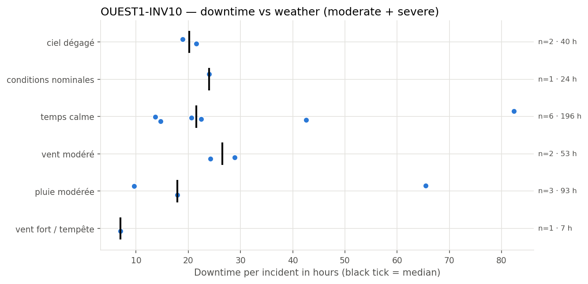
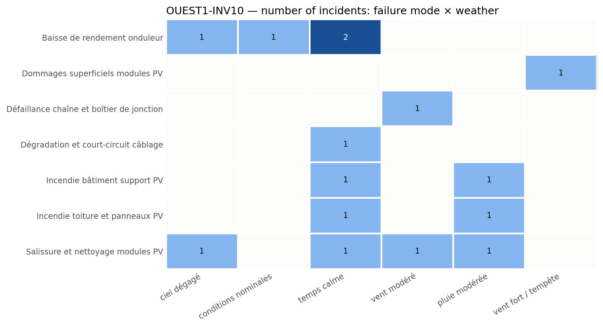

## 4. Weather exposure

### 4.1 Downtime vs weather condition

*Downtime of each incident per weather condition; the black tick is the median.*

| Weather | Incidents | Severe | Downtime (h) | Median (h) | % of downtime | Compared with site |
| --- | --- | --- | --- | --- | --- | --- |
| temps calme | 6 | 3 | 196.5 | 21.6 | 47.5 | over-represented vs site |
| pluie modérée | 3 | 1 | 93.0 | 17.9 | 22.5 | in line with site |
| vent modéré | 2 | 1 | 53.1 | 26.5 | 12.8 | over-represented vs site |
| ciel dégagé | 2 | 1 | 40.4 | 20.2 | 9.8 | in line with site |
| conditions nominales | 1 | 0 | 24.0 | 24.0 | 5.8 | under-represented vs site |
| vent fort / tempête | 1 | 0 | 7.0 | 7.0 | 1.7 | under-represented vs site |

The equipment experiences the most downtime under 'temps calme', accounting for 47.5% of the total downtime, which is over-represented compared to its share on the whole site (17.4%). This indicates that most failures and associated downtime tend to occur during calm weather conditions, possibly due to the nature of failure modes active in these conditions.

### 4.2 Failure modes vs weather condition

*Number of incidents per failure mode and weather condition.*

Failure modes such as 'Baisse de rendement onduleur' occur under 'ciel dégagé', 'conditions nominales', and 'temps calme', suggesting they are not weather-dependent. 'Dommages superficiels modules PV' occur under 'vent fort / tempête', indicating a link with high wind events. 'Défaillance chaîne et boîtier de jonction' is associated with 'vent modéré', and 'Salissure et nettoyage modules PV' appears under multiple conditions including 'ciel dégagé', 'temps calme', 'vent modéré', and 'pluie modérée', implying these failure modes may be influenced by weather conditions that affect dirt accumulation or mechanical stress. These links imply that inspections after specific weather events, such as storms or high winds, could be beneficial for early detection of certain failure modes.
