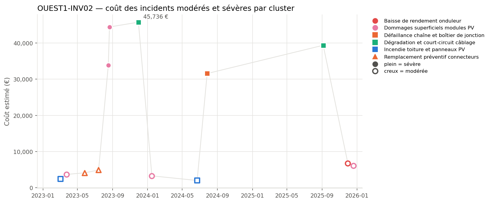
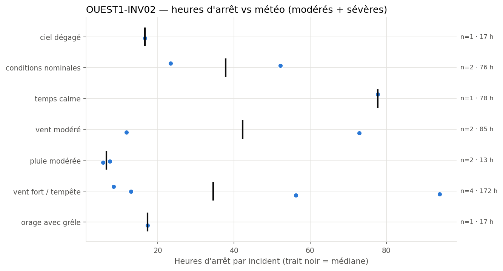
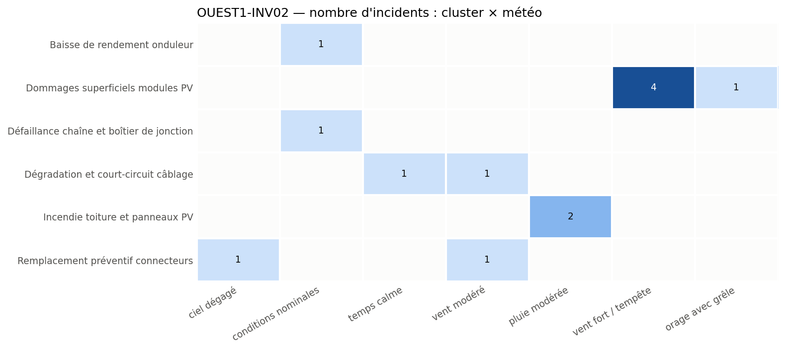

# OUEST1-INV02: Module Damage and Cable Degradation Incidents

**Equipment:** OUEST1-INV02 · **Site:** Centrale PV Ouest-1 · **Asset type:** Photovoltaic (inverter) · **Generated on:** 2026-10-19

> This inverter and upstream DC field experienced multiple incidents, with significant costs and recurring damage, especially under storm and calm weather conditions. The most costly events are related to superficial module damage and cable degradation, indicating potential environmental and aging factors. Immediate focus should be on inspecting modules and cables, especially after storm events, and implementing preventive measures.

**Risk level: HIGH** — With 13 incidents costing over EUR 228,000 and 456 hours of downtime, plus multiple severe events, this equipment is a clear outlier with recurrent damage, especially under storm conditions (lift_vs_site > 1.9).

---

## 1. Key figures

| Indicator | This equipment | Median equipment of the site |
| --- | ---: | ---: |
| Incidents (all severities) | 29 | 31.5 |
| Severe incidents | 5 | 4.5 |
| Total estimated cost (all severities) | 238 752 EUR | 212 067 EUR |
| Total downtime (all severities) | 503.9 h | 473.8 h |

| Moderate + severe incidents (scope of this report) | Value |
| --- | ---: |
| Incidents analysed | 13 (8 moderate · 5 severe) |
| Period covered | 2023-02-03 → 2025-12-19 |
| Total estimated cost | 228 167 EUR |
| Average cost per incident | 17 551 EUR |
| Total downtime | 456.2 h |
| Most costly cluster | Dommages superficiels modules PV (91 303 EUR) |
| Weather with most downtime | vent fort / tempête (171.5 h) |

**Criticality score:** 52.9/100 within the site (rank 6/10) · 85.1/100 against the whole solar fleet.

## 2. Methodology

Incidents come from `incidents_clusterised_solar.csv` (text, digital PDF and scanned PDF reports, clustered into failure modes with BERTopic on Azure OpenAI embeddings). The criticality score combines leave-one-out robust z-scores of n_incidents (×1), n_incidents_severes (×2), cout_total (×1), arret_total (×1), computed against the other equipment of the same site (and, for the fleet score, against all solar equipment), mapped to 0-100 with the normal CDF. Selection criterion used: *score intra-site >= 75, ou au moins un incident sévère et score intra-site >= 50*. The detailed tables, figures and the narrative analysis only cover moderate and severe incidents; the narrative sections are written by an LLM from the aggregated tables and checked against them.

## 3. Cost timeline

*Estimated cost of each moderate (hollow) and severe (filled) incident over time. Colour = cluster family, marker shape = cluster.*

| Year | Incidents | Severe | Cost (EUR) | Downtime (h) |
| --- | --- | --- | --- | --- |
| 2023 | 7 | 3 | 139141 | 276.5 |
| 2024 | 3 | 1 | 36833 | 66.2 |
| 2025 | 3 | 1 | 52194 | 113.5 |

Incident costs show escalation during storm periods, with bursts of damage (notably in August 2023 and late 2024). Recurrences of superficial module damage (#631, #1315, #806, #987, #1521) suggest ineffective repairs or ongoing environmental stress. The most costly incident (#1315, #806) occurred within days of each other, indicating possible storm-related damage accumulation.

## 4. Weather exposure

### 4.1 Downtime vs weather condition

*Downtime of each moderate/severe incident per weather condition; the black tick is the median.*

| Weather | Incidents | Severe | Downtime (h) | Median (h) | % of downtime | Lift vs site |
| --- | --- | --- | --- | --- | --- | --- |
| vent fort / tempête | 4 | 2 | 171.5 | 34.6 | 37.6 | 1.93 |
| vent modéré | 2 | 1 | 84.6 | 42.3 | 18.5 | 1.56 |
| temps calme | 1 | 1 | 77.7 | 77.7 | 17.0 | 0.44 |
| conditions nominales | 2 | 1 | 75.5 | 37.8 | 16.5 | 1.27 |
| orage avec grêle | 1 | 0 | 17.3 | 17.3 | 3.8 | 0.63 |
| ciel dégagé | 1 | 0 | 16.6 | 16.6 | 3.6 | 0.56 |
| pluie modérée | 2 | 0 | 13.0 | 6.5 | 2.8 | 0.81 |

Incidents are over-represented during stormy weather (lift_vs_site=1.93), especially for superficial module damage. Moderate and calm weather show fewer incidents relative to their site incident share, but still contribute to cable degradation and minor module damage, indicating some weather-related vulnerability.

### 4.2 Failure modes vs weather condition

*Number of moderate/severe incidents per cluster and weather condition.*

Superficial module damage clusters strongly with storm and wind events, with 4 incidents under storm/ gale conditions (#631, #1315, #806, #1521). Cable degradation correlates with calm and moderate weather, suggesting aging or environmental exposure as factors. Preventive actions should consider weather exposure, especially after storms.

## 5. Failure modes (clusters)

| Cluster | Incidents | Severe | Cost (EUR) | % of cost | Recurrences < 90 d | % equipment | % site |
| --- | --- | --- | --- | --- | --- | --- | --- |
| Dommages superficiels modules PV | 5 | 2 | 91303 | 40.0 | 1 | 38.5 | 28.0 |
| Dégradation et court-circuit câblage | 2 | 2 | 85092 | 37.3 | 0 | 15.4 | 14.4 |
| Défaillance chaîne et boîtier de jonction | 1 | 1 | 31553 | 13.8 | 0 | 7.7 | 7.6 |
| Remplacement préventif connecteurs | 2 | 0 | 8993 | 3.9 | 1 | 15.4 | 11.4 |
| Baisse de rendement onduleur | 1 | 0 | 6780 | 3.0 | 0 | 7.7 | 9.1 |
| Incendie toiture et panneaux PV | 2 | 0 | 4446 | 1.9 | 0 | 15.4 | 15.9 |

### Dommages superficiels modules PV

This cluster involves superficial damage to PV modules, predominantly during storm conditions, with 4 incidents under storm/ gale weather (#631, #1315, #806, #1521). The damage likely results from hail or wind-driven debris, exacerbated by environmental stress. The two severe incidents caused significant costs (EUR 33875 and EUR 44420) and extended downtime, indicating substantial damage. The recurrence pattern suggests damage accumulation or ineffective repairs.

### Dégradation et court-circuit câblage

Cable degradation and short-circuits occurred mainly under calm and moderate weather conditions, with two incidents (#1559, #650). The long interval between these events (up to 645 days) and their occurrence during stable weather suggest aging, insulation wear, or environmental exposure as primary causes. The high severity of the second incident indicates potential safety risks and the need for proactive inspection.

### Défaillance chaîne et boîtier de jonction

A single incident (#1353) under nominal conditions caused a severe failure in the junction box or string chain, likely due to internal component failure or connection issues. The absence of weather influence points to intrinsic aging or manufacturing defects as probable causes.

### Remplacement préventif connecteurs

Two incidents (#295, #1734) involved connector replacements, occurring under clear and moderate weather, respectively. These suggest connector aging or corrosion as contributing factors. The recurrence within 49 days indicates possible ongoing connector degradation or improper installation.

### Baisse de rendement onduleur

A single moderate incident (#1697) in late 2025 indicates inverter performance decline, possibly due to aging components or thermal issues. No weather correlation is observed, so internal inverter issues are suspected.

### Incendie toiture et panneaux PV

Two moderate incidents (#981, #1467) occurred during rainy conditions, likely caused by water ingress or electrical faults exacerbated by moisture. The incidents resulted in moderate costs and downtime, emphasizing the importance of roof and panel sealing and electrical insulation.

## 6. Root-cause hypotheses

1. **Environmental stress from storms causes superficial module damage, especially during high wind or hail events.** *(confidence: medium)* — 4 incidents under storm/ gale conditions (#631, #1315, #806, #1521), with costs up to EUR 44,420, recurring damage pattern.
2. **Aging and environmental exposure lead to cable degradation and short-circuits, especially during calm or moderate weather.** *(confidence: medium)* — Incidents #1559 and #650 during calm and moderate weather, with high costs and long recurrence intervals (up to 645 days).
3. **Connector aging or corrosion contributes to failures, exacerbated by environmental conditions.** *(confidence: medium)* — Two connector replacement incidents (#295, #1734) during clear and moderate weather, recurrence within 49 days.
4. **Internal inverter issues or thermal stress cause the observed decrease in inverter performance.** *(confidence: low)* — Single incident (#1697) with no weather link, indicating possible internal component aging.
5. **Water ingress or electrical faults during rain lead to roof and panel fires or damage.** *(confidence: medium)* — Two incidents during rainy weather (#981, #1467), with moderate costs and downtime.

## 7. Recommendations

| Priority | Action | Type | Target | Expected impact |
| --- | --- | --- | --- | --- |
| P1 | Inspect and reinforce module sealing and shielding, especially after storm events. | preventive | Dommages superficiels modules PV | Reduce storm-related superficial damage and associated costs. |
| P2 | Perform thermography and visual inspection of cables and connectors, focusing on aging and corrosion signs. | preventive | Dégradation et court-circuit câblage | Detect early signs of insulation wear, preventing short-circuits. |
| P2 | Replace aging connectors and ensure proper torque and sealing during scheduled maintenance. | preventive | Remplacement préventif connecteurs | Decrease connector failures and improve reliability. |
| P2 | Inspect and upgrade roof sealing and electrical insulation, especially around panels vulnerable to water ingress. | preventive | Incendie toiture et panneaux PV | Reduce fire risk and water-related damage. |
| P3 | Schedule internal inverter diagnostics and thermal checks to identify aging components. | monitoring | Baisse de rendement onduleur | Maintain inverter efficiency and prevent unexpected failures. |
| P3 | Review and improve storm damage mitigation measures, such as wind barriers or module mounting strength. | design change | Dommages superficiels modules PV | Lower damage severity and repair costs during storms. |
| P3 | Maintain a stock of spare modules, cables, and connectors for rapid replacement after storm or weather events. | spare parts | All clusters | Minimize downtime and repair delays. |

## 8. Data limitations

- Limited incident sample size for some weather conditions, especially storms.
- Clustering based on LLM-assisted analysis may introduce classification bias.
- Cost estimates are approximate and may not include all indirect costs.
- Missing context such as equipment age, previous maintenance history, or specific environmental conditions limits causal attribution.
- Some incidents may be underreported or not captured in this dataset.

## 9. Conclusion

OUEST1-INV02 exhibits recurrent damage primarily driven by storm and environmental factors, compounded by aging components. Immediate inspection and preventive reinforcement are recommended to mitigate ongoing risks and costs. Long-term strategies should include structural upgrades and enhanced environmental protections.
