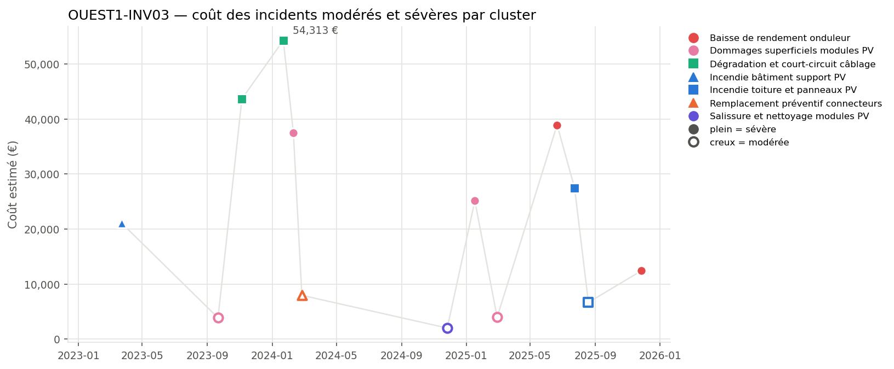
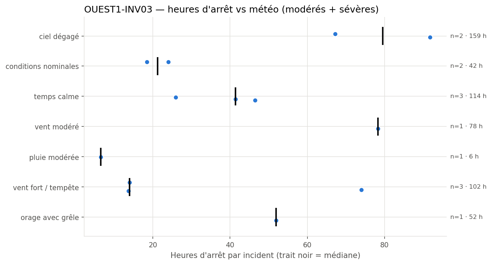
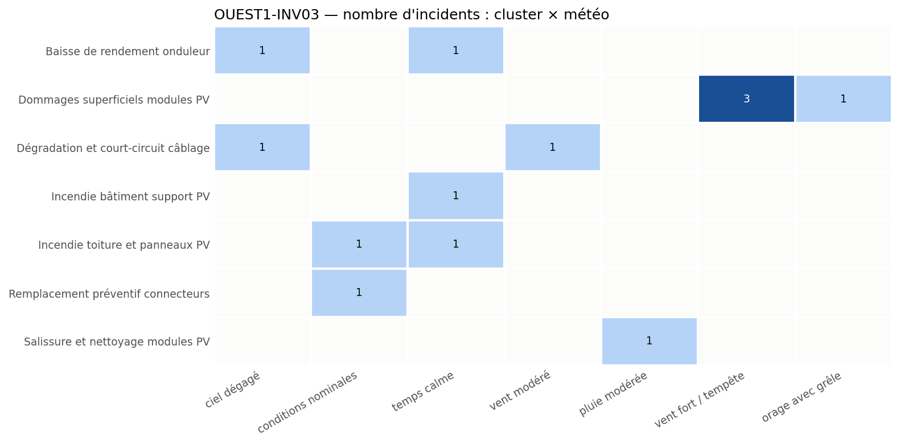

# OUEST1-INV03: High Incidents and Costly Cable Degradation

**Equipment:** OUEST1-INV03 · **Site:** Centrale PV Ouest-1 · **Asset type:** Photovoltaic (inverter) · **Generated on:** 2026-10-19

> This equipment has experienced 13 incidents since 2023, with two severe cable degradation events costing over €97,000 and causing significant downtime. The recurrence of cable-related failures suggests aging or connection issues, with recent incidents under moderate wind conditions. Immediate focus on cable inspection and preventive measures is recommended to reduce recurrence and mitigate costs.

**Risk level: HIGH** — The equipment has a high incident count (13), with two severe cable degradation events totaling €97,989 and recurring within 78 days, indicating an outlier status and escalating risk.

---

## 1. Key figures

| Indicator | This equipment | Median equipment of the site |
| --- | ---: | ---: |
| Incidents (all severities) | 36 | 31.5 |
| Severe incidents | 8 | 4.5 |
| Total estimated cost (all severities) | 301 163 EUR | 212 067 EUR |
| Total downtime (all severities) | 627.8 h | 473.8 h |

| Moderate + severe incidents (scope of this report) | Value |
| --- | ---: |
| Incidents analysed | 13 (5 moderate · 8 severe) |
| Period covered | 2023-01-04 → 2025-11-27 |
| Total estimated cost | 285 065 EUR |
| Average cost per incident | 21 928 EUR |
| Total downtime | 553.7 h |
| Most costly cluster | Dégradation et court-circuit câblage (97 989 EUR) |
| Weather with most downtime | ciel dégagé (159.0 h) |

**Criticality score:** 95.5/100 within the site (rank 2/10) · 98.2/100 against the whole solar fleet.

## 2. Methodology

Incidents come from `incidents_clusterised_solar.csv` (text, digital PDF and scanned PDF reports, clustered into failure modes with BERTopic on Azure OpenAI embeddings). The criticality score combines leave-one-out robust z-scores of n_incidents (×1), n_incidents_severes (×2), cout_total (×1), arret_total (×1), computed against the other equipment of the same site (and, for the fleet score, against all solar equipment), mapped to 0-100 with the normal CDF. Selection criterion used: *score intra-site >= 75, ou au moins un incident sévère et score intra-site >= 50*. The detailed tables, figures and the narrative analysis only cover moderate and severe incidents; the narrative sections are written by an LLM from the aggregated tables and checked against them.

## 3. Cost timeline

*Estimated cost of each moderate (hollow) and severe (filled) incident over time. Colour = cluster family, marker shape = cluster.*

| Year | Incidents | Severe | Cost (EUR) | Downtime (h) |
| --- | --- | --- | --- | --- |
| 2023 | 3 | 2 | 68661 | 133.4 |
| 2024 | 4 | 2 | 101819 | 196.3 |
| 2025 | 6 | 4 | 114585 | 224.0 |

The timeline shows recurrent cable degradation incidents with a median recurrence of 78 days, including two severe events (#1648, #849). Costs have escalated over time, with recent incidents under moderate wind conditions, and a notable burst in failures in late 2023 and early 2024. The recent cable issues dominate the total cost and downtime, highlighting ongoing degradation.

## 4. Weather exposure

### 4.1 Downtime vs weather condition

*Downtime of each moderate/severe incident per weather condition; the black tick is the median.*

| Weather | Incidents | Severe | Downtime (h) | Median (h) | % of downtime | Lift vs site |
| --- | --- | --- | --- | --- | --- | --- |
| ciel dégagé | 2 | 2 | 159.0 | 79.5 | 28.7 | 1.13 |
| temps calme | 3 | 3 | 113.8 | 41.4 | 20.6 | 1.32 |
| vent fort / tempête | 3 | 1 | 101.7 | 14.0 | 18.4 | 1.45 |
| vent modéré | 1 | 1 | 78.3 | 78.3 | 14.1 | 0.78 |
| orage avec grêle | 1 | 1 | 51.9 | 51.9 | 9.4 | 0.63 |
| conditions nominales | 2 | 0 | 42.5 | 21.2 | 7.7 | 1.27 |
| pluie modérée | 1 | 0 | 6.5 | 6.5 | 1.2 | 0.41 |

Downtime is over-represented under moderate wind conditions (lift_vs_site 1.45) and clear skies (lift_vs_site 1.13), correlating with the cable degradation clusters. Incidents are more frequent than expected under these weather conditions, suggesting weather may influence cable aging or connection failures.

### 4.2 Failure modes vs weather condition

*Number of moderate/severe incidents per cluster and weather condition.*

Cable degradation incidents co-occur with moderate wind (vent modéré) and clear sky conditions, indicating possible mechanical stress or connection loosening due to wind vibrations. The correlation is supported by the weather counts (vent modéré, ciel dégagé) and their over-representation (lift_vs_site > 1.3).

## 5. Failure modes (clusters)

| Cluster | Incidents | Severe | Cost (EUR) | % of cost | Recurrences < 90 d | % equipment | % site |
| --- | --- | --- | --- | --- | --- | --- | --- |
| Dégradation et court-circuit câblage | 2 | 2 | 97989 | 34.4 | 1 | 15.4 | 14.4 |
| Dommages superficiels modules PV | 4 | 2 | 70510 | 24.7 | 1 | 30.8 | 28.0 |
| Baisse de rendement onduleur | 2 | 2 | 51357 | 18.0 | 0 | 15.4 | 9.1 |
| Incendie toiture et panneaux PV | 2 | 1 | 34127 | 12.0 | 1 | 15.4 | 15.9 |
| Incendie bâtiment support PV | 1 | 1 | 21116 | 7.4 | 0 | 7.7 | 6.1 |
| Remplacement préventif connecteurs | 1 | 0 | 7961 | 2.8 | 0 | 7.7 | 11.4 |
| Salissure et nettoyage modules PV | 1 | 0 | 2006 | 0.7 | 0 | 7.7 | 7.6 |

### Dégradation et court-circuit câblage

This cluster involves cable degradation and short circuits, evidenced by two severe incidents (#1648, #849) costing €97,989 and causing 78.3 and 91.8 hours of downtime respectively. The incidents occurred under moderate wind and clear sky, suggesting mechanical stress or aging of cables. The recurrence within 78 days indicates ongoing degradation, possibly due to aging or connection issues.

### Dommages superficiels modules PV

This cluster relates to superficial damages on PV modules, with four incidents including two severe ones (#685, #1696) costing €70,510. These occurred under storm and wind conditions, indicating physical impact damage, likely from hail or debris during storms.

### Baisse de rendement onduleur

This cluster involves inverter performance decline, with two moderate incidents (#1454, #495) costing €51,357. Both occurred under clear sky and calm conditions, possibly linked to internal inverter issues rather than weather.

### Incendie toiture et panneaux PV

This cluster includes two incidents (#644, #1499) costing €34,127, occurring under calm and nominal conditions, likely due to electrical faults or insulation failures rather than weather. The first was severe, indicating potential fire risk.

### Incendie bâtiment support PV

A single incident (#1202) caused €21,116 in damages, occurring under calm weather, likely from electrical or mechanical failure in the support structure, with no recurrence observed.

### Remplacement préventif connecteurs

One incident (#960) costing €7,961 involved connector replacement under nominal conditions, indicating aging or connection issues. Preventive replacement could reduce future failures.

### Salissure et nettoyage modules PV

A single incident (#852) costing €2,006 occurred after moderate rain, indicating soiling. Regular cleaning could prevent efficiency loss and minor damage.

## 6. Root-cause hypotheses

1. **Aging and mechanical stress on cable connections leading to degradation and short circuits.** *(confidence: high)* — Two severe incidents (#1648, #849) within 78 days, costs over €97,000, under moderate wind and clear sky, suggest mechanical stress or connection loosening.
2. **Physical damage to PV modules from storms or hail causing superficial damages.** *(confidence: high)* — Four incidents including two severe ones (#685, #1696) under storm and wind conditions, with costs over €70,000.
3. **Internal inverter component failure causing performance decline.** *(confidence: medium)* — Two moderate incidents (#1454, #495) under calm and clear conditions, with costs over €51,000.
4. **Electrical faults or insulation failure leading to fires.** *(confidence: medium)* — Two fire incidents (#644, #1499) under nominal weather, with costs over €34,000.
5. **Aging or connection issues in connectors, leading to failures.** *(confidence: medium)* — One connector replacement (#960) under nominal conditions, €7,961, suggests connection aging.

## 7. Recommendations

| Priority | Action | Type | Target | Expected impact |
| --- | --- | --- | --- | --- |
| P1 | Conduct thermographic inspection of cable trays and connections to identify hot spots. | monitoring | Dégradation et court-circuit câblage | Early detection of loose or aging connections to prevent short circuits and reduce downtime. |
| P1 | Replace aging cables and connectors showing signs of wear or looseness. | preventive | Dégradation et court-circuit câblage | Reduce recurrence of cable degradation incidents and associated costs. |
| P2 | Inspect and reinforce cable routing and fixation to minimize mechanical stress from wind. | preventive | Dégradation et court-circuit câblage | Decrease mechanical stress-induced failures, lowering incident frequency. |
| P2 | Implement regular cleaning schedule for PV modules, especially after rain events. | preventive | Salissure et nettoyage modules PV | Maintain module efficiency and prevent soiling-related issues. |
| P2 | Perform visual inspection and testing of PV modules after storm events for superficial damages. | monitoring | Dommages superficiels modules PV | Early detection of physical damage to prevent performance loss. |
| P2 | Assess fire risk in support structures and electrical panels, especially after incidents. | monitoring | Incendie toiture et panneaux PV | Prevent future fires and reduce damage costs. |
| P3 | Review inverter performance logs and perform IV curve tracing to diagnose decline causes. | monitoring | Baisse de rendement onduleur | Identify internal faults early, reducing downtime and repair costs. |

## 8. Data limitations

- Sample size per weather condition is small, especially for storm and hail events, limiting statistical significance.
- Clustering based on LLM-assisted topic modeling may introduce bias or misclassification.
- Cost estimates are approximate and may not include all indirect costs.
- Missing context such as equipment age, maintenance history, and detailed condition assessments limits root-cause certainty.

## 9. Conclusion

OUEST1-INV03 exhibits significant cable degradation and superficial module damages, with recurrent failures under moderate wind and storm conditions. Immediate inspection and preventive maintenance are recommended to mitigate ongoing risks and costs, especially focusing on cable connections and physical module integrity.
