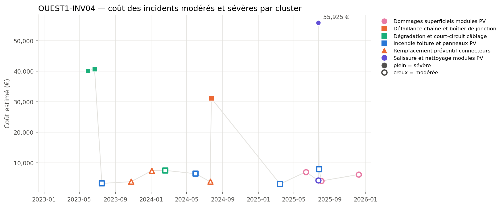
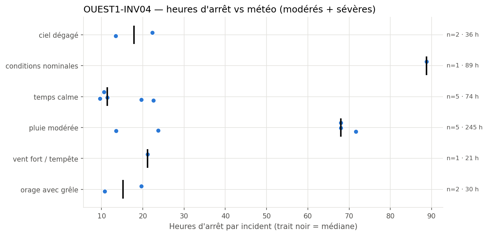
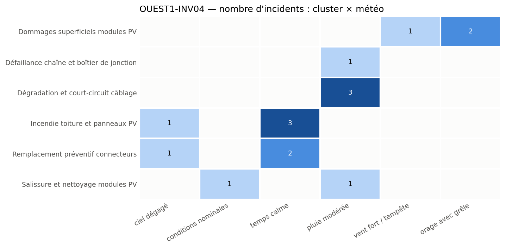

# OUEST1-INV04: Equipment failure analysis and action plan

**Equipment:** OUEST1-INV04 · **Site:** Centrale PV Ouest-1 · **Asset type:** Photovoltaic (inverter) · **Generated on:** 2026-10-19

> This equipment has experienced multiple moderate and severe incidents, mainly related to cable degradation and short-circuits, with costs exceeding the site median. The most recurrent failure mode is cable degradation under rainy conditions, with recent incidents indicating potential aging or insulation issues. Immediate focus should be on cable inspection and preventive maintenance to mitigate recurrence and reduce costs.

**Risk level: HIGH** — The equipment has 16 incidents including 4 severe ones, with total costs of €232,135, above the site median, and recurrent cable-related failures under rainy weather (#1452, #1700, #1192).

---

## 1. Key figures

| Indicator | This equipment | Median equipment of the site |
| --- | ---: | ---: |
| Incidents (all severities) | 38 | 31.5 |
| Severe incidents | 4 | 4.5 |
| Total estimated cost (all severities) | 247 736 EUR | 212 067 EUR |
| Total downtime (all severities) | 563.4 h | 473.8 h |

| Moderate + severe incidents (scope of this report) | Value |
| --- | ---: |
| Incidents analysed | 16 (12 moderate · 4 severe) |
| Period covered | 2023-01-13 → 2025-12-08 |
| Total estimated cost | 232 135 EUR |
| Average cost per incident | 14 508 EUR |
| Total downtime | 494.6 h |
| Most costly cluster | Dégradation et court-circuit câblage (88 376 EUR) |
| Weather with most downtime | pluie modérée (244.8 h) |

**Criticality score:** 56.4/100 within the site (rank 5/10) · 88.8/100 against the whole solar fleet.

## 2. Methodology

Incidents come from `incidents_clusterised_solar.csv` (text, digital PDF and scanned PDF reports, clustered into failure modes with BERTopic on Azure OpenAI embeddings). The criticality score combines leave-one-out robust z-scores of n_incidents (×1), n_incidents_severes (×2), cout_total (×1), arret_total (×1), computed against the other equipment of the same site (and, for the fleet score, against all solar equipment), mapped to 0-100 with the normal CDF. Selection criterion used: *score intra-site >= 75, ou au moins un incident sévère et score intra-site >= 50*. The detailed tables, figures and the narrative analysis only cover moderate and severe incidents; the narrative sections are written by an LLM from the aggregated tables and checked against them.

## 3. Cost timeline

*Estimated cost of each moderate (hollow) and severe (filled) incident over time. Colour = cluster family, marker shape = cluster.*

| Year | Incidents | Severe | Cost (EUR) | Downtime (h) |
| --- | --- | --- | --- | --- |
| 2023 | 4 | 2 | 87884 | 163.6 |
| 2024 | 5 | 1 | 56186 | 145.3 |
| 2025 | 7 | 1 | 88065 | 185.7 |

Incidents show a pattern of recurring cable degradation failures, especially during rainy periods, with a median recurrence interval of 132 days. Recent incidents indicate escalation in costs and downtime, notably the severe cable short-circuit (#1700) and multiple moderate failures. The last incident occurred in February 2024, with ongoing risk of further failures if preventive actions are not taken.

## 4. Weather exposure

### 4.1 Downtime vs weather condition

*Downtime of each moderate/severe incident per weather condition; the black tick is the median.*

| Weather | Incidents | Severe | Downtime (h) | Median (h) | % of downtime | Lift vs site |
| --- | --- | --- | --- | --- | --- | --- |
| pluie modérée | 5 | 3 | 244.8 | 68.0 | 49.5 | 1.65 |
| conditions nominales | 1 | 1 | 88.8 | 88.8 | 18.0 | 0.52 |
| temps calme | 5 | 0 | 73.8 | 11.4 | 14.9 | 1.79 |
| ciel dégagé | 2 | 0 | 35.7 | 17.9 | 7.2 | 0.92 |
| orage avec grêle | 2 | 0 | 30.4 | 15.2 | 6.1 | 1.03 |
| vent fort / tempête | 1 | 0 | 21.1 | 21.1 | 4.3 | 0.39 |

Downtime is notably higher under moderate rain (49 hours, lift vs site 1.65) and nominal conditions (89 hours, lift 0.52), indicating weather influences failure occurrence. Rainy conditions are over-represented in incidents, especially for cable degradation, suggesting weather accelerates aging or insulation breakdown.

### 4.2 Failure modes vs weather condition

*Number of moderate/severe incidents per cluster and weather condition.*

Cable degradation and short-circuits are strongly associated with moderate rain (lift 1.65, incidents #1452, #1700, #1192). Incidents of roof fires and panel damage are linked to clear and calm weather, indicating different failure mechanisms. Cleaning-related failures occur under nominal conditions, possibly due to maintenance activities.

## 5. Failure modes (clusters)

| Cluster | Incidents | Severe | Cost (EUR) | % of cost | Recurrences < 90 d | % equipment | % site |
| --- | --- | --- | --- | --- | --- | --- | --- |
| Dégradation et court-circuit câblage | 3 | 2 | 88376 | 38.1 | 1 | 18.8 | 14.4 |
| Salissure et nettoyage modules PV | 2 | 1 | 60105 | 25.9 | 1 | 12.5 | 7.6 |
| Défaillance chaîne et boîtier de jonction | 1 | 1 | 31133 | 13.4 | 0 | 6.2 | 7.6 |
| Incendie toiture et panneaux PV | 4 | 0 | 20423 | 8.8 | 0 | 25.0 | 15.9 |
| Dommages superficiels modules PV | 3 | 0 | 17146 | 7.4 | 1 | 18.8 | 28.0 |
| Remplacement préventif connecteurs | 3 | 0 | 14953 | 6.4 | 1 | 18.8 | 11.4 |

### Dégradation et court-circuit câblage

This failure mode is characterized by cable insulation deterioration leading to short circuits, often exacerbated by moisture ingress during rainy weather. Incidents #1452, #1700, and #1192 demonstrate recurrent short-circuit events with high costs and significant downtime, suggesting aging or inadequate insulation. The median interval between these failures is 132 days, with recent incidents indicating escalation.

### Salissure et nettoyage modules PV

This failure mode involves soiling of modules, reducing efficiency and potentially increasing thermal stress. Incidents #59 and #882 occurred under nominal and rainy conditions, with the severe incident (#882) causing high downtime and costs. Cleaning is scheduled regularly, but recent incidents suggest the need for more frequent or targeted cleaning.

### Défaillance chaîne et boîtier de jonction

This failure mode involves junction box failures, often linked to moisture ingress or aging. The single severe incident (#1104) under rainy weather caused significant downtime, indicating vulnerability of junctions to environmental conditions.

### Incendie toiture et panneaux PV

Roof fires and panel damage are associated with clear and calm weather, possibly due to electrical faults or thermal stress. Incidents #60, #194, #1413, and #851 show sporadic occurrence with moderate costs, but potential for severe damage if not monitored.

### Dommages superficiels modules PV

Surface damages, including cracks or impacts, are linked to stormy weather (hail, wind). Incidents #331, #285, and #1154 occurred during storm conditions, causing moderate downtime and costs, indicating vulnerability to severe weather.

### Remplacement préventif connecteurs

Connector replacements are preventive measures undertaken under clear or calm weather, with incidents #152, #1284, and #1445. These actions aim to prevent future failures, with recurrence intervals around 134 days, reflecting aging or wear.

## 6. Root-cause hypotheses

1. **Cable insulation aging leading to short circuits during rainy weather.** *(confidence: high)* — Incidents #1452, #1700, #1192 occurred under rain, with recurrent short-circuits and high costs (€40k+ each). Median recurrence of 132 days suggests aging effects.
2. **Moisture ingress into junction boxes causing failures.** *(confidence: medium)* — Single severe incident #1104 under rain indicates junction vulnerability, with high downtime (68h).
3. **Surface module damage due to storm impacts.** *(confidence: medium)* — Storm-related incidents #331, #285, #1154 during hail/wind, with moderate costs and downtime.
4. **Electrical faults or thermal stress causing roof fires.** *(confidence: medium)* — Incidents #60, #194, #1413, #851 during clear/calm weather, with moderate costs.
5. **Aging connectors leading to failures, mitigated by scheduled replacements.** *(confidence: high)* — Connectors replaced in #152, #1284, #1445, recurrence interval ~134 days.

## 7. Recommendations

| Priority | Action | Type | Target | Expected impact |
| --- | --- | --- | --- | --- |
| P1 | Conduct thermographic inspection of cables and junction boxes to identify hotspots and insulation degradation. | monitoring | Dégradation et court-circuit câblage | Early detection of insulation issues, reducing short-circuit risk and costs. |
| P2 | Increase inspection and sealing of junction boxes, especially after rain events. | preventive | Défaillance chaîne et boîtier de jonction | Reduce moisture ingress, preventing failures and downtime. |
| P2 | Implement more frequent cleaning schedule for modules, especially before rainy seasons. | preventive | Salissure et nettoyage modules PV | Maintain module efficiency, reduce soiling-related failures. |
| P2 | Review and reinforce module mounting and sealing to prevent storm damage. | preventive | Dommages superficiels modules PV | Decrease impact damage during storms, lowering repair costs. |
| P2 | Schedule regular replacement of aging connectors based on wear indicators. | preventive | Remplacement préventif connecteurs | Reduce connector failures, improve reliability. |
| P3 | Install surge protection devices and improve grounding to prevent roof fires. | preventive | Incendie toiture et panneaux PV | Lower fire risk, protect assets. |
| P3 | Perform insulation resistance testing on cables and junctions after heavy rain. | monitoring | Dégradation et court-circuit câblage | Identify insulation deterioration early, prevent short-circuits. |

## 8. Data limitations

- Limited incident data under storm and hail conditions, affecting damage assessment.
- Sample size for weather correlation is small, especially for rare weather events.
- Cost estimates are based on initial assessments, not detailed repair logs.
- Missing context on equipment age and maintenance history limits root-cause certainty.
- Clustering analysis was assisted by LLM, which may introduce bias in failure mode interpretation.

## 9. Conclusion

OUEST1-INV04 exhibits recurrent cable insulation degradation failures primarily under rainy weather, with significant costs and downtime. Immediate targeted inspections, sealing, and preventive replacements are recommended to mitigate further failures. Long-term monitoring and weatherproofing will enhance reliability and reduce operational costs.
