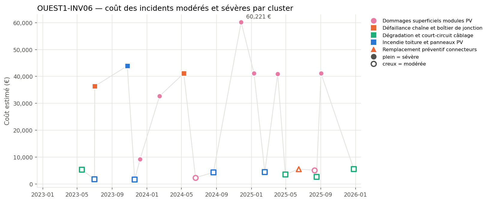
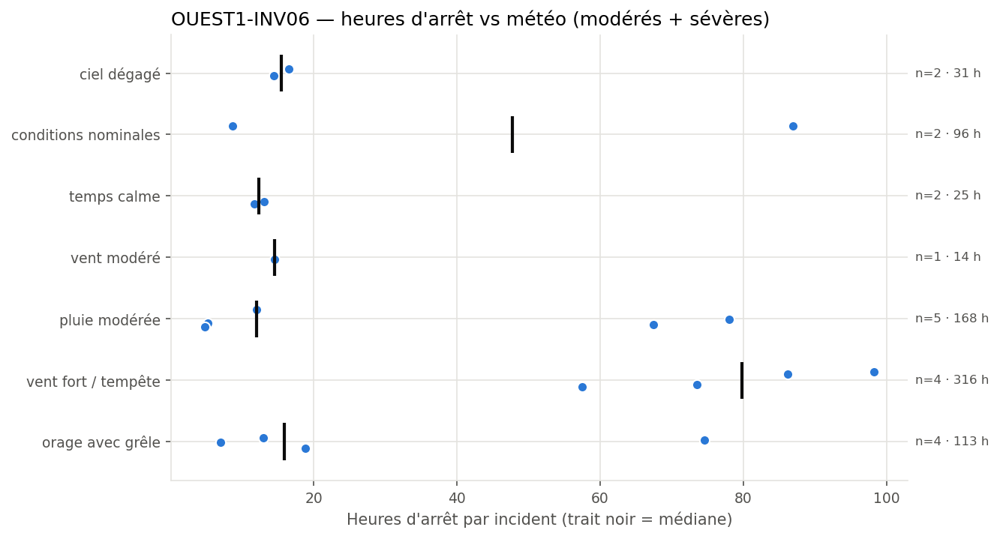
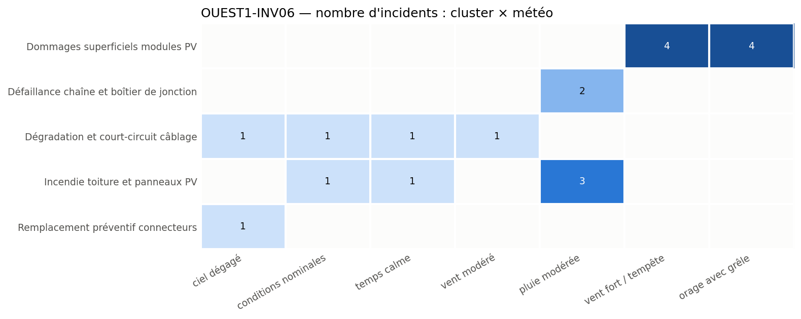

# OUEST1-INV06 - Critical failure in PV module damage and recurring weather-related incidents

**Equipment:** OUEST1-INV06 · **Site:** Centrale PV Ouest-1 · **Asset type:** Photovoltaic (inverter) · **Generated on:** 2026-10-19

> OUEST1-INV06 has experienced 20 incidents since February 2023, with a total cost of nearly €389,000 and 762 hours of downtime. The most significant failure mode involves superficial damages to PV modules, strongly correlated with storm and hail weather conditions. Immediate focus should be on inspecting and reinforcing module protection and implementing preventive measures for storm exposure.

**Risk level: HIGH** — Frequent severe incidents (9 severe events) totaling €389,000 and over 760 hours of downtime, with recurrent damage under storm and hail conditions, indicate a high risk level for this equipment.

---

## 1. Key figures

| Indicator | This equipment | Median equipment of the site |
| --- | ---: | ---: |
| Incidents (all severities) | 37 | 31.5 |
| Severe incidents | 9 | 4.5 |
| Total estimated cost (all severities) | 403 752 EUR | 212 067 EUR |
| Total downtime (all severities) | 826.3 h | 473.8 h |

| Moderate + severe incidents (scope of this report) | Value |
| --- | ---: |
| Incidents analysed | 20 (11 moderate · 9 severe) |
| Period covered | 2023-02-25 → 2025-12-26 |
| Total estimated cost | 388 974 EUR |
| Average cost per incident | 19 449 EUR |
| Total downtime | 762.2 h |
| Most costly cluster | Dommages superficiels modules PV (232 939 EUR) |
| Weather with most downtime | vent fort / tempête (315.5 h) |

**Criticality score:** 99.0/100 within the site (rank 1/10) · 99.2/100 against the whole solar fleet.

## 2. Methodology

Incidents come from `incidents_clusterised_solar.csv` (text, digital PDF and scanned PDF reports, clustered into failure modes with BERTopic on Azure OpenAI embeddings). The criticality score combines leave-one-out robust z-scores of n_incidents (×1), n_incidents_severes (×2), cout_total (×1), arret_total (×1), computed against the other equipment of the same site (and, for the fleet score, against all solar equipment), mapped to 0-100 with the normal CDF. Selection criterion used: *score intra-site >= 75, ou au moins un incident sévère et score intra-site >= 50*. The detailed tables, figures and the narrative analysis only cover moderate and severe incidents; the narrative sections are written by an LLM from the aggregated tables and checked against them.

## 3. Cost timeline

*Estimated cost of each moderate (hollow) and severe (filled) incident over time. Colour = cluster family, marker shape = cluster.*

| Year | Incidents | Severe | Cost (EUR) | Downtime (h) |
| --- | --- | --- | --- | --- |
| 2023 | 6 | 3 | 98215 | 208.2 |
| 2024 | 5 | 3 | 140685 | 242.3 |
| 2025 | 9 | 3 | 150075 | 311.7 |

The incident timeline shows recurring damage to PV modules approximately every 83 days on median, with several clusters of severe events under stormy weather. Notably, four incidents (#127, #794, #41, #1210) under storm and hail conditions caused significant costs and downtime, with some recurrence within 90 days, suggesting persistent vulnerability.

## 4. Weather exposure

### 4.1 Downtime vs weather condition

*Downtime of each moderate/severe incident per weather condition; the black tick is the median.*

| Weather | Incidents | Severe | Downtime (h) | Median (h) | % of downtime | Lift vs site |
| --- | --- | --- | --- | --- | --- | --- |
| vent fort / tempête | 4 | 4 | 315.5 | 79.8 | 41.4 | 1.26 |
| pluie modérée | 5 | 2 | 167.5 | 12.0 | 22.0 | 1.32 |
| orage avec grêle | 4 | 2 | 113.4 | 15.9 | 14.9 | 1.65 |
| conditions nominales | 2 | 1 | 95.6 | 47.8 | 12.5 | 0.83 |
| ciel dégagé | 2 | 0 | 30.9 | 15.4 | 4.1 | 0.73 |
| temps calme | 2 | 0 | 24.8 | 12.4 | 3.3 | 0.57 |
| vent modéré | 1 | 0 | 14.5 | 14.5 | 1.9 | 0.51 |

Incidents are over-represented under storm and hail conditions, with a lift_vs_site of 1.26 and 1.65 respectively, indicating these weather patterns are strongly associated with equipment failures. Downtime peaks during these events, especially under storm conditions, which account for 41.4% of downtime despite only 20% of incidents, highlighting weather-driven vulnerability.

### 4.2 Failure modes vs weather condition

*Number of moderate/severe incidents per cluster and weather condition.*

PV module damages co-occur predominantly with storm and hail weather, with 4 incidents each under these conditions. This suggests that physical impacts from hail and high winds are primary failure mechanisms, supported by the high incidence of superficial damages during such weather. Other failure modes show less weather correlation, indicating specific weather-related risks for modules.

## 5. Failure modes (clusters)

| Cluster | Incidents | Severe | Cost (EUR) | % of cost | Recurrences < 90 d | % equipment | % site |
| --- | --- | --- | --- | --- | --- | --- | --- |
| Dommages superficiels modules PV | 8 | 6 | 232939 | 59.9 | 4 | 40.0 | 28.0 |
| Défaillance chaîne et boîtier de jonction | 2 | 2 | 77502 | 19.9 | 0 | 10.0 | 7.6 |
| Incendie toiture et panneaux PV | 5 | 1 | 55997 | 14.4 | 1 | 25.0 | 15.9 |
| Dégradation et court-circuit câblage | 4 | 0 | 17007 | 4.4 | 0 | 20.0 | 14.4 |
| Remplacement préventif connecteurs | 1 | 0 | 5529 | 1.4 | 0 | 5.0 | 11.4 |

### Dommages superficiels modules PV

This cluster involves physical damage to PV modules, primarily caused by hail and storm impacts, as evidenced by incidents #127, #794, #41, and #1210, with costs exceeding €120,000. The damage results in significant downtime and recurrent failures, indicating a need for improved module protection against severe weather.

### Défaillance chaîne et boîtier de jonction

Two incidents (#63, #574) under moderate rain suggest that moisture ingress or water-related corrosion may cause junction box failures. These are less frequent but still contribute to overall risk, requiring inspection of sealing and waterproofing.

### Incendie toiture et panneaux PV

Five incidents, including two severe events (#863, #164), occurred under various weather conditions, with some linked to moderate rain and calm weather. These suggest potential electrical faults or thermal issues, possibly exacerbated by environmental factors, leading to localized fires.

### Dégradation et court-circuit câblage

Four incidents show wiring degradation or short circuits, with no clear weather correlation, indicating age-related or installation issues. These are less costly but still impact reliability.

### Remplacement préventif connecteurs

A single incident under clear weather indicates connector issues may be mitigated through preventive replacement, reducing future failures.

## 6. Root-cause hypotheses

1. **Physical impact from hail and storm winds causing superficial module damage.** *(confidence: high)* — Multiple incidents (#127, #794, #41, #1210, #548, #967) under storm/hail weather with high costs and recurring damage, median recurrence interval 83 days.
2. **Moisture ingress leading to junction box failures.** *(confidence: medium)* — Incidents #63 and #574 under moderate rain, with costs and downtime indicating water-related faults.
3. **Electrical faults or thermal stress causing panel fires.** *(confidence: medium)* — Incidents #863, #164, #1533 under various weather, some with fire reports, costs over €40,000.
4. **Aging or installation issues causing wiring short circuits.** *(confidence: medium)* — Incidents #948, #839, #1228, #680 with no specific weather pattern, moderate costs, and recurrent nature.
5. **Connector degradation over time, leading to failures.** *(confidence: low)* — Single incident (#1453) under clear weather with moderate cost, suggesting preventive replacement could mitigate risk.

## 7. Recommendations

| Priority | Action | Type | Target | Expected impact |
| --- | --- | --- | --- | --- |
| P1 | Inspect and reinforce module mounting and sealing against hail and storm impacts. | preventive | Dommages superficiels modules PV | Reduce damage from hail/storms, decreasing incident recurrence and costs. |
| P2 | Install or upgrade surge protection and lightning arresters on PV modules and junction boxes. | preventive | All clusters | Mitigate electrical faults and fires, lowering severe incident frequency. |
| P2 | Implement weather-resistant module covers or shields in storm-prone areas. | preventive | Dommages superficiels modules PV | Decrease physical damage during storms, reducing repair costs. |
| P2 | Conduct thermography and insulation resistance tests on junction boxes and wiring. | monitoring | Défaillance chaîne et boîtier de jonction | Identify early signs of moisture ingress or corrosion, preventing failures. |
| P3 | Schedule regular inspection and replacement of aging connectors and wiring. | preventive | Remplacement préventif connecteurs, Dégradation et court-circuit câblage | Reduce short-circuits and improve reliability. |
| P3 | Review and improve installation practices to ensure proper wiring and connector torque. | design change | Dégradation et court-circuit câblage | Minimize wiring faults caused by poor installation. |
| P3 | Develop storm and hail weather contingency procedures, including rapid inspection and repair protocols. | monitoring | All clusters | Limit damage extent and downtime during severe weather events. |

## 8. Data limitations

- Sample size for storm/hail weather incidents is limited to 4 events, which may not fully represent all risks.
- Clustering analysis was assisted by LLM, which may introduce bias in failure mode classification.
- Cost estimates are based on incident reports and may not include all indirect costs or long-term impacts.
- Missing context such as equipment age, maintenance history, or specific module models limits detailed root cause analysis.

## 9. Conclusion

OUEST1-INV06 faces significant weather-related risks, especially from storms and hail, leading to high costs and recurrent damage. Immediate actions should focus on physical reinforcement of modules and enhanced weather protection measures. Long-term strategies include regular inspections, improved sealing, and weather contingency planning to mitigate future failures.
