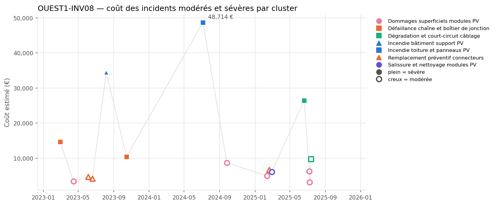
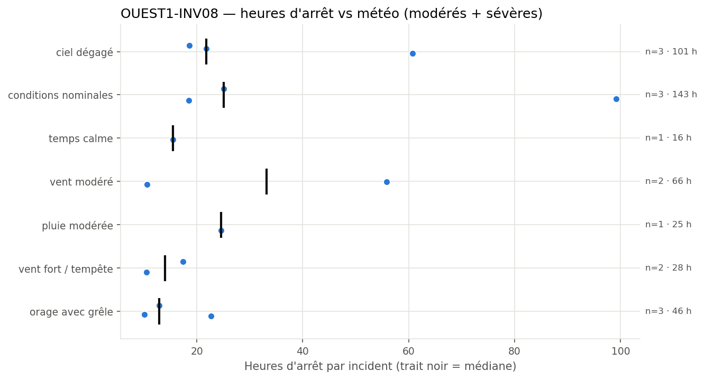
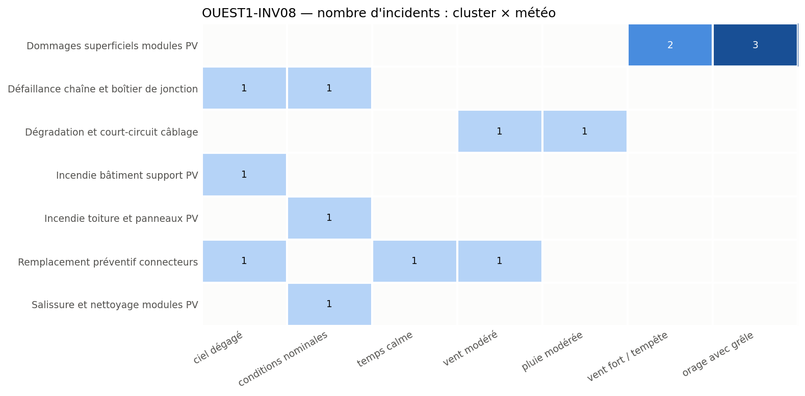

# OUEST1-INV08: Critical incidents and failure modes analysis

**Equipment:** OUEST1-INV08 · **Site:** Centrale PV Ouest-1 · **Asset type:** Photovoltaic (inverter) · **Generated on:** 2026-10-19

> This equipment has experienced 15 incidents since February 2023, including 5 severe events costing over €192,000 and causing 424 hours of downtime. The most significant event was an incipient fire on the PV roof and panels (incident #335), with recurrent issues in cable degradation and connector replacements. Immediate focus should be on fire risk mitigation and cable integrity checks to prevent further costly failures.

**Risk level: HIGH** — With 5 severe incidents totaling over €192,000 and recurrent failure modes such as cable degradation (#916, #139) and connector issues (#1638, #691, #69), the equipment is a clear outlier with escalating risks, justifying a high risk level.

---

## 1. Key figures

| Indicator | This equipment | Median equipment of the site |
| --- | ---: | ---: |
| Incidents (all severities) | 34 | 31.5 |
| Severe incidents | 5 | 4.5 |
| Total estimated cost (all severities) | 206 576 EUR | 212 067 EUR |
| Total downtime (all severities) | 486.6 h | 473.8 h |

| Moderate + severe incidents (scope of this report) | Value |
| --- | ---: |
| Incidents analysed | 15 (10 moderate · 5 severe) |
| Period covered | 2023-02-09 → 2025-09-23 |
| Total estimated cost | 192 356 EUR |
| Average cost per incident | 12 824 EUR |
| Total downtime | 424.0 h |
| Most costly cluster | Incendie toiture et panneaux PV (48 714 EUR) |
| Weather with most downtime | conditions nominales (142.8 h) |

**Criticality score:** 59.5/100 within the site (rank 4/10) · 84.8/100 against the whole solar fleet.

## 2. Methodology

Incidents come from `incidents_clusterised_solar.csv` (text, digital PDF and scanned PDF reports, clustered into failure modes with BERTopic on Azure OpenAI embeddings). The criticality score combines leave-one-out robust z-scores of n_incidents (×1), n_incidents_severes (×2), cout_total (×1), arret_total (×1), computed against the other equipment of the same site (and, for the fleet score, against all solar equipment), mapped to 0-100 with the normal CDF. Selection criterion used: *score intra-site >= 75, ou au moins un incident sévère et score intra-site >= 50*. The detailed tables, figures and the narrative analysis only cover moderate and severe incidents; the narrative sections are written by an LLM from the aggregated tables and checked against them.

## 3. Cost timeline

*Estimated cost of each moderate (hollow) and severe (filled) incident over time. Colour = cluster family, marker shape = cluster.*

| Year | Incidents | Severe | Cost (EUR) | Downtime (h) |
| --- | --- | --- | --- | --- |
| 2023 | 6 | 3 | 71689 | 144.2 |
| 2024 | 2 | 1 | 57385 | 121.9 |
| 2025 | 7 | 1 | 63281 | 157.9 |

The incident timeline shows recurring failures in cable and connector issues, with notable bursts in June and July 2025, indicating potential ineffective repairs or ongoing deterioration. The most costly incident was the roof fire (#335) in July 2024, which caused nearly €49,000 in damages and 99 hours of downtime. Recurrent incidents within short intervals suggest persistent underlying problems needing targeted intervention.

## 4. Weather exposure

### 4.1 Downtime vs weather condition

*Downtime of each moderate/severe incident per weather condition; the black tick is the median.*

| Weather | Incidents | Severe | Downtime (h) | Median (h) | % of downtime | Lift vs site |
| --- | --- | --- | --- | --- | --- | --- |
| conditions nominales | 3 | 2 | 142.8 | 25.1 | 33.7 | 1.65 |
| ciel dégagé | 3 | 2 | 101.1 | 21.8 | 23.8 | 1.47 |
| vent modéré | 2 | 1 | 66.4 | 33.2 | 15.7 | 1.35 |
| orage avec grêle | 3 | 0 | 45.7 | 12.9 | 10.8 | 1.65 |
| vent fort / tempête | 2 | 0 | 27.9 | 13.9 | 6.6 | 0.84 |
| pluie modérée | 1 | 0 | 24.6 | 24.6 | 5.8 | 0.35 |
| temps calme | 1 | 0 | 15.5 | 15.5 | 3.7 | 0.38 |

Downtime is over-represented under conditions nominales and clear skies, with lift_vs_site values of 1.65 and 1.47 respectively, indicating failures are not strongly weather-dependent but may be influenced by operational conditions or aging components. Storms and hail are associated with damage to modules but less with operational downtime.

### 4.2 Failure modes vs weather condition

*Number of moderate/severe incidents per cluster and weather condition.*

Failures in 'Dommages superficiels modules PV' cluster are strongly associated with storm and hail conditions, with 3 incidents during hailstorms (#1780, #867, #648). Cable and junction failures occur under clear or moderate weather, suggesting intrinsic aging or installation issues rather than weather-driven damage. Connector replacements are spread across various weather, indicating age-related wear.

## 5. Failure modes (clusters)

| Cluster | Incidents | Severe | Cost (EUR) | % of cost | Recurrences < 90 d | % equipment | % site |
| --- | --- | --- | --- | --- | --- | --- | --- |
| Incendie toiture et panneaux PV | 1 | 1 | 48714 | 25.3 | 0 | 6.7 | 15.9 |
| Dégradation et court-circuit câblage | 2 | 1 | 36150 | 18.8 | 1 | 13.3 | 14.4 |
| Incendie bâtiment support PV | 1 | 1 | 34465 | 17.9 | 0 | 6.7 | 6.1 |
| Dommages superficiels modules PV | 5 | 0 | 26364 | 13.7 | 1 | 33.3 | 28.0 |
| Défaillance chaîne et boîtier de jonction | 2 | 2 | 25010 | 13.0 | 0 | 13.3 | 7.6 |
| Remplacement préventif connecteurs | 3 | 0 | 15573 | 8.1 | 1 | 20.0 | 11.4 |
| Salissure et nettoyage modules PV | 1 | 0 | 6080 | 3.2 | 0 | 6.7 | 7.6 |

### Incendie toiture et panneaux PV

This cluster includes a severe incident (#335) on 2024-07-05 involving a roof and panel fire under nominal conditions. The event caused €48,714 in damages and nearly 100 hours of downtime. The absence of adverse weather suggests an internal fault, possibly related to electrical arcing or insulation failure, leading to significant safety and operational risks.

### Dégradation et court-circuit câblage

Two incidents (#916, #139) in 2025 involved cable degradation and short circuits, with costs exceeding €26,000 and over 80 hours of downtime. These occurred under moderate and rainy weather, indicating aging or insulation issues rather than weather-induced damage. The recurrence within a month suggests ongoing deterioration or inadequate previous repairs.

### Incendie bâtiment support PV

A single severe incident (#1455) on 2023-08-06 involved a fire in the PV support building under clear sky conditions, costing €34,465 and causing 60 hours of downtime. This points to internal electrical faults or fire safety lapses, requiring immediate inspection of fire prevention systems.

### Dommages superficiels modules PV

Five incidents (#556, #1780, #867, #1117, #648) caused surface damages, mainly during hailstorms and strong winds, with costs up to €8,671. These are weather-related, indicating module fragility to hail and storm impacts. The recurrence pattern suggests the need for module protection or replacement planning.

### Défaillance chaîne et boîtier de jonction

Two incidents (#936, #188) in 2023 and 2025 involved junction box failures, with high costs (€25,010) and significant downtime (46.9 hours). These occurred under clear and nominal weather, implying aging or poor installation as root causes, with potential for preventive inspection.

### Remplacement préventif connecteurs

Three incidents (#1638, #691, #69) between 2023 and 2025 involved connector replacements, costing €15,573 and causing around 45 hours of downtime. These occurred under various weather conditions, indicating age-related connector wear. The median interval of over 300 days suggests a scheduled preventive replacement could be effective.

### Salissure et nettoyage modules PV

A single incident (#1035) in 2025 involved module soiling, costing €6,080 and 18.5 hours of downtime under nominal weather. Regular cleaning could prevent minor efficiency losses and reduce the risk of surface damage.

## 6. Root-cause hypotheses

1. **Aging electrical components and connectors leading to increased failure rates.** *(confidence: high)* — Multiple cable (#916, #139) and connector (#1638, #691, #69) incidents over a span of 2 years, with recurrent failures and high costs.
2. **Weather-related damage, especially hail and storms, causing surface and internal module damage.** *(confidence: high)* — Incidents #556, #1780, #867, #648 occurred during hailstorms and storms, with significant surface damage and costs.
3. **Inadequate fire safety measures or electrical faults causing the roof fire incident.** *(confidence: medium)* — Severe fire incident (#335) under nominal weather, with high cost and downtime, suggests internal electrical arcing or insulation failure.
4. **Possible insufficient maintenance or delayed repairs leading to recurrence of failures.** *(confidence: medium)* — Repeated incidents in the same failure mode clusters, with median recurrence times over 200 days.
5. **Environmental factors such as wind and hail accelerating surface damage.** *(confidence: medium)* — Multiple surface damage incidents during storm conditions, with lift_vs_site > 1.3.

## 7. Recommendations

| Priority | Action | Type | Target | Expected impact |
| --- | --- | --- | --- | --- |
| P1 | Implement thermography inspections to identify hot spots in inverters and junction boxes. | monitoring | Défaillance chaîne et boîtier de jonction | Early detection of thermal anomalies could prevent catastrophic failures and reduce repair costs. |
| P1 | Conduct detailed electrical inspection and insulation testing of cables and connectors. | preventive | Dégradation et court-circuit câblage, Remplacement préventif connecteurs | Identifies aging components before failure, preventing outages and costly repairs. |
| P1 | Review fire safety protocols and inspect electrical wiring and insulation in the roof and support structures. | corrective | Incendie toiture et panneaux PV | Reduces fire risk, potentially avoiding multi-€50k damages. |
| P2 | Schedule regular cleaning of modules to prevent soiling and surface degradation. | preventive | Salissure et nettoyage modules PV | Maintains module efficiency and reduces surface damage risk. |
| P2 | Inspect and reinforce module mounting and sealing to withstand hail and storm impacts. | preventive | Dommages superficiels modules PV | Reduces surface damage during hailstorms, lowering repair costs. |
| P2 | Plan for scheduled replacement of aging connectors and junction boxes based on age and failure history. | preventive | Remplacement préventif connecteurs, Défaillance chaîne et boîtier de jonction | Decreases failure frequency and improves reliability. |
| P2 | Install surge protection devices and fire detection systems in critical areas. | corrective | Incendie bâtiment support PV | Mitigates fire risk and limits damage severity. |

## 8. Data limitations

- Sample size per weather condition is small, especially for rare events like hailstorms, which limits statistical significance.
- Clustering is assisted by LLM and may not perfectly distinguish failure modes, especially for complex incidents.
- Cost estimates are based on initial repair data and may not include all indirect costs or future repairs.
- Missing context such as equipment age, previous maintenance history, and specific installation details limits root cause analysis.
- Weather data is aggregated and may not reflect microclimate effects at the equipment location.

## 9. Conclusion

OUEST1-INV08 exhibits recurrent failure modes primarily driven by aging components and weather impacts, with significant fire and cable failures. Immediate actions should focus on fire risk mitigation, electrical inspections, and preventive replacements of connectors and junction boxes to reduce costs and downtime. Regular monitoring and targeted maintenance are essential to improve reliability and safety.
