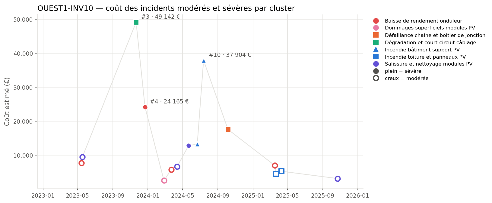
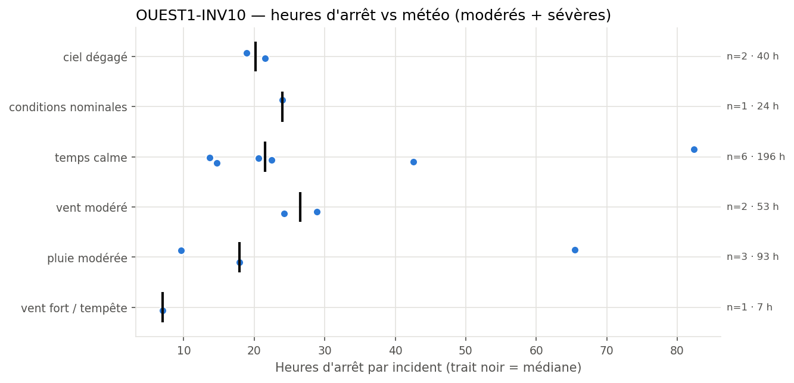
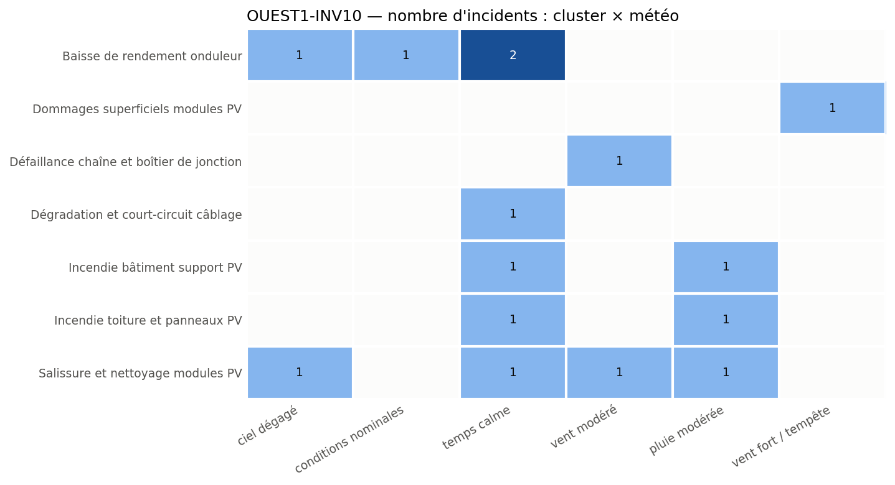

# High-Risk Inverter OUEST1-INV10: Multiple Failure Modes and Incidents

**Equipment:** OUEST1-INV10 · **Site:** Centrale PV Ouest-1 · **Asset type:** Photovoltaic (inverter) · **Generated on:** 2026-10-19

> This inverter has experienced various failures, with significant costs and downtime, especially related to wiring degradation, inverter performance drops, and fire incidents. The most costly incident was an inverter building fire, followed by wiring degradation. Immediate focus should be on fire prevention and wiring inspection to mitigate high-cost risks.

**Equipment priority: P2 · Risk level: HIGH** — The equipment has a high risk level due to 6 severe incidents, accounting for 74.9% of total costs, and a high number of incidents compared to the site median, with a ratio of 1.33.

---

## 1. Key figures

| Indicator | This equipment | Median equipment of the site | Ratio |
| --- | ---: | ---: | ---: |
| Incidents (all severities) | 29 | 31.5 | ×0.92 |
| Severe incidents | 6 | 4.5 | ×1.33 |
| Total estimated cost (all severities) | 217 557 EUR | 212 067 EUR | ×1.03 |
| Total downtime (all severities) | 460.9 h | 473.8 h | ×0.97 |

| Moderate and severe incidents (scope of this report) | Value |
| --- | ---: |
| Incidents analysed | 15 (9 moderate · 6 severe) |
| Period covered | 2023-02-19 → 2025-12-30 |
| Total estimated cost | 206 762 EUR (74.9 % from severe incidents) |
| Average cost per incident | 13 784 EUR |
| Total downtime | 414.0 h |
| Average interval between incidents | 64 days |
| Most costly failure mode | Incendie bâtiment support PV (51 131 EUR) |
| Weather with most downtime | temps calme (196.5 h) |

## 2. How this report was built

**Scope.** This report covers the maintenance incidents recorded on OUEST1-INV10 between 2023-02-19 and 2025-12-30. Each incident report was read and assigned to a *failure mode* according to its description. The detailed analysis focuses on moderate and severe incidents; minor incidents only appear in the key figures. Incidents are numbered #1, #2, … in chronological order for this equipment (see the annex).

**Why this equipment.** Each piece of equipment receives a criticality score from 0 to 100 that combines four indicators: number of incidents, number of severe incidents (counted twice), total repair cost and total downtime. The score is computed twice: against the other equipment of the same site and against all solar equipment of the fleet. 50 corresponds to a typical piece of equipment, 75 or more to one clearly above the others. Equipment scoring 75 or more on both comparisons is priority **P1**, on one of them priority **P2**. Here: score within site 64.3 (< 75), score vs fleet 86.2 (>= 75) → **P2**.

**Recommendation priority.** Each recommendation addresses one failure mode and inherits its priority:
- **P1** — within 1 month: the failure mode caused at least one severe incident on this equipment and either represents >= 20% of its cost or recurred within 90 days
- **P2** — within 6 months: the failure mode caused at least one severe incident or represents >= 10% of the cost
- **P3** — next yearly maintenance plan: all other failure modes

**Analysis.** All figures, tables and charts are computed directly from the incident records. The commentary was drafted with the help of an AI assistant from these figures only.

*Patterns based on fewer than three incidents are flagged as indicative in the text.*

## 3. Cost timeline

*Estimated cost of each moderate (hollow) and severe (filled) incident. Colour = family of failure modes, marker shape = failure mode; the three most costly incidents are labelled.*

| Year | Incidents | Severe | Cost (EUR) | Cost vs previous year | Downtime (h) |
| --- | --- | --- | --- | --- | --- |
| 2023 | 4 | 2 | 90 452 |  | 173.2 |
| 2024 | 7 | 4 | 96 489 | +6.7 % | 180.7 |
| 2025 | 4 | 0 | 19 821 | -79.5 % | 60.1 |

Incidents are spread over the last two years, with recurrent issues such as inverter performance drops and wiring degradation. Close incident sequences indicate ongoing problems, notably the series of fires and wiring failures within short periods.

## 4. Weather exposure

### 4.1 Downtime vs weather condition

*Downtime of each incident per weather condition; the black tick is the median.*

| Weather | Incidents | Severe | Downtime (h) | Median (h) | % of downtime | Compared with site |
| --- | --- | --- | --- | --- | --- | --- |
| temps calme | 6 | 3 | 196.5 | 21.6 | 47.5 | over-represented vs site |
| pluie modérée | 3 | 1 | 93.0 | 17.9 | 22.5 | in line with site |
| vent modéré | 2 | 1 | 53.1 | 26.5 | 12.8 | over-represented vs site |
| ciel dégagé | 2 | 1 | 40.4 | 20.2 | 9.8 | in line with site |
| conditions nominales | 1 | 0 | 24.0 | 24.0 | 5.8 | under-represented vs site |
| vent fort / tempête | 1 | 0 | 7.0 | 7.0 | 1.7 | under-represented vs site |

Downtime is over-represented under calm weather conditions, with 47.5% of downtime during 40% of incidents, suggesting that some failures are not weather-dependent. Moderate rain also correlates with fire incidents, indicating potential weather influence on certain failure modes.

### 4.2 Failure modes vs weather condition

*Number of incidents per failure mode and weather condition.*

Failures like incendie bâtiment support PV and incendie toiture et panneaux PV occurred under rain and calm weather, respectively, indicating that fire-related failures are not solely weather-driven but may involve equipment or operational factors. Wiring degradation occurred in calm weather, possibly due to aging or poor maintenance.

## 5. Failure modes

| Failure mode | Priority | Incidents | Severe | Cost (EUR) | % of cost | Recurrences < 90 d | Incidents # |
| --- | --- | --- | --- | --- | --- | --- | --- |
| Incendie bâtiment support PV | P1 | 2 | 2 | 51 131 | 24.7 | 1 | #9, #10 |
| Dégradation et court-circuit câblage | P1 | 1 | 1 | 49 142 | 23.8 | 0 | #3 |
| Baisse de rendement onduleur | P1 | 4 | 1 | 44 568 | 21.6 | 0 | #1, #4, #6, #12 |
| Salissure et nettoyage modules PV | P1 | 4 | 1 | 32 044 | 15.5 | 1 | #2, #7, #8, #15 |
| Défaillance chaîne et boîtier de jonction | P2 | 1 | 1 | 17 578 | 8.5 | 0 | #11 |
| Incendie toiture et panneaux PV | P3 | 2 | 0 | 9 760 | 4.7 | 1 | #13, #14 |
| Dommages superficiels modules PV | P3 | 1 | 0 | 2 540 | 1.2 | 0 | #5 |

### Incendie bâtiment support PV · P1

This failure mode involves fires originating in the inverter building support structure, with two severe incidents causing significant damage and costs. The incidents occurred under rainy and calm weather, suggesting that fire prevention measures should focus on electrical safety and fire risk mitigation regardless of weather conditions.

### Dégradation et court-circuit câblage · P1

This failure mode was responsible for the most costly incident, with wiring degradation leading to a severe incident costing EUR 49142. The failure likely involves insulation breakdown or short circuits, exacerbated by aging or poor maintenance, and occurred under calm weather.

### Baisse de rendement onduleur · P1

Multiple incidents caused by inverter performance drops, with costs up to EUR 24165. These failures are often linked to internal inverter issues or external conditions like temperature, and are recurrent over time, indicating the need for detailed inverter diagnostics.

### Salissure et nettoyage modules PV · P1

This failure mode involves dirt accumulation on modules, leading to performance loss, with several incidents and a recurrence within 90 days. It occurs under various weather conditions, notably clear and calm weather, and impacts energy yield.

### Défaillance chaîne et boîtier de jonction · P2

A severe incident was caused by failure in the junction box, with a cost of EUR 17578. The failure appears to be related to electrical connection issues, possibly due to environmental exposure or aging, occurring under moderate wind conditions.

### Incendie toiture et panneaux PV · P3

Two incidents involved fires on the roof and panels, with costs around EUR 5000 each. These occurred under calm and rainy weather, indicating that fire risk is not solely weather-dependent but may involve electrical faults or material failures.

### Dommages superficiels modules PV · P3

A single incident involved superficial damage to modules, likely caused by storm or wind, with indicative data. Such damage can lead to performance degradation and should be monitored.

## 6. Root-cause hypotheses

1. **Aging and lack of maintenance of wiring and electrical connections.** *(confidence: high)* — High costs associated with wiring degradation and junction box failure, with incidents under calm and moderate wind conditions.
2. **Inadequate fire safety measures and electrical protection.** *(confidence: high)* — Two fire incidents with recurrence within 90 days, occurring under various weather conditions.
3. **Environmental exposure leading to material degradation and damage.** *(confidence: medium)* — Incidents under calm, rainy, and stormy weather, affecting modules and wiring.

## 7. Recommendations

| Priority | Action | Type | Failure mode addressed | Expected impact |
| --- | --- | --- | --- | --- |
| P1 | Perform thermography and insulation resistance tests on wiring and junction boxes. | monitoring | Dégradation et court-circuit câblage | Identify potential insulation failures before incidents occur. |
| P1 | Inspect and upgrade fire detection and suppression systems in the inverter building. | preventive | Incendie bâtiment support PV | Reduce fire risk and mitigate damage. |
| P1 | Schedule regular cleaning and module inspection to prevent dirt accumulation and superficial damage. | preventive | Salissure et nettoyage modules PV | Maintain optimal energy production and prevent performance loss. |
| P1 | Implement a comprehensive maintenance plan focusing on inverter health diagnostics. | preventive | Baisse de rendement onduleur | Improve inverter reliability and reduce performance drops. |
| P2 | Check and tighten all electrical connectors and surge protection devices. | preventive | Défaillance chaîne et boîtier de jonction | Reduce electrical connection failures and improve reliability. |
| P3 | Review and reinforce fire safety protocols and electrical wiring standards. | design change | Incendie toiture et panneaux PV | Lower the likelihood of fire incidents and improve safety. |
| P3 | Conduct visual inspections for superficial damages, especially after storms or high winds. | monitoring | Dommages superficiels modules PV | Detect early damages to prevent further deterioration. |

## 8. Conclusion

This inverter's failure profile indicates a high fire risk and wiring degradation, both of which significantly impact costs and downtime. Immediate actions should prioritize fire safety upgrades and wiring inspections, complemented by regular cleaning and inverter diagnostics to enhance overall reliability.

---

### Annex — Incident register

| # | Date | Severity | Failure mode | Cost (EUR) | Downtime (h) | Weather |
| --- | --- | --- | --- | --- | --- | --- |
| #1 | 2023-05-15 | modérée | Baisse de rendement onduleur | 7 670 | 24.0 | conditions nominales |
| #2 | 2023-05-18 | modérée | Salissure et nettoyage modules PV | 9 476 | 24.2 | vent modéré |
| #3 | 2023-11-21 | sévère | Dégradation et court-circuit câblage | 49 142 | 82.4 | temps calme |
| #4 | 2023-12-22 | sévère | Baisse de rendement onduleur | 24 165 | 42.6 | temps calme |
| #5 | 2024-02-26 | modérée | Dommages superficiels modules PV | 2 540 | 7.0 | vent fort / tempête |
| #6 | 2024-03-23 | modérée | Baisse de rendement onduleur | 5 780 | 14.7 | temps calme |
| #7 | 2024-04-12 | modérée | Salissure et nettoyage modules PV | 6 643 | 20.6 | temps calme |
| #8 | 2024-05-22 | sévère | Salissure et nettoyage modules PV | 12 817 | 21.5 | ciel dégagé |
| #9 | 2024-06-21 | sévère | Incendie bâtiment support PV | 13 226 | 22.5 | temps calme |
| #10 | 2024-07-13 | sévère | Incendie bâtiment support PV | 37 904 | 65.5 | pluie modérée |
| #11 | 2024-10-06 | sévère | Défaillance chaîne et boîtier de jonction | 17 578 | 28.9 | vent modéré |
| #12 | 2025-03-18 | modérée | Baisse de rendement onduleur | 6 954 | 18.9 | ciel dégagé |
| #13 | 2025-03-22 | modérée | Incendie toiture et panneaux PV | 4 506 | 13.7 | temps calme |
| #14 | 2025-04-10 | modérée | Incendie toiture et panneaux PV | 5 254 | 17.9 | pluie modérée |
| #15 | 2025-10-23 | modérée | Salissure et nettoyage modules PV | 3 108 | 9.6 | pluie modérée |
