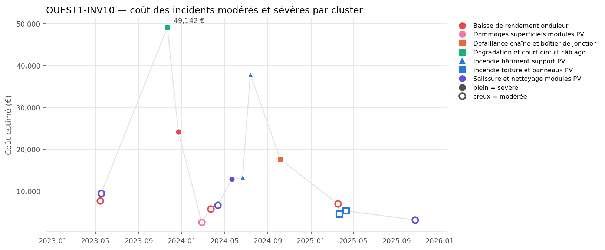
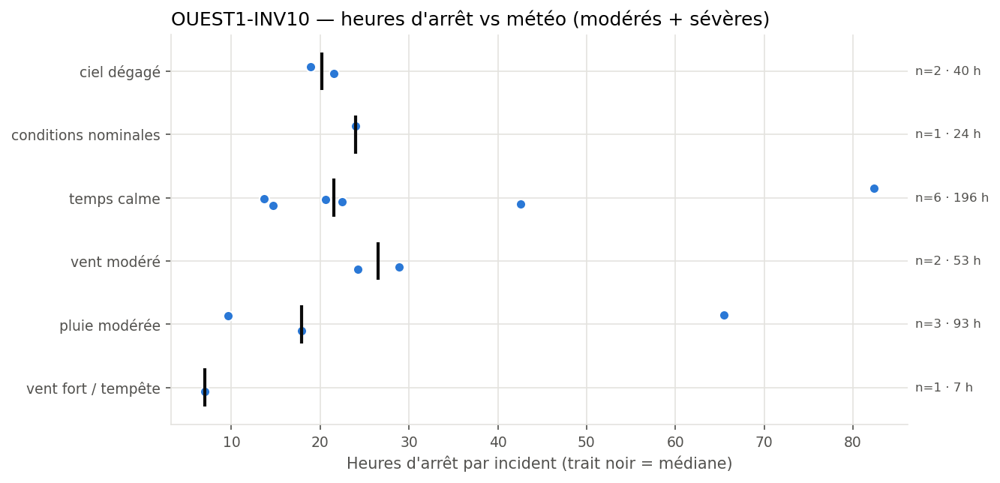
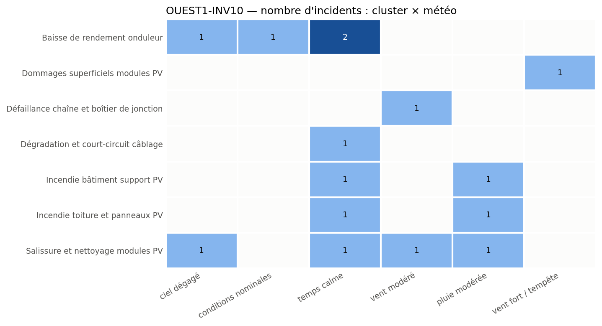

# OUEST1-INV10: Equipment Failure and Damage Summary

**Equipment:** OUEST1-INV10 · **Site:** Centrale PV Ouest-1 · **Asset type:** Photovoltaic (inverter) · **Generated on:** 2026-10-19

> This inverter and upstream DC field have experienced multiple incidents, totaling over €200,000 in costs with significant downtime. The most recurrent issues involve inverter performance decline, wiring short-circuits, and fire incidents, often linked to weather conditions such as storms and moderate rain. Immediate focus should be on inspecting wiring integrity and fire prevention measures, especially for incidents related to building support and roof fires.

**Risk level: HIGH** — Frequent severe incidents, including two fires (#738, #76), and recurrent wiring failures (#1300, #1493), with total costs exceeding €200,000 and over 400 hours of downtime, justify a high risk level.

---

## 1. Key figures

| Indicator | This equipment | Median equipment of the site |
| --- | ---: | ---: |
| Incidents (all severities) | 29 | 31.5 |
| Severe incidents | 6 | 4.5 |
| Total estimated cost (all severities) | 217 557 EUR | 212 067 EUR |
| Total downtime (all severities) | 460.9 h | 473.8 h |

| Moderate + severe incidents (scope of this report) | Value |
| --- | ---: |
| Incidents analysed | 15 (9 moderate · 6 severe) |
| Period covered | 2023-02-19 → 2025-12-30 |
| Total estimated cost | 206 762 EUR |
| Average cost per incident | 13 784 EUR |
| Total downtime | 414.0 h |
| Most costly cluster | Incendie bâtiment support PV (51 131 EUR) |
| Weather with most downtime | temps calme (196.5 h) |

**Criticality score:** 64.3/100 within the site (rank 3/10) · 86.2/100 against the whole solar fleet.

## 2. Methodology

Incidents come from `incidents_clusterised_solar.csv` (text, digital PDF and scanned PDF reports, clustered into failure modes with BERTopic on Azure OpenAI embeddings). The criticality score combines leave-one-out robust z-scores of n_incidents (×1), n_incidents_severes (×2), cout_total (×1), arret_total (×1), computed against the other equipment of the same site (and, for the fleet score, against all solar equipment), mapped to 0-100 with the normal CDF. Selection criterion used: *score intra-site >= 75, ou au moins un incident sévère et score intra-site >= 50*. The detailed tables, figures and the narrative analysis only cover moderate and severe incidents; the narrative sections are written by an LLM from the aggregated tables and checked against them.

## 3. Cost timeline

*Estimated cost of each moderate (hollow) and severe (filled) incident over time. Colour = cluster family, marker shape = cluster.*

| Year | Incidents | Severe | Cost (EUR) | Downtime (h) |
| --- | --- | --- | --- | --- |
| 2023 | 4 | 2 | 90452 | 173.2 |
| 2024 | 7 | 4 | 96489 | 180.7 |
| 2025 | 4 | 0 | 19821 | 60.1 |

Incidents show recurring failures in inverter performance and wiring, with notable bursts around mid-2024. The two major fire events (#738, #76) occurred within a month, indicating potential ongoing fire risk. The cost of incidents has escalated over time, with the most severe costs linked to wiring degradation and fires, emphasizing the need for targeted preventive actions.

## 4. Weather exposure

### 4.1 Downtime vs weather condition

*Downtime of each moderate/severe incident per weather condition; the black tick is the median.*

| Weather | Incidents | Severe | Downtime (h) | Median (h) | % of downtime | Lift vs site |
| --- | --- | --- | --- | --- | --- | --- |
| temps calme | 6 | 3 | 196.5 | 21.6 | 47.5 | 2.3 |
| pluie modérée | 3 | 1 | 93.0 | 17.9 | 22.5 | 1.06 |
| vent modéré | 2 | 1 | 53.1 | 26.5 | 12.8 | 1.35 |
| ciel dégagé | 2 | 1 | 40.4 | 20.2 | 9.8 | 0.98 |
| conditions nominales | 1 | 0 | 24.0 | 24.0 | 5.8 | 0.55 |
| vent fort / tempête | 1 | 0 | 7.0 | 7.0 | 1.7 | 0.42 |

Downtime is over-represented under calm weather conditions (lift 2.3), especially for inverter and wiring issues, suggesting intrinsic aging or wiring problems rather than weather-driven failures. Storm and moderate rain are less associated with downtime, but fires occurred during rain and calm weather, indicating other risk factors.

### 4.2 Failure modes vs weather condition

*Number of moderate/severe incidents per cluster and weather condition.*

Wiring short-circuits and fires are associated with calm and rainy weather, respectively, but the small sample size (1-2 incidents per cluster) limits definitive conclusions. The wiring failure (#1300) occurred in calm weather, while fires (#76, #738) happened during rain and calm, implying multiple contributing factors beyond weather.

## 5. Failure modes (clusters)

| Cluster | Incidents | Severe | Cost (EUR) | % of cost | Recurrences < 90 d | % equipment | % site |
| --- | --- | --- | --- | --- | --- | --- | --- |
| Incendie bâtiment support PV | 2 | 2 | 51131 | 24.7 | 1 | 13.3 | 6.1 |
| Dégradation et court-circuit câblage | 1 | 1 | 49142 | 23.8 | 0 | 6.7 | 14.4 |
| Baisse de rendement onduleur | 4 | 1 | 44568 | 21.6 | 0 | 26.7 | 9.1 |
| Salissure et nettoyage modules PV | 4 | 1 | 32044 | 15.5 | 1 | 26.7 | 7.6 |
| Défaillance chaîne et boîtier de jonction | 1 | 1 | 17578 | 8.5 | 0 | 6.7 | 7.6 |
| Incendie toiture et panneaux PV | 2 | 0 | 9760 | 4.7 | 1 | 13.3 | 15.9 |
| Dommages superficiels modules PV | 1 | 0 | 2540 | 1.2 | 0 | 6.7 | 28.0 |

### Incendie bâtiment support PV

This cluster includes two severe fire incidents (#738, #76) occurring within a month, with costs totaling over €50,000. Both incidents happened during calm and rainy weather, respectively, suggesting fire risk from electrical faults or insulation issues in the building support structure. The recurrence within 22 days indicates potential ineffective repairs or ongoing vulnerabilities.

### Dégradation et court-circuit câblage

A severe wiring short-circuit (#1300) caused €49,142 in damages, with a long interval since previous similar incidents. The event occurred in calm weather, pointing to aging wiring or poor insulation as probable causes. The high cost and downtime highlight the critical need for wiring inspection and replacement.

### Baisse de rendement onduleur

Four incidents of inverter performance decline, including two severe events (#458, #1196), have accumulated significant downtime and costs (~€44,568). These occurred under clear and nominal weather, indicating intrinsic inverter aging or component degradation rather than weather effects.

### Salissure et nettoyage modules PV

Four incidents, including one severe (#157), are linked to soiling, with occurrences spread over two years and various weather conditions. The recurrence pattern suggests ongoing soiling issues, possibly due to environmental factors or maintenance scheduling.

### Défaillance chaîne et boîtier de jonction

A single severe incident (#1493) involved junction box failure during moderate wind, with moderate downtime. The limited data suggests a possible connection to mechanical stress or aging of connectors, warranting inspection.

### Incendie toiture et panneaux PV

Two fire incidents (#1719, #1020) occurred within a month, with costs exceeding €19,000. Both happened during calm and rainy weather, indicating electrical or material failure risks in the roof and panels, possibly exacerbated by environmental conditions.

### Dommages superficiels modules PV

A single incident (#596) involved superficial damage during storm conditions, with minimal downtime. This suggests physical impact damage from storm debris or wind, requiring physical inspection and possible reinforcement.

## 6. Root-cause hypotheses

1. **Aging wiring and insulation leading to short-circuits.** *(confidence: high)* — Incident #1300 in calm weather caused €49,142 damages, with no recurrence within 90 days. Wiring failure likely due to aging or insulation degradation.
2. **Electrical faults or insulation failure in building support structure.** *(confidence: high)* — Fire incidents (#738, #76) occurred during calm and rainy weather, with costs over €50,000, indicating electrical or insulation issues.
3. **Mechanical stress or aging of junction boxes causing failures.** *(confidence: medium)* — Incident #1493 during moderate wind, with moderate downtime, suggests mechanical stress or aging.
4. **Environmental impact causing physical damage to modules.** *(confidence: medium)* — Storm damage incident (#596) during storm conditions, with superficial damage, indicates physical impact risk.
5. **Inverter aging or component degradation.** *(confidence: medium)* — Multiple inverter performance decline incidents (#458, #1196) under various weather conditions, with costs over €44,000.

## 7. Recommendations

| Priority | Action | Type | Target | Expected impact |
| --- | --- | --- | --- | --- |
| P1 | Inspect wiring and insulation throughout the DC field, replace aged wiring and improve insulation. | preventive | Dégradation et court-circuit câblage | Reduce wiring short-circuits and prevent costly damages. |
| P1 | Conduct thermography and insulation resistance tests on building support structures and wiring. | monitoring | Incendie bâtiment support PV | Identify hot spots and insulation failures early. |
| P1 | Install fire detection and suppression systems in the support building and critical areas. | preventive | Incendie bâtiment support PV | Minimize fire damage and safety risks. |
| P2 | Review and reinforce roof and panel mounting to prevent physical damage during storms. | preventive | Incendie toiture et panneaux PV | Reduce physical damage and fire risk during storms. |
| P2 | Inspect and replace aging junction boxes and connectors, especially those exposed to mechanical stress. | preventive | Défaillance chaîne et boîtier de jonction | Lower failure rate and downtime. |
| P2 | Stock spare wiring, connectors, and inverter components for quick replacement. | spare parts | All failure modes | Reduce downtime duration. |
| P3 | Implement a regular cleaning schedule to mitigate soiling, especially during dry and dusty periods. | preventive | Salissure et nettoyage modules PV | Maintain module efficiency and reduce soiling incidents. |

## 8. Data limitations

- Sample size per weather condition and cluster is small, limiting statistical significance.
- Clustering based on LLM-assisted topic modeling may introduce classification bias.
- Cost estimates are approximate and may not include all indirect costs.
- Missing context such as equipment age, maintenance history, and environmental exposure limits the analysis.
- Weather data is limited to observed conditions and does not account for microclimate effects.

## 9. Conclusion

OUEST1-INV10 has experienced significant failures primarily related to wiring degradation, fire risks, and inverter performance decline. The recurrence of fires and wiring short-circuits indicates urgent need for detailed inspections, preventive maintenance, and fire safety measures. Addressing wiring aging and reinforcing physical protections will be critical to reducing future incidents and costs.
